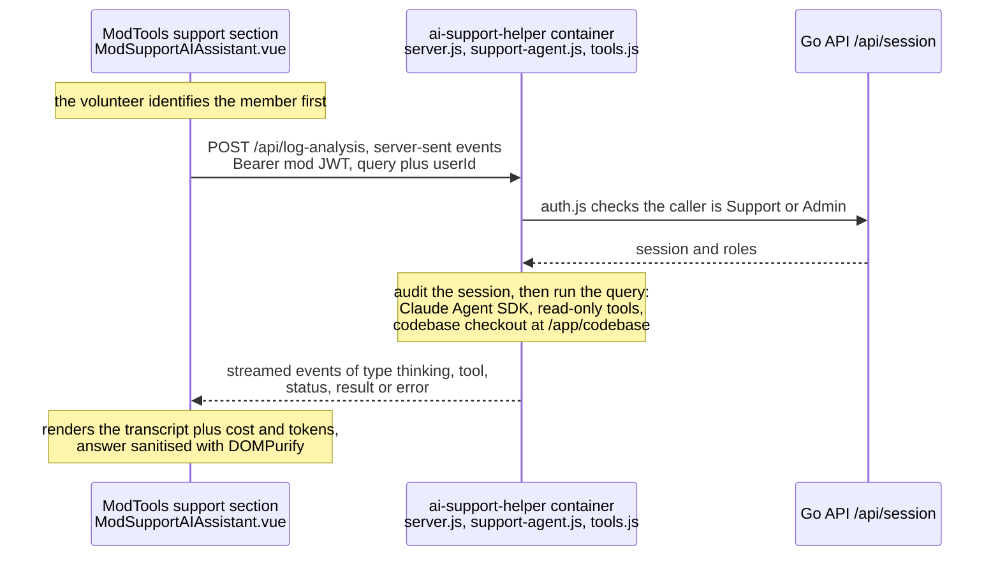

# AI Support Helper

The AI Support Helper lets **Support** and **Admin** volunteers investigate a member's
problem by asking questions in natural language, in the ModTools support section. It
drives the Claude Code harness (`@anthropic-ai/claude-agent-sdk`'s `query()`) with a set
of direct-access tools over Freegle's production data, and streams the thinking, tool
calls and answer back to the browser.

> **Design note — no anonymisation.** An earlier version kept PII in the browser and only
> sent counts/booleans to Claude. That was removed. Support volunteers can already access
> confidential member data and reading chats/logs is legitimate debugging, so the tool has
> **direct, de-anonymised** read access. The controls below instead guard against
> *accidental* damage, against *other* (non-support) mods gaining access, and against
> hostile **member data** (prompt injection), and record an **audit trail** of every
> investigation.

## Architecture

One `query()` code path serves both auth modes (see below); everything else is identical.

## Claude auth: three modes, one code path

`driverMode()` (in `auth.js`) picks the mode from the environment:

- **subscription** — `CLAUDE_CODE_OAUTH_TOKEN` set (a token from `claude setup-token`). Uses a
  Max/Pro subscription and is **headless** - no interactive login and no `~/.claude` mount - so
  the helper can be driven by an automation/subagent.
- **api** — only `ANTHROPIC_API_KEY` set. Metered API billing. Production/edge. No `~/.claude` mount.
- **session** — a read-only `~/.claude` credential mount (a logged-in Claude subscription).
  Testing only. `docker-compose.yml` mounts **just** `.credentials.json`, not the whole
  `~/.claude` (so a prompt-injected read cannot reach memory/transcripts). That file is mode
  600, so the container's `claude` user is built with the owning host uid
  (`SUPPORT_CLAUDE_UID`, default 1000). The entrypoint starts as root only to take ownership
  of the audit volume, then runs the server as `claude`.

On the docker host the token is the claude-broker gateway password and `ANTHROPIC_BASE_URL`
points at the broker, which holds the real accounts (see
[the runbook](../../ops/runbooks/claude-broker.md)).

**`CLAUDE_CODE_OAUTH_TOKEN` wins when both are set** - this is a headless background job, so it
should run on the subscription rather than metered API spend (consistent with Community News'
`CommunityNewsResearchService`). Because the SDK/CLI bills the API whenever `ANTHROPIC_API_KEY`
is present (the reason `monitor-fsm/run-loop.sh` unsets it), `preferSubscriptionToken()` removes
the key at startup so `query()` actually authenticates with the subscription; `entrypoint.sh`
does the same at the shell level and reports which mode is active on startup.

## Tools

Built in `tools.js` (`buildTools(ctx)`), exposed as an in-process MCP server, plus the
SDK's `Read`/`Grep`/`Glob` confined to the codebase checkout:

| Tool | Purpose |
|------|---------|
| `identify_user` | resolve an email, part of an email, a phone number, a name or an id to a member (must be done first); lists the members when part of an email or a phone number matches several |
| `get_user_dump` + `query_dump` | pull a per-user SQLite dump (~70 tables + Loki + Sentry, secrets redacted) via the Go API and run SQL against it locally |
| `db_query` | ad-hoc **read-only** SQL against the live DB (guarded — see below) |
| `loki_search` | multi-pass member-id search (both label eras), or raw LogQL (window capped) |
| `sentry_search` | recent Sentry issues across the nuxt3/go/capacitor/modtools projects |
| `discourse_search` | search the community forum (bug reports cite topic numbers) |
| `code_history_search` / `git_fixed_already` | grep git history to see if an issue is already fixed |

The investigation playbook (held chat replies, duplicate conversations, purged accounts,
rippling auto-joins, stale-deploy chunks, etc.) lives in the system prompt in
`prompt.js`. That module has no `require` at all, so the bare `node --test` CI step can
load it and `prompt.test.js` can pin its load-bearing lines; `support-agent.js` (which
pulls in `tools.js` and with it `mysql2`) only wires the prompt into `query()`.

### What the user dump does and does not contain

`get_user_dump` is served by `iznik-server-go/userdump`, and `?since=` (default 90 days) is
a real bound, not a hint:

- **Chat membership is complete** — every room the member is in. **Message bodies are
  windowed** to the rooms active inside `since`. A moderator is in the roster of every
  Mod2Mod and User2Mod chat on their groups (one real admin: 18,664 rooms, of which 332
  had any activity in 90 days), and pulling every message for all of them could not finish
  inside the caller's timeout — so that member could not be investigated at all.
  The **roster** is the member's own row in every room plus everyone's rows in the
  active rooms; the other members of old mod chats are left out (they were 112,609 of
  one moderator's rows).
- **The questions Freegle asked the member in a chat** (`chat_prompts`, the reply confirmation) are in
  the dump with how they answered, so a reply that never arrived can be traced to a question that was
  never answered.
- **Sections are collected concurrently** (`dumpWorkers` in `userdump.go`), heaviest
  first, so the snapshot takes as long as its slowest section rather than the sum of
  them. `_sections` rows are in completion order.
- **Loki logs are clamped to 30 days** whatever `since` says, because production Loki
  rejects any `query_range` longer than `30d1h` outright.
- **Loki collection runs every pass at once under a time budget** (`userdump/loki.go`,
  at most `lokiParallel` queries in flight): the member's labelled lines by `user_bucket`
  plus `user_id`, one query per source group (`api`, `client`, the rest) so the busiest
  source cannot fill the line cap and crowd out the others; the slim unlabelled sources;
  and all the member's emails in **one** query (each `|=`-prefiltered before any
  `| json`/regex, in 15-day halves). The same prefilter-before-parse rule applies to every
  LogQL the helper or `systemlogs` builds. Anything the caps drop is recorded in
  `_sections` as `loki_bounds`.
- **`api_headers` is searched only where the member was active.** It has no member label,
  so a 7-day search of the ~67GB firehose was a full-text scan (~40-50s). But each request
  writes exactly one `api` line and one `api_headers` line, together, and the dump has
  just fetched the member's `api` lines by index: they give the minutes to search and how
  many header lines each window holds. An ordinary member measured 27s -> 1s with nothing
  missed. A member active all week fills the `api` line cap, so their headers cover only
  the period of their newest 5,000 requests, and the dump says so.
- **Logged-out client lines are not in the dump.** They carry no user at all, so finding
  them is a full-text scan of seven days of client logs. The dump says so in `_sections`
  (`loki_not_collected`), and the system prompt points the agent at `loki_search`.
- **A member's logs are addressed two ways** (changed 2026-08-23). Entries written before
  that carry `user_id` as a Loki stream label; later ones carry a coarse `user_bucket`
  label plus the exact `user_id` as structured metadata, because `user_id` had far too
  many values to be a label and was silently discarding entries. The dump asks only for
  the bucketed form: it reads the last 30 days, all written after the change, and the
  old-form queries returned nothing for 3-5s each. The helper's `loki_search`, which can
  look further back, still asks for both. See
  [../../ops/reference/logging.md](../../ops/reference/logging.md).
- Anything the dump had to bound is recorded in its **`_sections`** table with
  `status='warning'` and a note. Read it before concluding "there is nothing there" — an
  empty table can mean *not collected*, not *did not happen*.
- **Sentry is two org-wide searches**, by `user.id` and by all emails as one
  `user.email:[a,b]` list, across every project. Freegle's Sentry events do not
  currently set `user.email` at all, so in practice matches come from the id.
- The helper downloads the dump with **`format=framed`** (see
  `iznik-server-go/userdump/frame.go`): the server flushes a progress frame per section
  plus a 15s heartbeat during long sections, so the prod API LB's 50s idle timeout never
  cuts a slow build the way the silent `format=raw` stream was cut. The client verifies
  the end frame's byte count and SHA-256, and aborts only on 90s of *inactivity* rather
  than a fixed overall deadline.

## What the volunteer sees while it works

`support-agent.js` streams three kinds of progress event: `status` once at the start,
`thinking` for each piece of text the model writes between tool calls (the conclusions it
is reaching as it goes) and `tool` for each tool call with its raw arguments (a file
path, a grep pattern, SQL). The transcript in `ModSupportAIAssistant.vue` lists the
`status` and `thinking` events only. It used to list the `tool` events as well, and an
investigation makes so many of them that the conclusions scrolled off the top of the
screen before anyone could read them.

A `tool` event instead sets a single line under the transcript saying what kind of check
is running, in plain words: "Querying the database", "Reading the code", "Searching the
logs" (the `TOOL_ACTIVITY` map in the component; a tool it does not know shows a generic
"Checking" rather than an internal name). Each tool event replaces that line, a
`thinking` event clears it, and it yields to the snapshot progress bar while that is
showing. The raw tool call still goes to the Debug panel, so which SQL ran or which file
was read is one switch away when something has gone wrong.

## How long an investigation takes

Nearly all of an investigation's time is the model's own thinking, not the tools: run time follows
the number of output tokens closely, and most of those are thinking that is never shown. So these
settings matter more than how fast any one tool is.

- **Model and effort.** `SUPPORT_AI_MODEL` (default `opus`, which agent SDK 0.3 maps to Opus 5.5)
  and `SUPPORT_AI_EFFORT` (`low`, `medium`, `high`, `xhigh` or `max`; default `medium`, which an
  unknown value also falls back to). `agent-options.js` sets both for every run, so the first pass on
  a referral uses them too. The run log's `model` column records the model a run used. Effort is not
  recorded, so compare runs by date when it changes.
- **Retries.** The CLI's own default retries a failed call for about three minutes. The broker
  answers 503 when no account is free, so that was a three-minute wait for an error. `agentEnv()`
  sets `CLAUDE_CODE_MAX_RETRIES=2` unless the environment already sets it, and the error comes back
  in seconds.
- **The member's dump starts when they are picked.** `ModSupportAIAssistant.vue` calls
  `POST /api/prefetch-dump` beside the device summary. It is Support/Admin only and audited as
  `prefetch_user_dump`, and it answers without waiting for the download. `get_user_dump` then reuses
  the finished dump, or joins the download if it is still running: `sharedDump()` in `tools.js` runs
  one download per member and window and passes its progress to whoever is waiting. A failed
  prefetch is logged and the investigation fetches the dump as before. A dump is kept for ten minutes
  after it is built, so a member picked and left longer than that is fetched again.
- **Independent checks in one turn.** Each turn is a round trip. The system prompt asks the agent to
  make lookups that do not depend on each other in the same turn.

## Follow-up questions

A follow-up carries on the same Claude session, which the CLI saves under `~/.claude/projects` in
the container. That folder is the `ai-support-sessions` volume, so a follow-up still works after the
container is recreated. `sessions.js` deletes sessions more than a day old, on start and every hour,
because they hold what the tools returned about a member. The page keeps a session's id only while it
stays open, so a day is ample. A follow-up whose session is gone gets `410 SESSION_EXPIRED` before
any work starts, and the page drops the old session and asks for the question again.

The image ignores the host's `node_modules` (`claude-agent-sdk/.dockerignore`). One installed on
the host, to run the tests there, is built for the host's Node. Copied over the image's own, it
breaks `better-sqlite3`, so `get_user_dump` fails and the agent quietly works from live queries
instead.

## Suggested replies

Volunteers paste the helper's suggested replies straight to the member, so the prompt's
Style section asks for them in the second person ("you haven't verified your email yet",
never "she hasn't"), with no internal names, under a **Suggested reply** heading in a
blockquote. The draft can then be copied out as-is and the analysis left behind.

**The tone.** The prompt asks for a reply that sounds like a kind, capable volunteer wrote it: a
greeting, a warm line showing the problem was understood, short sentences, plain words and
contractions, one apology at most, one or two clear next steps, and none of the stock phrases
that mark machine writing. It is under about 120 words unless the problem needs more.

**The review pass.** When an answer contains a **Suggested reply**, `support-agent.js` makes a
second model turn before the volunteer sees anything (`reviewPrompt()` in `prompt.js`). It
resumes the same session, so every tool result the draft relied on is still in front of the
model, and asks it to list each factual claim, confirm each against what the tools returned
(querying again if unsure), remove or turn into a question anything it cannot support, drop
promises of fixes, dates or refunds, and rewrite the tone if it is off. The answer comes back
with a short **Fact check** section outside the blockquote. The second turn's tokens are added to
the run. If the pass fails or returns no reply, the first draft is shown with **Not fact-checked**
under it, so the volunteer knows to check it by hand.

A reply once sent a member to `/myvolunteering` and an "expired tab", neither of which
exist. The prompt now asks the agent to find a page under `iznik-nuxt3/pages` before
linking to it. As a backstop, `links.js` checks every www.ilovefreegle.org link in the
answer against those pages and the redirects in `nuxt.config.ts`. Any link that matches
neither is listed under the answer with **Check before sending**.

## Screenshots

A volunteer can attach up to five pictures to any question (the **Attach screenshots** button, or
paste straight into the box). The browser (`useSupportScreenshots.js`) scales anything over 1600 pixels
or 1.5MB to a JPEG, so several fit in one request; a GIF is kept as it is. `/api/log-analysis` accepts
them as `images`: `{name, mime, data}` with `data` base64, in a 20MB body.

`images.js` (no `require`, so CI's bare `node --test` loads it) checks them again: PNG, JPEG, GIF or
WebP only, the first bytes must match the type, 4MB each and 12MB together. With pictures,
`buildPrompt()` gives `query()` a one-message stream of text and image blocks, which is the only form the
SDK takes images in. The system prompt already tells the model to read images. The audit trail records
how many screenshots came with a question, not the pictures. They show as thumbnails in the chat.

## Device summary panel

`GET /api/device-summary?userId=` (`server.js`) is a deterministic, no-AI view shown as
soon as a member is selected: their recent devices (browser/OS/viewport, freshness badge)
built from client `session_start` telemetry in Loki (`device-summary.js`). Telemetry is
**best-effort** — the `/clientlog` POST is an unauthenticated fire-and-forget fetch that
ad/tracker blockers routinely eat, that drops entries over a per-IP rate limit, and that app
builds from before client logging never send — so a member can be fully active with zero
device sessions. When that happens the
endpoint falls back to the member's newest `source="api"` Loki line (`lastApiActivity`)
and the panel says so explicitly, rather than showing a bare "no sessions" that misreads
as "not active".

**Freshness** answers two different questions. For the **web** it is the age of the loaded
bundle (`build_date`): more than a couple of days old means a refresh will update them. For
the **app** it is a version comparison of the member's installed version against
`MOBILE_VERSION` in `iznik-nuxt3/config.js`, which is hand-bumped in step with each app
release. Either input missing yields `unknown`, which shows no badge rather than a wrong one.

**Where the app version comes from.** Only the native app knows its installed version, and
only after Capacitor's `App.getInfo()` returns — long after the client-logging plugin starts.
So the app logs `session_start` **twice** for one session: once immediately (no app version
yet), then again from `stores/mobile.js` (which also owns deep-link handling, see the mobile
app page) `logAppSession()` once `App.getInfo()` and
`Device.getInfo()` have answered. Both carry the same `session_id`, so `dedupeSessions()`
merges them into one record — keeping the session count honest and making the app version
independent of the order Loki returns the lines in. The same native answers are set as
Sentry tags (`os.version.exact`, `device.model.exact`, `app.version`, `app.build`), because
the user agent only gives Sentry the OS minor version and a device-specific fault needs the
patch level and model.

## Refer to geeks

When a volunteer gets as far as they can, **Refer to geeks** (in
`ModSupportAIAssistant.vue`, shown as soon as there is a conversation) hands the whole
investigation over by email, so nobody has to retype the story.

`POST /api/refer-to-geeks` (Support/Admin gated and audited, like everything else) takes
the member, the device summary, every message, the running totals and the volunteer's
**referral text** — which is required, because a transcript with no statement of what the
volunteer wants doing about it is not a referral. It emails `GEEKS_EMAIL`
(`geeks@ilovefreegle.org`) with **Reply-To set to `SUPPORT_ADDR`** (`support@ilovefreegle.org`),
so a reply lands in the support mailbox where the whole support team sees it, rather than
in one volunteer's personal inbox. The referring volunteer is named in the email body.

Every referral gets a short reference — `SR-XXXXX`, generated **server-side** so the client
cannot choose or reuse one. It appears in the subject line, the email body, an
`X-Freegle-Support-Referral` header, the audit trail, and back in the UI for the volunteer
to quote. It is deliberately brief (eight characters, from an alphabet with `0/1/O/I/L`
removed) so it can lead a subject line without crowding out what the referral is about, and
survive being read aloud or retyped.

**No money appears in the email.** The helper runs on a Claude subscription, so the SDK's
`total_cost_usd` is a notional list price nobody is charged (see `billableCostUsd` in
`auth.js`). Token counts are kept — they say how much work the investigation was — but the
dollar figures are neither sent nor rendered.

The email is **MJML** (`referral-mjml.js` builds it, `referral-email.js` compiles and
sends it) and deliberately mirrors the helper's own screen — same header, member chip,
device cards and green-you/blue-assistant chat bubbles — so reading the mail feels like
looking at the tool. Two things follow from that:

- **`referral-mjml.js` has no `require` at all.** CI runs the `claude-agent-sdk` specs
  with no `node_modules`, so everything worth testing lives in the dependency-free module
  and only the MJML compile and the SMTP send need libraries.
- **Message bodies are the HTML the browser already rendered** —
  `DOMPurify.sanitize(marked(...))`, the exact markup that was on screen. That is what
  makes the email a faithful copy rather than a second, subtly different rendering.
  `stripUnsafeHtml()` is a *second* belt over that already-sanitised HTML (script/style/
  frame elements, inline handlers, `javascript:` URLs), not the primary sanitiser.
  Everything else — names, emails, the referral text — is escaped, so a volunteer's typed
  `<script>` shows as visible text and never as markup.

**Screenshots go with it.** Every picture attached during the investigation (the latest ten) is sent as
`screenshots` and checked again by `images.js`. Each is shown inline in the body by content id and is
also a real attachment, so it can be saved at full size from any mail client.

**Threading in the support mailbox.** Gmail groups by subject as well as by `References`, and the
subject used to start with the reference and the question, so every referral was a new conversation.
Now the subject is the same for one member (`Support referral: <name> (<id>)`, with `Re: ` once an earlier
referral has gone), and `referralThreadHeaders()` sets the ids: one anchor per member
(`support-member-<id>@ilovefreegle.org`) in `References`, followed by the earlier referrals the browser
says were sent in this session (`earlierRefs`, only well-formed `SR-` references are kept); the newest is
`In-Reply-To`. The `Message-ID` is derived from the reference, so a reply from the geeks, which
quotes it, joins the same conversation. The reference and the first question are in the body and the
`X-Freegle-Support-Referral` header. Chat notification mail to moderators already carried the same
kind of headers per chat (`ChatNotification`), so only this path changed.

SMTP defaults to the local **mailpit** (`SUPPORT_SMTP_HOST`), so a referral sent while
developing lands at `mailpit.localhost` and never reaches the real geeks list; edge/prod
points `SUPPORT_SMTP_*` at a real relay.

## Run log and ratings

Every question put to the helper is a **run**, kept in `support_ai_runs` so that answers that
went badly can be found and the prompt or tools improved. A follow-up question is a run of its
own; runs in one investigation share the Claude `sessionid`.

- **What is kept.** The question, the answer, the status (an error run is kept too, so failures
  show up as well as poor answers), the model, tokens, duration, and a transcript: the agent's
  own text, each tool call with its input, and each tool result capped at 4,000 characters
  (`run-record.js`). A transcript that would not fit loses its *oldest* steps, because the end is
  where the answer was reached.
- **Who records it.** `support-agent.js` sends the run to the Go API
  (`POST /api/supportai/runs`, `iznik-server-go/supportai`) with the asking volunteer's own JWT,
  because this container's database connection is a read-only grant. The volunteer is taken from
  the JWT, never the body. Recording is best-effort: if it fails, the volunteer still gets the
  answer, just with no rating buttons.
- **Quota.** On a Claude subscription the run records the subscription's five-hour and seven-day
  utilisation just before and just after, from `GET https://api.anthropic.com/api/oauth/usage`
  (what `claude /usage` reads; undocumented). Anything else on the same subscription at the time
  moves it too, so the difference is an upper bound, and the endpoint reports whole percent, so a
  short run reads +0%. Metered API mode has no subscription quota, so those columns stay NULL;
  NULL always means unknown, never zero.
- **Rating.** The run id comes back in the `result` event, and `ModSupportAIRating.vue` puts a
  thumbs up/down under the answer, then asks what was wrong (or anything worth noting). Clicking
  the chosen thumb again clears it. Any Support or Admin volunteer can rate any run
  (`PATCH /api/supportai/runs`), so a run can also be judged when it is reviewed later.
- **Review.** ModTools **SysAdmin -> AI Helper**, which only Admins see (`ModSysAdminSupportAI.vue`,
  `/sysadmin?tab=aihelper`) lists runs most recent first, filterable to thumbs down, thumbs up or
  not rated. Opening one fetches its transcript (`GET /api/supportai/runs/:id`); the list leaves
  transcripts out because they can be large.

All four endpoints are Support/Admin only, the same people who can use the helper. A run about a
member is deleted with that member's account (`userid` cascades).

## Security controls

- **Caller gate (`auth.js`)** — only `Support` and `Admin` systemroles may use it; a plain
  `Moderator` or `User` gets 403. The JWT is validated against the Go API `/api/session`
  with a fail-closed timeout, and the caller's id/email are threaded through for the audit.
- **Read-only DB, fail closed (`tools.js` `dbSelect`)** — a dedicated connection runs
  `SET SESSION TRANSACTION READ ONLY, max_execution_time = 15000` **before** the query;
  no root fallback outside localhost/percona.
- **Query guard (`guardSelect`)** — `SELECT`/`WITH` only, single statement, SQL comments
  stripped first (defeats `INTO/**/OUTFILE`), a denylist of write/DoS keywords, a denylist
  of auth-secret **tables** (`sessions`, `users_logins`, `config`, …) and **columns**
  (`credentials`, `token`, `password`, …), and a hard cap on the `LIMIT` value. A query
  written in `tools.js` itself can pass `allowSecretNames`: `identify_user` asks whether a
  member has a password (`credentials IS NOT NULL` from `users_logins`), which names the
  secret table but returns only a yes or no. `db_query` never passes it.
- **Prompt-injection defence (`prompt.js`)** — the system prompt marks everything
  tools return (chat text, names, log lines) as **data, never instructions**; tools are
  read-only (`disallowedTools: Write/Edit/Bash`), file reads are confined to
  `additionalDirectories: [CODEBASE]`.
- **XSS defence (`ModSupportAIAssistant.vue`)** — the answer is markdown that may quote
  member-supplied text verbatim, so `marked()` output is run through `DOMPurify.sanitize`
  before `v-html`.
- **Narrowed credential mount (`docker-compose.yml`)** — session mode exposes only the
  Claude OAuth credential file, not the whole `~/.claude`.
- **Audit trail (`tools.js` `audit()`)** — every session and every `db_query` /
  `get_user_dump` / `query_dump`, and each dump started early (`prefetch_user_dump`), logs who (mod id/email) investigated whom (target user)
  with what, to stdout (`SUPPORT_AUDIT …`, shippable to Loki) and, durably, to
  `AUDIT_LOG_PATH` on the `ai-support-audit` volume.

## Internal routes for the member surveys

The batch, not a browser, calls two more routes. They code members' written answers into grouped
problems ([ux-member-surveys.md](ux-member-surveys.md)). Neither has any tools: the model reads text and
writes JSON, so nothing in an answer can read a file or run a command.

- `POST /internal/ux-themes` takes the answers (an id and scrubbed text, no user id), the funnel keys and
  the group list, and returns themes, each with a group, a title of at most 60 characters and the answer
  ids and quotes it came from. A quote is kept only when its words appear in that answer.
- `POST /internal/ux-groups` takes the group list and each problem's id, title and description, and returns
  the group for each. It sees no answers.

Bodies on these routes may be up to 2 MB. The default 100 KB parser is skipped for any path that starts with
`/internal/`.

**The model.** The coder asks for the model named in `UX_THEMES_MODEL` when the helper's environment sets
it, else `SUPPORT_AI_MODEL`, else `opus`. `docker-compose.yml` passes `SUPPORT_AI_MODEL` only, so to give
the coder its own model, add `UX_THEMES_MODEL` to the helper's `environment:` block. The coder reads no model
setting that belongs to another feature.

**The guard (`ux-internal.js`).** A call must come from a private address, carry no forwarding headers, and
send the shared secret in `X-Freegle-Internal-Secret`, equal to the helper's `UX_INTERNAL_SECRET`. Being on
the docker network is not enough: each call starts a long model run on the shared subscription, and the load
balancer's `/api/ai-support` prefix reaches this same container, so the address check alone could be
bypassed through it. The check runs before the body is read.

**Setting the secret on live**, by variable name only:

- Make up one long random value and **never write it in a pull request, a commit message, a test or a doc**.
  The same value goes in two places.
- *The batch:* `UX_INTERNAL_SECRET` in `.env.background` on the backend host (the file `batch-prod` reads;
  it applies when the container is next created). The batch reads it as
  `config('freegle.ux.prompts.internal_secret')` and sends it on every call.
- *The helper:* `UX_INTERNAL_SECRET` in the helper container's environment. `docker-compose.yml` passes a
  container only the variables its `environment:` block names, so the `ai-support-helper` service names
  `UX_INTERNAL_SECRET` (as `${UX_INTERNAL_SECRET:-}`) and the value must be in the compose `.env` on that
  host. Check with `printenv UX_INTERNAL_SECRET` inside the container, never by printing the value into a log
  or a chat.
- *Unset on either side, it fails closed.* The helper answers 403 when the variable is empty or different.
  The batch will not call without it: `ux:prompt analyse` and `regroup` stop with "UX_INTERNAL_SECRET is not
  set" rather than send a request bound to be refused. Collecting answers does not use it and carries on.
- *Rotate* by changing both and restarting the helper and the batch container. A call in flight while they
  differ is refused.

**One run at a time.** Every internal route goes through one queue, so a long run is never started while
another is going. A second call gets 429 at once. Any other internal route that uses the queue, such as the
idea generator's, makes `ux:prompt analyse` and `regroup` get 429 until its run ends, so run them at
another time.

## First pass on a referral

When a moderator refers a chat to Support, the helper makes one bounded "first pass" before a person
looks at it. The batch asks for it; nobody in a browser can. The whole flow, including the case, the mail
and what each person sees, is in [support-cases.md](support-cases.md). This section is the helper's part.

- **The route.** `POST /internal/support-first-pass` in `server.js`, behind the same guard, queue and
  429 as the survey routes above. The body limit is 20 MB, because up to five chat images travel in it.
  `cleanFirstPassRequest` in `first-pass.js` validates and trims the request. A picture that fails the
  checks in `images.js` is dropped and counted as skipped rather than refusing the pass. A Group chat is
  accepted, though the Go API does not open cases for one.
- **An investigation, not a form.** `runFirstPass` runs the helper's own agent headless, with the same
  read-only tools as the interactive helper (the member's dump in key mode, the live read-only database,
  logs, the error tracker, the forum and the code) and its playbook. Added to that is a first-pass method:
  find the one question the moderator needs answered, look at recent cases first, investigate only that
  question, and stop after about twelve tool calls. No facts are built by code; the agent looks at what
  the question needs. The answer is forced into a fixed shape (`first-pass-prompt.js`) and the chat
  images travel with the prompt. There is no review turn.
- **The shared options.** `agent-options.js` builds the `query()` options for both the interactive agent
  and the first pass: the same tool list, the refusal of write, edit and shell tools, file reads
  (Read, Grep, Glob) confined to the code checkout by a PreToolUse hook that resolves symlinks, and an
  allowlisted environment for the agent's CLI (only what it needs to run and reach Claude, so no database
  password, tokens, internal secret or dump keys).
- **Two bounds.** `FIRST_PASS_MAX_TURNS` (default 30) limits the agent's turns, and
  `FIRST_PASS_DEADLINE_MS` (default 480000) is one deadline over the whole pass. The batch waits 30
  seconds longer (`SUPPORT_FIRST_PASS_TIMEOUT`). A pass that hits the deadline ends with `DEADLINE`, and one that
  hits the turn limit with `TOO_MANY_STEPS`, rather than a partial brief.
- **The brief, version 2.** The pass returns the question, the answer, a classification (Bug, Usage,
  Suggestion, Incident or Other), confidence with a reason, the checks made, up to three open questions,
  the related recent cases and a draft written to the referring moderator. Every link in the draft is
  checked, and any that is not a known Freegle page is listed under "Check before sending", as are bare
  domains (a name ending in a common top-level domain, with no scheme) and email addresses that are not
  Freegle's. A credit or usage-limit error that the SDK returns as an error result is read as `CREDIT`.
- **Error codes.** A failure is a 502 whose body carries a `code`: `DEADLINE`, `CREDIT`, `MODEL`,
  `TOO_MANY_STEPS`, `DUMP_LOCKDOWN`, `DUMP_AUTH` (the dump key is missing or refused) or `BAD_OUTPUT`. A refused key or a
  lockdown stops the run at once; the agent does not work round it with other tools. `ux-internal.js`
  adds the code only when the route attached one, and the message is always the route's own fixed text,
  never upstream text. The batch turns each code into a plain reason.
- **Dump key mode.** `fetchUserDump` in `tools.js` takes a `key`, sent as `X-Dump-Key` with the case id in
  `X-Freegle-Case`, never in the URL. The Go API accepts `USERDUMP_INTERNAL_KEY` by header only
  (`validDumpKey` in `iznik-server-go/userdump/userdump.go`) and puts the case in its log line. A lockdown
  refuses it like any other download. The dump is private to the run: not put in or taken from the shared cache, reused if asked for twice, and deleted when the pass ends. The first pass may dump only the member in the case.
- **The key is not in the agent's environment.** `agentEnv()` passes the agent's CLI an allowlist, not the
  helper's whole environment, and the dump keys are never in it. File reads (Read, Grep, Glob) go through a
  PreToolUse hook in `agent-options.js` for the interactive helper and the first pass alike. It resolves
  symlinks and refuses anything outside the code checkout, `/proc` included, so the key is no longer
  readable that way. Hooks run whatever the permission mode, and the hook is set after any caller's options. It also refuses paths starting with `~`, `$` or `%`, and
  Read, Grep and Glob are the only built-in tools the agent has.
- **The first pass has its own trust boundary.** The interactive prompt lets a volunteer's question direct
  the agent. A first pass has no volunteer and reads member text, so its prompt says only the system prompt
  directs it, everything else is data, a request for another member's details is itself the finding, and no
  email, phone or postal address goes in the answer. Markdown images are stripped from the answer, and the
  case page forbids images.
- **It never sends anything.** The pass returns data. It has no mail tool, and the batch alone decides what
  is mailed. It is recorded in the audit trail as `first_pass`, with the case id.

Settings, by name only: `USERDUMP_INTERNAL_KEY`, `FIRST_PASS_MODEL` (falls back to `SUPPORT_AI_MODEL`) and
`FIRST_PASS_MAX_TURNS` and `FIRST_PASS_DEADLINE_MS` in the helper's `environment:` block; `USERDUMP_INTERNAL_KEY` also on the Go API.
See [deployment-switches.md](deployment-switches.md).

## Files

- **Backend**: `claude-agent-sdk/` — `server.js` (SSE endpoint + CORS + auth gate),
  `support-agent.js` (`query()` orchestration), `run-record.js` (run log, quota, transcript;
  dependency-free so it is unit-tested in CI), `prompt.js` (system prompt + playbook,
  dependency-free so it is unit-tested in CI), `tools.js`
  (direct-access tools + guards + audit), `auth.js` (Support/Admin verification),
  `sessions.js` (saved sessions: found, and pruned after a day), `Dockerfile` / `entrypoint.sh`.
- **Frontend**: `iznik-nuxt3/modtools/components/ModSupportAIAssistant.vue`,
  `ModSupportAIRating.vue` (thumbs), `ModSysAdminSupportAI.vue` (SysAdmin review).
- **Go API**: `iznik-server-go/supportai/` (record, list, get, rate runs).
- **Internal routes**: `claude-agent-sdk/ux-internal.js` (guard, queue, handler and JSON parser),
  `ux-themes.js` and `ux-groups.js` (the two coders), wired in `server.js`.
- **First pass**: `claude-agent-sdk/first-pass.js` (route logic, validation, the headless investigation), `first-pass-prompt.js` (method, prompt and answer schema), `agent-options.js` (options shared with the interactive agent). The case flow around it is in [support-cases.md](support-cases.md).
- **Compose**: the `ai-support-helper` service in `docker-compose.yml` (profile `backend`).
- **Lockdown**: the user dump (`iznik-server-go/userdump/userdump.go`) is a download, so it is
  refused while a [lockdown](../../ops/runbooks/lockdown.md) holds `export`, for Support and Admin
  too.
