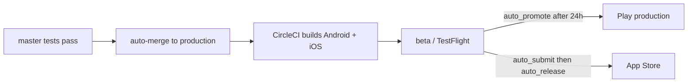

# Mobile apps

New to this and taking it on? Start with
[../../getting-started/mobile-track.md](../../getting-started/mobile-track.md), which is
the day 1, week 1, month 1 version of this page.

The Freegle app is the **Capacitor build of the Nuxt site**: `iznik-nuxt3/`
(`capacitor.config.ts`, `android/`, `ios/`, `fastlane/`). There is no separate native app.

There is also a `freegle-mobile/` directory on some machines. It is **not in git** and is
local scratch. Ignore it.

## The app that ships

Capacitor wraps the same Nuxt code that runs the website into native Android and iOS apps.
There is no separate app codebase: a fix to a Vue component fixes the website and both
apps.

**The manual is [`iznik-nuxt3/README-APP.md`](../../../iznik-nuxt3/README-APP.md)** - 1,200
lines covering build configuration, native plugins, push notifications, photo handling,
signing and release. This page is orientation only; go there to do the work.

Facts worth carrying in your head:

- Built from the **`production` branch**, the same branch Netlify deploys, so web and app
  ship the same code.
- `ISAPP=true` switches the build to static generation instead of server rendering.
- **Four store listings**, not two: Freegle and ModTools, each on Android and iOS.
  The member app is `org.ilovefreegle.direct` on Android; the iOS bundle id differs
  (`org.ilovefreegle.iphone`), selected in `capacitor.config.ts` by the `USE_COOKIES`
  environment variable.
- **Minimum OS** is Android 8.0 and iOS 15.0.
- Native plugins are on a **per-platform allowlist** (`includePlugins`) in
  `capacitor.config.ts`. A plugin that is installed but not listed is silently absent at
  runtime.
- The Android build **throws at config time** unless the four keystore variables are set
  (`FREEGLE_NUXT3_KEYSTORE_PATH`, `..._PASSWORD`, `..._ALIAS`, `FREEGLE_NUXT3_KEYALIAS_PASSWORD`).
  That is deliberate: an unsigned build is worse than no build.

Adverts in the app: no ad network runs without cookie consent, so every ad slot shows the
job listings, with the donate banner while there are none. See
[ads.md](ads.md#the-mobile-app) before changing that path.

## Releasing

Releases are automated with **fastlane** (`iznik-nuxt3/fastlane/Fastfile`), driven by
CircleCI jobs (`build-android`, `build-ios`, and the ModTools and debug variants). Android
builds run only on the `production` branch.

Lanes you will meet: `beta`, `promote_beta`, `auto_promote` (waits 24 hours before
promoting), `auto_submit` and `auto_release` for iOS review, `expire_test_versions` (the
99.x.x test builds), `check_release_divergence`, which alerts when the live Play and
App Store versions have been different for over a week, and `check_apple_agreements`.

### Apple agreements

Apple refuses every App Store request while an agreement, such as an updated Program
License Agreement, waits for the Account Holder. Only the Account Holder can accept it,
signed in at <https://developer.apple.com/account>; there is no API. On 29 and 30 October
2026 this stopped every production deploy at the iOS build until it was accepted.

- `check_apple_agreements` makes the two kinds of request the deploys make, and fails if
  either is refused. The CircleCI schedule `daily-apple-agreement-check` runs it each day
  on `master` (pipeline parameter `run_apple_agreement_check`), so the failure notice
  arrives before a deploy is blocked.
- Any iOS lane that is refused for an agreement says what to do at the end of its log. The
  wordings Apple uses are in `fastlane/apple_agreements.rb`, with tests beside it in
  `fastlane/test/`.

Two traps that have bitten before:

- **Google Play's target-API requirement spans every track.** A stale build sitting in the
  test track can block a production release. Expire old test versions.
- **The orb version is pinned deliberately.** In August 2026 it was rolled back because a
  newer version moved the Android executor to a machine size that is not in our plan. Check
  the comments in `.circleci/continue-config.yml` before bumping it.

App JavaScript is baked into the package at build time, so when a member reports an old
bug, check the build date in the app rather than assuming they have the current code.

### The emulator gate

The browser suite never runs the app itself, which is how a plugin missing from
`includePlugins` once shipped unnoticed. Before the promote workflow moves the Freegle app
to a live store track, `freegle/app-emulator-tests` builds the Android app from the checkout
(the `e2e` build type: the release configuration, R8 included, signed with the debug key,
reporting to no Sentry project), boots a headless emulator on CircleCI's Android machine
image (the Hetzner runners have no `/dev/kvm`) and runs the Playwright `app` project through
the app's WebView against the local stack brought up on the same machine, split across four
such machines. ModTools' submission does not wait for it. It checks the native plugin set, push notification
delivery and routing (an FCM data message injected on the device, no Firebase servers
involved), deep links, photos from the system camera and the photo picker, images shared into
the app from another app (with the app in the background and not running), and the post and
reply flows on a phone-sized screen. It runs in
`manual-promote-submit` and on demand with the `run_app_emulator_test` pipeline parameter,
not on every push. The scripts, the run's anatomy and its traps are in
[`scripts/app-e2e/README.md`](../../../scripts/app-e2e/README.md); the specs are in
`iznik-nuxt3/tests/e2e/app/`. There is no iOS equivalent: the simulator needs a macOS
host, where the Docker stack cannot run.

## Tracked email links opened in the app

The iOS universal-link association hands every site path except `/api/*` to the app, so a
tapped email link arrives as the tracker's own URL (`/e/d/r/...`), not the page it points to,
and the tap never reaches the server that would have recorded the click. Until 2026-09 the app
pushed that path into its router, which has no such page: the member landed on the error page
and then their home page - a chat notification's Reply button once put a member's reply into
ChitChat that way. `stores/mobile.js` `resolveTrackedLink()` now asks apiv2 for the
destination (`?format=json` on the same tracked path, served at the API origin; the click is
recorded exactly as a 302 would) and routes there, falling back to `/`.
