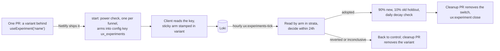

# UX experiments

The measurement in [UX telemetry](ux-telemetry.md) exists so that changes to the member site can be
tried, judged and kept or removed without a person in the loop. This page is how an experiment runs:
how a member gets an arm, how the batch reads it every hour and decides within 24 hours, and how to
run one by hand. The code is the contract; this says where to look and why it is shaped the way it is.
The numbers quoted are the defaults. Every one is a setting, listed with its environment variable in
[deployment-switches.md](deployment-switches.md).



## What an experiment is

One experiment is **one pull request, one switch and one row**:

- The PR adds the variant to the frontend only, behind `useExperiment('<name>') === 'b'`. Anything
  else, including `null`, is control. Nothing in the batch or the Go API changes per experiment, and
  neither does the schema.
- The switch is the `name`: letters, digits, `_` and `-`, up to 64, and not `__proto__`,
  `constructor` or `prototype` (the name becomes a key in a JSON object the browser reads). The read
  finds the arm by matching the name only at the start of the `variant` field or after a comma, so
  `cta` is not confused with `login_cta`. It is still kinder to the next reader not to reuse a name as
  a suffix of another.
- The arms are `control` and at least one variant, each a name of letters, digits and `_` up to 16 and a
  range of the 100 buckets (the default is `control` 0 to 49 and `b` 50 to 99). There are **at most five
  (`MAX_ARMS`)**: the hourly read is one Loki query, and Loki refuses a query that returns 500 series or
  more (see [The hourly tick](#the-hourly-tick)). `create` refuses a sixth arm, and `start` leaves a
  draft with more than five (one made through the routes, for example) as a draft and says why.
- The row is in `ux_experiments` (`UxExperimentService`): the funnel (`flow`), the name, a title, the
  hypothesis, what the change does, the effect expected, the arms, the PR, and a `design` object. The
  wording is plain English because staff read it as written.
- `design` holds `touches` (the flows the change can affect, which are the only other flows read as
  guardrails; default its own flow and `login`), `expected_points` (the effect expected; default 5
  points, the setting `default_expected_points`) and, once started, `power` (see
  [The decision rule](#the-decision-rule-and-why-each-number)). It is set with `ux:experiment create
  --touches=a,b --expected-points=N`, or in the `design` of `POST /modtools/ux/experiments`.
- Status runs `draft`, `running`, then one of `adopted`, `reverted`, `inconclusive` or `stopped`. An
  adopted experiment becomes `closed` when its switch has been removed from the code (see
  [Corpse control](#corpse-control)); only an adopted one can be closed. A finished experiment that was
  reverted, inconclusive or stopped can be started again.
- At most **`max_concurrent` (5) run at once**, **one per funnel**, and none for longer than
  **`max_hours` (24)**. `start` refuses a sixth, a second on the same funnel (two changes to one funnel
  cannot be told apart) and an experiment the power check rejects, and sets the end time.

Two tables hold all of it, created once by
`iznik-batch/database/migrations/2026_10_14_000001_create_ux_experiment_tables.php`: `ux_experiments`
(one row per experiment) and `ux_experiment_reads` (one row per hourly read). A new experiment is a
row, never a migration.

## What a member gets

`composables/useExperiment.js`: `useExperiment(name)` returns the member's arm for a configured
experiment, or `null`, which is control. Assignment is `crc32(<id>|<name>) % 100`, the same function as
`iznik-batch/app/Support/ExperimentBucket.php`, where `<id>` is the user id when logged in and the
client `session_id` otherwise. Arms come from the live config key `ux_experiments` (next section):

```
running: {"<name>": {"arms": {"control": [0, 34], "b": [35, 99]}, "until": <unix seconds>}}
adopted: {"<name>": {"arms": {"b": [0, 89], "control": [90, 99]}, "adopted": true, "until": <unix seconds>}}
```

Bounds are inclusive. Every flow event carries the member's arms in `variant` as comma-joined
`name:arm` pairs, so the funnel splits by arm with no per-experiment recording code. The client's
safety rules (a kill switch, a sticky arm, an exposure event, a cap of five) are below. Use a control
arm; the epsilon-greedy bandit in `abtest` is for choosing between asks, not for measuring a change.

## How arms reach members, live

The arms of every running experiment are published as JSON in the `config` table, key
`ux_experiments`. Starting, re-weighting, adopting and reverting are all a change to that one row, so
none of them needs a deploy.

- **Server side.** `UxExperimentService::rebuildConfig()` writes the row from the `running` and
  `adopted` experiments. A running entry is `{"arms": {...}, "until": <ends_at + 1 hour>}`. An adopted
  entry serves the winner to most members and keeps the **holdout** on the old version:
  `{"arms": {"b": [0, 89], "control": [90, 99]}, "adopted": true, "until": <decided_at + 15 days>}`
  (`holdout_share` is the 10). It runs on every start, stop, close and decision and at the end of every
  hourly tick, so the row cannot drift from the table. Do not edit it by hand; the next tick rewrites
  it. `GET /config/ux_experiments` is public (`isPublicConfigKey` in
  `iznik-server-go/config/config.go`) because it holds names, bucket ranges and times only, nothing
  about a member.
- **The `until` kill switch.** The batch is one process on one host. If it dies, a half-served
  experiment must not stay on for ever, so the client (`normaliseConfig` in `useExperiment.js`) treats a
  running entry as control unless its `until` is in the future **and less than 25 hours away**. A
  missing, past or implausibly distant `until` is control. At most five running entries are honoured
  (the first five by name). An **adopted entry's `until` is ignored**: expiring it would flip members
  back to the old design, which is worse than a stale entry. The batch writes the `until` on adopted
  entries anyway, for a reader of the row.
- **Fetching.** `plugins/uxExperiments.client.js` fetches the key at boot without awaiting it and hands
  it to `setLiveExperiments`, which keeps a copy and its fetch time in `localStorage`
  (`freegle_ux_experiments`). A deep link into a flow has the stored copy before the fetch returns. The
  copy is ignored for running entries once it is more than two hours old, so a member offline for a day
  is not held in an experiment that ended. If the fetch fails the stored copy stands (within that age);
  with none, the member is in control. A page that stays open asks again (`keepFresh`): when it returns
  to the front, on a route change once the copy is five minutes old, and at least hourly. A stopped or
  reverted experiment has left the key, so the new copy has no entry and the member is back in control:
  it no longer waits for the next full page load or for `until`. The old flat shape
  `{"name": {"control": [0, 49], "b": [50, 99]}}` is read only from runtime config
  `public.UX_EXPERIMENTS` (local testing), never from the live key. The fetch is made quietly
  (`logError` false, see [Deploying it](#deploying-it)).
- **A sticky arm.** The arm is worked out once, at the member's first exposure to the experiment, and
  kept in `localStorage` under `freegle_ux_arm:<name>` with the entry's `until`. Later calls return it
  even after the member signs in mid-flow (when the id the bucket is computed from would change) and
  even after the hourly re-weighting moves the boundaries, so a member does not see control on one visit
  and the change on the next. It is dropped when the experiment leaves the config, when `until` passes
  or differs (a restarted run of the same name starts fresh) or when the arm no longer exists. Adopted
  entries are served from the config and are not sticky. With `localStorage` blocked, the arm is held in
  memory for the page view.
- **An exposure event.** The first time an arm is evaluated in a page view the client sends one client
  log, `experiment_exposure`, with the name and arm, through `useClientLog` like any other event.
- **The arm is pinned to the flow instance.** `flowArm(flow, name)` in `useFlowTelemetry.js` returns the
  arm frozen into the live flow instance at `flow_start`, and only falls back to `useExperiment` when
  there is none. Variant UI inside a flow should use it, so what the member sees is what the events are
  stamped with.
- **Only switches this build contains are stamped.** `experimentVariant()` adds `name:arm` to a flow
  event only for an experiment the running bundle declares (a `useExperiment` call made in this page
  view, or a name in `ux-experiments.manifest.json`). A long-lived tab or an installed app from before
  the variant shipped fetches the new config but has no variant code, renders control, and so must not
  be counted in the variant arm: that would dilute the effect towards zero.

## The hourly tick

`php artisan ux:experiments-tick`, scheduled at 17 minutes past each hour in
`iznik-batch/routes/console.php`. It is in the backup drain's always-run list, because it only reads
Loki and writes small rows; skipped, a decision slips past the 24 hours. For each running experiment,
`UxExperimentService::tick`:

1. **Reads Loki by arm** (`read`). The window is from `started_at` to the end of the experiment or now,
   and only flows that **started at least `settle_minutes` (45) before then** are counted
   (`started_ms <= cut`), with everything they did counted up to the end of the window. A flow started
   in the last three quarters of an hour has not had time to finish, and whichever arm just got more
   traffic would look worse for it; cutting on when the flow started, not on when each event happened,
   means a flow that began before the cut and finished after it still counts as a completion. A line
   from a browser that does not send `started_ms`, or sends something that is not a number, is left out of
   both arms. The counts are fetched **hour by hour** with `start_logged_in`, and only whole hours inside
   the window are kept, because an hour that began before the experiment could hold an earlier run of the
   same name. The events are `flow_start`, `flow_complete`, `flow_submit_result`, `validation_failed` and
   `help_sought`. Name, arms and flow are checked against their patterns again before they reach LogQL.
   The patterns end in `\z`, not `$`, because `$` also matches before a final newline, and a newline
   inside a LogQL string fails the whole query.
2. **Compares each variant with control**, within strata. The primary measure is the funnel's completion
   rate, `flow_complete` over `flow_start`, end to end, never one step, because fixing one drop-off can
   move the loss to the next. The counts are split into strata of six-hour block of the day times
   **signed in when the flow started** (not at the event: a login flow's completions are all signed in
   and its starts all signed out, which would make every stratum one-sided and every P near one half),
   each stratum's difference is computed, and they are weighted back together by their share of starts
   (`BetaBinomial::stratifiedDiff`). **Why:** the bandit moves the split every hour and the traffic mix
   changes with the clock (evenings, signed-in members). A pooled total would credit the arm that
   happened to get more traffic in the better hours; comparing like with like removes that (Simpson's
   paradox). The outputs are P(variant beats control), a 90% interval, and the **expected loss** of
   choosing the variant.
3. **Records the read** in `ux_experiment_reads` with a plain-English summary (see
   [The plain-English reads](#the-plain-english-reads)).
4. **Decides** (see [The decision rule](#the-decision-rule-and-why-each-number)), or else
   **re-weights**.

**The query survives any line.** Anyone can post a flow line to `/clientlog`, and it is stored as sent.
Loki refuses a whole metric query for one line that carries an error, and for a query that returns 500
series or more, so a line that is forged, or merely odd, must not be able to do either. Three things in
`read` see to it, and the PHP tests pin all three (`UxExperimentServiceTest`, "a line anyone can send"):

- **A guard after every stage that can fail.** `| __error__=""` comes straight after the numeric
  `started_ms <= <cut>` filter as well as after the JSON parse. The numeric filter tags a line whose
  `started_ms` is not a number with `LabelFilterErr`, and without the second guard that one line fails the
  query: the experiment is never read again, the early-revert guardrails cannot fire, and the run ends
  `inconclusive` six hours after its end.
- **Only this experiment's arms.** The arm is captured only from the experiment's own arm names
  (`(?P<arm>b|control)`), ending at a comma or the closing quote, and a line with no such arm is dropped.
  A captured `[A-Za-z0-9_]+` gave every forged token a series of its own.
- **Free labels rewritten to fixed words.** `logged_in`, `start_logged_in` and `ok` can hold any text, so
  `label_format` turns each into `true`, `false` or nothing, and into nothing for an event that does not use
  it. That leaves at most 12 series for each arm of each funnel read (`SERIES_PER_ARM_AND_FLOW`: 4 each for
  start and complete, 2 for a submit result, 1 each for validation failures and help sought), and with
  `MAX_ARMS` (5) arms and the seven funnels that is 420, under the 500 limit. `start_logged_in` stays empty
  when a line sent none, because the fallback to `logged_in` is for those lines.

A forged line that is well formed (an arm of the experiment, a number for `started_ms`) is counted, as a
member's would be: nothing in the log tells them apart, and this page does not claim otherwise. What such
a line cannot do is stop the read.

**Re-weighting (a bandit, not a fixed split).** While undecided, and only once **every arm has
`early_min_starts_per_arm` (300) starts**, `allocate` gives each variant the share of traffic equal to
its **stratified P(better than control)** from the same comparison `decide` uses (so the split and the
decision cannot disagree, and a difference that is only a swing in who arrived moves nothing), held in
a band: **every arm, control and variants alike, keeps at least `min_control_share` (35, scaled by 2/k
for k arms) and none takes more than `max_variant_share` (65)**. The split is never an empty or
inverted range; a variant that has a bad first few hours still has a third of the traffic to recover
on. Ranges are rewritten as contiguous blocks over 0 to 99, control first, and `rebuildConfig` drops
any empty range rather than publish it. A restarted experiment (stopped, inconclusive or reverted
before) begins from an even split, not where the bandit left off. **Why a band:** a 10% floor starved
control and left too few people to read in a day; the band keeps both sides readable. **Why 300
first:** with fewer, the posteriors are wide and the split would chase noise, moving members between
arms on no evidence. **Why a bandit at all:** waiting for classical purity makes 24 hours of a clearly
worse variant half of traffic. `bandit` set false keeps the opening split.

**When Loki is down.** A failed query raises `UxLokiUnavailable`. The tick then reuses the stored read
only if it is under `stale_read_hours` (2) old **and was taken in this run** (a restarted experiment
keeps its old read rows, which are numbers it never produced), marked stale and with no new read row; a
stale read can revert but **can never adopt early**. With no usable read it records nothing that hour.
Past the end it waits up to `stale_wait_hours` (6) for Loki, then marks the experiment `inconclusive`
("taken off, nothing can be said about it"). It never adopts on old numbers, and never leaves an
experiment running unread.

**Concurrency.** `start`, `stop`, `close` and each experiment's step in the tick run inside
`GET_LOCK('ux_experiments')` taken on the write node (`locked()`), so two writers never interleave.
Every status change is an `UPDATE ... WHERE status = <the status expected>` that checks it changed a
row, and the tick **re-reads the row after its slow Loki query and before it finishes it**. So a human
stop that lands while a read is in flight wins, and two simultaneous starts cannot both pass the cap of
five. A tick that finds the row no longer running leaves it alone.

The same command also runs the holdout check (see [Guardrails and the
holdout](#guardrails-and-the-holdout)) and prints `Cleanup overdue` for adopted experiments (see
[Corpse control](#corpse-control)).

## The decision rule, and why each number

`UxExperimentService::decide`. `p` is P(the best variant is better than control) and `loss` is its
expected loss in points; "starts" are flow starts on each arm.

| When | Result |
|---|---|
| Any hour, both arms have 300 starts, a guardrail is worse by more than 2 points with probability at least `1 - 0.03/k` | `reverted`, early |
| Any hour, both arms have 300 starts, read not stale, `p >= 0.99`, `loss <= 0.5`, and no guardrail at `1 - 0.10/k` | `adopted`, early |
| Any hour, both arms have 300 starts, `p <= 0.02` | `reverted`, early |
| At `ends_at`, either arm under 50 starts | `inconclusive` |
| At `ends_at`, a guardrail worse by more than 2 points with probability at least `1 - 0.10/k` | `reverted`, whatever the main result |
| At `ends_at`, `p >= 0.80` but the variant's share of starts is off the share it was served (below) | `inconclusive` |
| At `ends_at`, `p >= 0.80` and `loss <= 0.5` | `adopted` |
| At `ends_at`, `p >= 0.80` but `loss > 0.5` | `inconclusive` |
| At `ends_at`, `p <= 0.20` | `reverted` |
| At `ends_at`, otherwise | `inconclusive` |

The default is the status quo: only `adopted` keeps a change, and `reverted`, `inconclusive` and
`stopped` all leave the config key, so everyone is back in control. Why each piece:

- **Expected loss as well as probability.** `p >= 0.80` alone would adopt a change worth +0.01 points,
  because a tiny positive effect on a lot of traffic is "probably better". The loss bar asks what we
  would give up, on average, if we keep it and it is not better; over 0.5 points we say "inconclusive"
  instead.
- **Early stops need 300 starts an arm and a stricter bar (0.99 and 0.02).** The rule is run every hour,
  so there are up to 24 looks, and every look is another chance to be fooled by noise. A decision at
  the end asks for 50 starts and 0.80; an early one has to be unmistakable.
- **The share of starts must match the share served.** The completion rate is among those who started,
  so a change that loses people before the start event (a sign-in prompt ahead of the flow, a broken
  first screen) can show a better rate while fewer people finish. Each read compares every variant's
  share of starts with the share it was served, hour by hour (`expectedStarts`: each hour's starts
  shared out by the split in force then, taken from the stored reads, because the bandit moves it). When
  the gap is over `sample_ratio_points` (5) **and** over 3.5 standard errors, `primary.<arm>.share_off`
  is true, the summary warns, and nothing is adopted on it, early or at the end (the end gives
  `inconclusive` with the reason). A revert is still allowed: a variant that is clearly worse is worse
  whatever the shares. The holdout read does not make this check.
- **A guardrail trips only past a margin.** Guardrails are the failure and validation rates, help
  sought, and the completion of every other funnel the change `touches` (see
  [Guardrails and the holdout](#guardrails-and-the-holdout)). Each is the probability the variant is
  worse than control by **more than 2 points** (`guardrail_margin_points`), a non-inferiority form: a
  null change read 24 times would otherwise cross a bare "probably worse" line by chance, and a good
  change would be stopped by noise in an unrelated flow. Each guardrail also needs 100 events behind it
  across both arms.
- **Multiplicity.** With `k` guardrails (three on the experiment's own flow plus one per other flow it
  touches) the chance of at least one false alarm grows with `k`. The error budget is split `k` ways:
  0.10 for blocking at the end, 0.03 for the early revert, so each guardrail needs `1 - budget/k`. The
  early revert also waits for 300 starts an arm.
- **The settle lag and the strata** are under [The hourly tick](#the-hourly-tick), and so is **the
  bandit band**.
- **A power gate before it starts.** `start` takes the funnel's recent daily starts and completion rate
  from the rollup (`ux_flow_outcome_daily`, last 7 days), and works out the chance a day of that funnel
  would adopt a change of `design.expected_points` under exactly this rule (`BetaBinomial::adoptPower`,
  a normal approximation that ignores the stratification and the bandit). The figure is stored as
  `design.power`. Below `min_power` (0.30) `start` refuses with advice: make the change bigger, or
  combine it with another change. A test that could almost never reach a decision would spend a funnel's
  only slot for a day to say "inconclusive". It only runs when the rollup has data for the funnel, and
  `min_power` 0 turns it off. The smallest effect a day could show at 80% power (`mde_points`) is
  recorded at start and shown in every read.
- **One experiment per funnel.** Two changes to one funnel at once confound each other, and the
  guardrails already read across flows, so five slots across seven funnels is enough.

## Guardrails and the holdout

**Guardrails.** A change can raise the measure it aims at and hurt something else. For each variant the
read also compares, against control, with the same arithmetic and margin:

- the share of submissions that failed (`flow_submit_result` with `ok` false);
- the number of validation failures per start;
- the share of starts where people went looking for help;
- **the completion rate of every other flow in `design.touches`**.

Each carries a `label` (the words above, or `finishing "<funnel title>"` for another funnel) that is the
subject of a sentence: `<label> got worse with the change`, `<label> was probably worse with the change`,
`<label> looks worse with the change`. So a label is one share or one number, never a plural, and
anything that shows a guardrail should use the stored label, not a name of its own for the same thing.

The last works because `variant` is stamped on every flow event, not only the experiment's own flow. A
Give change that lowers Reply completion shows up as a guardrail on `reply` with no per-experiment code,
provided the experiment declared that it touches `reply`; flows it cannot reach are not read, so they
cannot cause a false alarm. The per-start rates are clamped at 1 because the events can repeat within
one start, and are only meaningful while well below that.

**Holdout after adoption, and the decay check.** A gain that only looked good while it was new is not a
gain. So an adopted experiment is served as winner 90%, **old version 10%** until it is closed
(`rebuildConfig`). From 23 hours after the decision, then once a day for `holdout_days` (14) while it
stays `adopted`, `checkAdopted` re-reads the whole time since adoption, the adopted arm against the
holdout. When the holdout is better with probability at least `holdout_revert_probability` (0.99) on
`holdout_revert_looks` (2) looks in a row and **both sides have 300 starts**, it reverts the adoption
(status `reverted`, `result.decayed = true`, decision "Reverted after adoption: the people who kept the
old version did better over N days ..."). **Why a high bar and a repeat:** there are up to fourteen
daily looks, so a loose bar would undo good changes by chance, and the holdout is the small side (a
ninth of the adopted arm), so its noise is the largest; a look that is not clear starts the count again
(`result.holdout_check.strikes`). One adopted experiment that cannot be checked (a lock timeout, a bad
row) is logged and left; the others are still checked and the config is still rebuilt. Closing the
experiment (after the cleanup PR) ends the holdout, so with the 7-day cleanup target the check usually
runs about a week of the fourteen. A Loki failure skips that day's check; it is never a reason to
revert.

## The plain-English reads

Every hourly read stores a paragraph: how many started with and without the change, the completion
rate each way and the difference in points, the probability the change is better, any guardrail that
looks worse, what we would expect to lose if we kept the change and it were no better, the traffic
share on the change, the smallest effect a day could show, and whether enough people have been through
to read it. A decision is one more sentence that says which rule fired and carries the same figures.
These are stored text, so whoever reads the history needs no statistics.

Staff know funnels by their title, so the sentences name a funnel by its title and never by its key:
`finishing "Replying to a post" got worse with the change`, the first sentence of a read is `210 people
started "Offering something" with the change and 200 without`, and a refusal reads `Experiment <name> is
already running on the funnel "Offering something"`. The titles are the ones the SysAdmin UX tab uses
(`FLOW_TITLES` in `iznik-nuxt3/modtools/composables/useUxFlows.js`; `funnelTitle()` in
`UxExperimentService` has the same seven). The key stays where code reads it: a guardrail's `name` is
`flow:<key>`.

The same sentences follow the plain-words rules staff read by, and the tests pin each:

- **No idioms.** An inconclusive result says `the numbers do not show whether the change is better or
  worse`, and too few people says `Time was up before enough people had started with each version to say
  whether it worked (each needs at least 50)`.
- **A probability names itself and follows a colon**: `Probability the change is better: 70%`,
  `probability it is worse by more than 2 points: 60%`. It is never certain after a day of data, so a
  figure that would round to 100% reads `over 99%`, and one that would round to 0% reads `under 1%`.
- **A count of exactly one is singular**: `1 person started`, `+1 point`.
- A holdout reversal counts `checks in a row`, not looks.

What is stored, and where:

- `ux_experiment_reads` has **one row per hourly read**: `read_at`, the hours the experiment had run,
  the structured `metrics` and the `summary` paragraph. A restart keeps the rows of the run before.
- `ux_experiments.result` holds **the whole read** of the current run (`arms`, `primary`,
  `guardrails`, `allocation`). The tick rewrites it every hour while the experiment runs, a start resets
  it to the start facts (`mde_points`), and it is kept as the final read when the experiment ends. A
  `result` with no `arms` means no read yet.
- `GET /modtools/ux/experiments` sends `result` for every row, and its `latest_read` is **only the
  paragraph** of the newest read taken at or after the experiment's `started_at`. A restarted experiment
  has no `latest_read` until its first new read, so it never shows the text of the run before, and a
  draft has none.
- A refusal by the batch is kept in `result.last_refusal` (`action`, `message`, `at`) until the next
  change of status clears it.

## Running one by hand

`php artisan ux:experiment <action>` on the batch host. It does what the routes do through the API, with
the same rules, because both end in `UxExperimentService`.

| Command | Does |
|---|---|
| `ux:experiment list` | The latest 50 experiments. The `ends` column is filled only for a running one |
| `ux:experiment create --flow= --name= --title= --hypothesis= --change= --expected=` | A draft. `--flow` is the funnel's key. Optional `--arms` (JSON, default `{"control":[0,49],"b":[50,99]}`, at most five), `--touches=a,b`, `--expected-points=N` (default 5) and `--pr` (the pull request that adds the switch) |
| `ux:experiment start <name>` | Starts a draft or a finished experiment. Refuses when five are running, when one is running on the same funnel, or when a day of the funnel could hardly show the expected effect. Publishes the arms |
| `ux:experiment stop <name> --reason=` | Takes a running experiment off. Everyone goes back to control |
| `ux:experiment close <name> --cleanup-pr=` | Records that an adopted experiment's switch has been removed from the code, and takes it out of the config. Only an adopted experiment can be closed |
| `ux:experiment config` | Rebuilds the config key from the rows and prints it |
| `ux:experiments-tick` | The hourly read, decision, re-weighting and holdout check. Also prints `Cleanup overdue` for adopted experiments |

A good first run: `ux:experiment list`, then `create`, then `start <name>`. A real experiment's `--name`
is the switch in the code, listed in `iznik-nuxt3/ux-experiments.manifest.json`. That file is empty until
the first switch lands, so to try the command use any name, for example `try-it`: nothing in the site
reads a name that has no switch, so members see no change. A refusal is an answer, not a fault: the
command prints the reason and exits non-zero. A running experiment prints `ends <time>`; a stopped or
decided one prints no end, because it has none ahead of it.

## Corpse control

A switch left in the code after its experiment ended is dead weight that nobody remembers. Four things
stop that:

1. **Every switch is registered.** `iznik-nuxt3/ux-experiments.manifest.json` lists each live
   `useExperiment('<name>')` and `flowArm(<flow>, '<name>')` with its `name`, the date it was `opened`
   (`YYYY-MM-DD`) and its `pr`. `tests/unit/uxExperimentsManifest.spec.js` fails CI when a switch in the
   source is not listed, when a listed one has no call left, **when a name is not a string literal**
   (the scan cannot see those, so they would escape corpse control), or when one is more than
   `max_age_days` (**30**) old. A switch older than **14** days only prints a warning, because a hard
   failure at 14 days would turn every other branch red, and stop the deploy of an unrelated hotfix,
   whenever the cleanup loop was down. An entry that must live longer, such as a deliberate holdout,
   takes a `keep_until` date in the future and a `reason`.
2. **Cleanup is a step.** Once an experiment is decided, a cleanup PR is opened. Adopted: the variant
   becomes the only code and the switch goes. Reverted, inconclusive or stopped: the variant code and
   its tests go. Afterwards `ux:experiment close <name> --cleanup-pr=<url>` records it. **Close an
   adopted experiment only after the cleanup PR is live**, because closing takes the experiment out of
   the config key, and until the switch is gone from the code every member would fall back to control
   and lose the adopted change. Closing also ends the holdout.
3. **Variants are local and deletable.** The PR adds one `v-if` branch, or one component used only by
   that branch, touching as few files as it can, so cleanup is the inverse diff and never a rewrite.
4. **History is in the database, not the code.** What was tried and why it came off lives in
   `ux_experiments`, so no comment in the code has to remember it.

**Cleanup overdue.** An adopted experiment not closed after `cleanup_days` (7) is printed by the tick
(`Cleanup overdue: ...`) and flagged `cleanup_overdue` by `GET /modtools/ux/experiments`, so a missed
cleanup is seen within a day.

## The routes

Support and Admin only. `GET /modtools/ux/experiments?flow=` returns `running_count`, `max_running` and
`flows`: an entry for every known funnel, even an empty one, each with `running` and `history` (drafts
sit in `history`). An experiment carries its `status`, `arms`, `design`, `result`, `decision`,
`latest_read`, `hours`, `cleanup_overdue` and `holdout_until` (set while an adopted experiment is still
in its holdout), `pr_url` and `cleanup_pr_url`.

`POST /modtools/ux/experiments` creates a draft and answers `{id, status: "draft"}`. The body is
`flow`, `name`, `title`, `hypothesis`, `change` and `expected`, and optionally `arms` (two numbers each),
`design` and `pr_url`. It answers 400 with a plain message (more than five arms is one), and 409 when
the name exists. The new
draft's id is read from the primary database, so a start sent straight after is not answered "No such
experiment" by a replica that has not caught up.

`PATCH /modtools/ux/experiments/:id` with `action` of `start`, `stop` or `close` (and optionally
`reason` and `cleanup_pr`) queues a `ux_experiment` background task that the batch's background task
runner applies, so the cap, the 24-hour end and the config key are enforced by `UxExperimentService` and
nowhere else. The experiment is looked up on the primary database too. A request the rules refuse (the
cap, a second experiment on the funnel, too little power, a status the action does not fit) throws
`UxExperimentRefused`; the task finishes without retrying and the reason is kept in
`result.last_refusal`.

`pr_url` and `cleanup_pr_url` are links on the SysAdmin UX tab, and a `javascript:` address would run
when a moderator clicked it, so the API accepts only addresses that start with `https://`. The check is
on the text as sent, so a leading space does not pass. A body that still carries `idea_id` or
`image_*` is accepted and those fields are ignored.

The cap and the cleanup days come from the Go API's own environment: `UX_EXPERIMENTS_MAX_CONCURRENT`,
`UX_EXPERIMENTS_CLEANUP_DAYS`, `UX_EXPERIMENTS_HOLDOUT_DAYS` and `UX_EXPERIMENTS_HOLDOUT_SHARE`. The
batch reads the same four names from its own environment, and `docker-compose.yml` passes none of them
to `apiv2`, so Go answers with the defaults unless the host sets them. **Set each of the four on both
sides or on neither**, or the routes will report a cap that the batch does not use.

## Deploying it

Order matters, in both directions. The backend code reads and writes tables that must exist, and the
frontend reads a config key that only the new Go code serves.

1. **Run the SQL on production first**:
   `iznik-batch/database/migrations/2026_10_14_000001_create_ux_experiment_tables_migration.sql`. It is
   two `CREATE TABLE IF NOT EXISTS`, takes a short `lock_wait_timeout`, alters no existing table and is
   safe to run twice. Because it is `IF NOT EXISTS` it will **not** add a column to a table an earlier
   version of this change had already created: run `SHOW TABLES LIKE 'ux_%'` first, and if the old
   six-table shape was ever applied, add the columns by hand. The Laravel migration is the source of
   truth; production gets the SQL.
2. **Deploy the batch and the Go API** from the Docker host. The Go image bakes the code in, so it needs
   a rebuild. Until they are up there is no tick and no write API.
3. **Then the frontend, which ships itself.** Green master merges to `production` and Netlify builds
   both sites. **Go must be live first.** Before it, `isPublicConfigKey` does not list `ux_experiments`,
   so `GET /config/ux_experiments` is a 403 on every page view; the plugin fetches with logging off so
   that is not a Sentry event per page view, but members are in control. The earlier advice that the
   frontend could go first "harmlessly" was wrong.

After that, every experiment is a frontend PR plus a start; nothing else is deployed per experiment.

What breaks when a part is missing:

| Missing | Effect |
|---|---|
| SQL not run, batch live | The hourly tick fails on a missing table each hour: noise in the cron log. Nothing members see |
| SQL not run, Go live | The three routes answer with an error. Nothing members see |
| Batch not updated, Go live | A queued start is never applied. Reading and drafts work |
| New Go, old batch | The old batch does not know the `ux_experiment` task type. It throws `Unknown task type`, tries the task up to 3 times (`MAX_ATTEMPTS`), then marks it failed. Reading and drafts work |
| Go missing, site live | `GET /config/ux_experiments` answers 403 on every page view. The plugin treats a refusal as no value and logs nothing; members see the old version |
