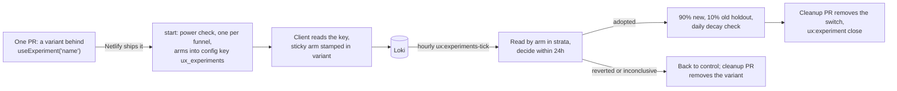

# UX experiments

The measurement in [UX telemetry](ux-telemetry.md) exists so that changes to the member site can be
tried, judged and kept or removed without a person in the loop. This page is how an experiment runs:
how a member gets an arm, how the batch reads it every hour and decides within 24 hours, and how to
run one by hand. The code is the contract; this says where to look and why it is shaped the way it is.
The numbers quoted are the defaults. Every one is a setting, listed with its environment variable in
[deployment-switches.md](deployment-switches.md).



## What an experiment is

One experiment is **one pull request, one switch and one row**:

- The PR adds the variant to the frontend only, behind `useExperiment('<name>') === 'b'`. Anything
  else, including `null`, is control. A change to the site needs nothing in the batch or the Go API, and
  no experiment changes the schema. An experiment decided on the server (mail, push, server code) is
  different: its call to the arm, and its entry in that runtime's switch list, are code in the batch or the
  Go API. See [Experiments in mail, push and the server](#experiments-in-mail-push-and-the-server).
- The switch is the `name`: letters, digits, `_` and `-`, up to 64, and not `__proto__`,
  `constructor` or `prototype` (the name becomes a key in a JSON object the browser reads). The read
  finds the arm by matching the name only at the start of the `variant` field or after a comma, so
  `cta` is not confused with `login_cta`. It is still kinder to the next reader not to reuse a name as
  a suffix of another.
- The arms are `control` and at least one variant, each a name of letters, digits and `_` up to 16 and a
  range of the 100 buckets (the default is `control` 0 to 49 and `b` 50 to 99). There are **at most five
  (`MAX_ARMS`)**: the hourly read is one Loki query, and Loki refuses a query that returns 500 series or
  more (see [The hourly tick](#the-hourly-tick)). `create` refuses a sixth arm, and `start` leaves a
  draft with more than five (one made through the routes, for example) as a draft and says why.
- The row is in `ux_experiments` (`UxExperimentService`): the funnel (`flow`), the name, a title, the
  hypothesis, what the change does, the effect expected, the arms, the PR, and a `design` object. The
  wording is plain English because staff read it as written.
- `design` holds `touches` (the flows the change can affect, which are the only other flows read as
  guardrails; default its own flow and `login`), `expected_points` (the effect expected; default 5
  points, the setting `default_expected_points`) and, once started, `power` (see
  [The decision rule](#the-decision-rule-and-why-each-number)). It is set with `ux:experiment create
  --touches=a,b --expected-points=N`, or in the `design` of `POST /modtools/ux/experiments`. Two more
  keys judge the change on something other than finishing the funnel: `primary_event` and `base_rate`
  (see [Judged on an event](#judged-on-an-event)).
- Status runs `draft`, `running`, then one of `adopted`, `reverted`, `inconclusive` or `stopped`. An
  adopted experiment becomes `closed` when its switch has been removed from the code (see
  [Corpse control](#corpse-control)). A reverted, inconclusive or stopped experiment keeps that status when
  its code cleanup is recorded with `close`, and can be started again only until then.
- At most **`max_concurrent` (5) run at once**, **one per funnel**, and none for longer than
  **`max_hours` (24)**. `start` refuses a sixth, a second on the same funnel (two changes to one funnel
  cannot be told apart) and an experiment the power check rejects, and sets the end time.

Two tables hold all of it, created once by
`iznik-batch/database/migrations/2026_10_14_000001_create_ux_experiment_tables.php`: `ux_experiments`
(one row per experiment) and `ux_experiment_reads` (one row per hourly read). A new experiment is a
row, never a migration.

## What a member gets

`composables/useExperiment.js`: `useExperiment(name)` returns the member's arm for a configured
experiment, or `null`, which is control. Assignment is `crc32(<id>|<name>) % 100`, the same function as
`iznik-batch/app/Support/ExperimentBucket.php`, where `<id>` is the user id when logged in and the
client `session_id` otherwise. Arms come from the live config key `ux_experiments` (next section):

```
running: {"<name>": {"arms": {"control": [0, 34], "b": [35, 99]}, "until": <unix seconds>}}
adopted: {"<name>": {"arms": {"b": [0, 89], "control": [90, 99]}, "adopted": true, "until": <unix seconds>}}
```

Bounds are inclusive. Every flow event carries the member's arms in `variant` as comma-joined
`name:arm` pairs, so the funnel splits by arm with no per-experiment recording code. The client's
safety rules (a kill switch, a sticky arm, an exposure event, a cap of five) are below. Use a control
arm; the epsilon-greedy bandit in `abtest` is for choosing between asks, not for measuring a change.

**Not in the app.** Web experiments run on the website only. In the iOS and Android app
(`Capacitor.isNativePlatform()`) every running entry is control: no arm, no exposure, nothing in
`variant`, so app members are in neither arm and are not counted. An adopted change does reach the app,
because by then it is the site.

## How arms reach members, live

The arms of every running experiment are published as JSON in the `config` table, key
`ux_experiments`. Starting, re-weighting, adopting and reverting are all a change to that one row, so
none of them needs a deploy.

- **Server side.** `UxExperimentService::rebuildConfig()` writes the row from the `running` and
  `adopted` experiments. A running entry is `{"arms": {...}, "until": <ends_at + 1 hour>}`. An adopted
  entry serves the winner to most members and keeps the **holdout** on the old version:
  `{"arms": {"b": [0, 89], "control": [90, 99]}, "adopted": true, "until": <decided_at + 15 days>}`
  (`holdout_share` is the 10). It runs on every start, stop, close and decision and at the end of every
  hourly tick, so the row cannot drift from the table. Do not edit it by hand; the next tick rewrites
  it. `GET /config/ux_experiments` is public (`isPublicConfigKey` in
  `iznik-server-go/config/config.go`) because it holds names, bucket ranges and times only, nothing
  about a member.
- **The `until` kill switch.** The batch is one process on one host. If it dies, a half-served
  experiment must not stay on for ever, so the client (`normaliseConfig` in `useExperiment.js`) treats a
  running entry as control unless its `until` is in the future **and less than 25 hours away**. A
  missing, past or implausibly distant `until` is control. At most five running entries are honoured
  (the first five by name). An **adopted entry's `until` is ignored**: expiring it would flip members
  back to the old design, which is worse than a stale entry. The batch writes the `until` on adopted
  entries anyway, for a reader of the row.
- **Fetching.** `plugins/uxExperiments.client.js` fetches the key at boot without awaiting it and hands
  it to `setLiveExperiments`, which keeps a copy and its fetch time in `localStorage`
  (`freegle_ux_experiments`). A deep link into a flow has the stored copy before the fetch returns. The
  copy is ignored for running entries once it is more than two hours old, so a member offline for a day
  is not held in an experiment that ended. If the fetch fails the stored copy stands (within that age);
  with none, the member is in control. A page that stays open asks again (`keepFresh`): when it returns
  to the front, on a route change once the copy is five minutes old, and at least hourly. A stopped or
  reverted experiment has left the key, so the new copy has no entry and the member is back in control:
  it no longer waits for the next full page load or for `until`. The old flat shape
  `{"name": {"control": [0, 49], "b": [50, 99]}}` is read only from runtime config
  `public.UX_EXPERIMENTS` (local testing), never from the live key. The fetch is made quietly
  (`logError` false, see [Deploying it](#deploying-it)).
- **A sticky arm.** The arm is worked out once, at the member's first exposure to the experiment, and
  kept in `localStorage` under `freegle_ux_arm:<name>` with the entry's `until`. Later calls return it
  even after the member signs in mid-flow (when the id the bucket is computed from would change) and
  even after the hourly re-weighting moves the boundaries, so a member does not see control on one visit
  and the change on the next. It is dropped when the experiment leaves the config, when `until` passes
  or differs (a restarted run of the same name starts fresh) or when the arm no longer exists. Adopted
  entries are served from the config and are not sticky. With `localStorage` blocked, the arm is held in
  memory for the page view.
- **An exposure event.** The first time an arm is evaluated in a page view the client sends one client
  log, `experiment_exposure`, with the name and arm, through `useClientLog` like any other event.
- **The arm is pinned to the flow instance.** `flowArm(flow, name)` in `useFlowTelemetry.js` returns the
  arm frozen into the live flow instance at `flow_start`, and only falls back to `useExperiment` when
  there is none. Variant UI inside a flow should use it, so what the member sees is what the events are
  stamped with.
- **Only switches this build contains are stamped.** `experimentVariant()` adds `name:arm` to a flow
  event only for an experiment the running bundle declares (a `useExperiment` call made in this page
  view, or a name in `ux-experiments.manifest.json`). A long-lived tab or an installed app from before
  the variant shipped fetches the new config but has no variant code, renders control, and so must not
  be counted in the variant arm: that would dilute the effect towards zero.

## The hourly tick

`php artisan ux:experiments-tick`, scheduled at 17 minutes past each hour in
`iznik-batch/routes/console.php`. It is in the backup drain's always-run list, because it only reads
Loki and writes small rows; skipped, a decision slips past the 24 hours. For each running experiment,
`UxExperimentService::tick`:

1. **Reads Loki by arm** (`read`). The window is from `started_at` to the end of the experiment or now,
   and only flows that **started at least `settle_minutes` (45) before then** are counted
   (`started_ms <= cut`), with everything they did counted up to the end of the window. A flow started
   in the last three quarters of an hour has not had time to finish, and whichever arm just got more
   traffic would look worse for it; cutting on when the flow started, not on when each event happened,
   means a flow that began before the cut and finished after it still counts as a completion. A line
   from a browser that does not send `started_ms`, or sends something that is not a number, is left out of
   both arms. The counts are fetched **hour by hour** with `start_logged_in`, and only whole hours inside
   the window are kept, because an hour that began before the experiment could hold an earlier run of the
   same name. The events are `flow_start`, `flow_complete`, `flow_submit_result`, `validation_failed` and
   `help_sought`. Name, arms and flow are checked against their patterns again before they reach LogQL.
   The patterns end in `\z`, not `$`, because `$` also matches before a final newline, and a newline
   inside a LogQL string fails the whole query.
2. **Compares each variant with control**, within strata. The primary measure is the funnel's completion
   rate, `flow_complete` over `flow_start`, end to end, never one step, because fixing one drop-off can
   move the loss to the next. The counts are split into strata of six-hour block of the day times
   **signed in when the flow started** (not at the event: a login flow's completions are all signed in
   and its starts all signed out, which would make every stratum one-sided and every P near one half),
   each stratum's difference is computed, and they are weighted back together by their share of starts
   (`BetaBinomial::stratifiedDiff`). **Why:** the bandit moves the split every hour and the traffic mix
   changes with the clock (evenings, signed-in members). A pooled total would credit the arm that
   happened to get more traffic in the better hours; comparing like with like removes that (Simpson's
   paradox). The outputs are P(variant beats control), a 90% interval, and the **expected loss** of
   choosing the variant.
3. **Records the read** in `ux_experiment_reads` with a plain-English summary (see
   [The plain-English reads](#the-plain-english-reads)).
4. **Decides** (see [The decision rule](#the-decision-rule-and-why-each-number)), or else
   **re-weights**.

**The query survives any line.** Anyone can post a flow line to `/clientlog`, and it is stored as sent.
Loki refuses a whole metric query for one line that carries an error, and for a query that returns 500
series or more, so a line that is forged, or merely odd, must not be able to do either. Three things in
`read` see to it, and the PHP tests pin all three (`UxExperimentServiceTest`, "a line anyone can send"):

- **A guard after every stage that can fail.** `| __error__=""` comes straight after the numeric
  `started_ms <= <cut>` filter as well as after the JSON parse. The numeric filter tags a line whose
  `started_ms` is not a number with `LabelFilterErr`, and without the second guard that one line fails the
  query: the experiment is never read again, the early-revert guardrails cannot fire, and the run ends
  `inconclusive` six hours after its end.
- **Only this experiment's arms.** The arm is captured only from the experiment's own arm names
  (`(?P<arm>b|control)`), ending at a comma or the closing quote, and a line with no such arm is dropped.
  A captured `[A-Za-z0-9_]+` gave every forged token a series of its own.
- **Free labels rewritten to fixed words.** `logged_in`, `start_logged_in` and `ok` can hold any text, so
  `label_format` turns each into `true`, `false` or nothing, and into nothing for an event that does not use
  it. That leaves at most 12 series for each arm of each funnel read (`SERIES_PER_ARM_AND_FLOW`: 4 each for
  start and complete, 2 for a submit result, 1 each for validation failures and help sought), and with
  `MAX_ARMS` (5) arms and the seven funnels that is 420, under the 500 limit. `start_logged_in` stays empty
  when a line sent none, because the fallback to `logged_in` is for those lines.

A forged line that is well formed (an arm of the experiment, a number for `started_ms`) is counted, as a
member's would be: nothing in the log tells them apart, and this page does not claim otherwise. What such
a line cannot do is stop the read.

**Re-weighting (a bandit, not a fixed split).** While undecided, and only once **every arm has
`early_min_starts_per_arm` (300) starts**, `allocate` gives each variant the share of traffic equal to
its **stratified P(better than control)** from the same comparison `decide` uses (so the split and the
decision cannot disagree, and a difference that is only a swing in who arrived moves nothing), held in
a band: **every arm, control and variants alike, keeps at least `min_control_share` (35, scaled by 2/k
for k arms) and none takes more than `max_variant_share` (65)**. The split is never an empty or
inverted range; a variant that has a bad first few hours still has a third of the traffic to recover
on. Ranges are rewritten as contiguous blocks over 0 to 99, control first, and `rebuildConfig` drops
any empty range rather than publish it. A restarted experiment (stopped, inconclusive or reverted
before) begins from an even split, not where the bandit left off. **Why a band:** a 10% floor starved
control and left too few people to read in a day; the band keeps both sides readable. **Why 300
first:** with fewer, the posteriors are wide and the split would chase noise, moving members between
arms on no evidence. **Why a bandit at all:** waiting for classical purity makes 24 hours of a clearly
worse variant half of traffic. `bandit` set false keeps the opening split.

**When Loki is down.** A failed query raises `UxLokiUnavailable`. The tick then reuses the stored read
only if it is under `stale_read_hours` (2) old **and was taken in this run** (a restarted experiment
keeps its old read rows, which are numbers it never produced), marked stale and with no new read row; a
stale read can revert but **can never adopt early**. With no usable read it records nothing that hour.
Past the end it waits up to `stale_wait_hours` (6) for Loki, then marks the experiment `inconclusive`
("taken off, nothing can be said about it"). It never adopts on old numbers, and never leaves an
experiment running unread.

**Concurrency.** `start`, `stop`, `close` and each experiment's step in the tick run inside
the cache lock `ux_experiments` (`locked()`, a row in `cache_locks` on the live database store), so two
writers never interleave. It is not `GET_LOCK`, which the cluster refuses under `pxc_strict_mode=ENFORCING`.
Every status change is an `UPDATE ... WHERE status = <the status expected>` that checks it changed a
row, and the tick **re-reads the row after its slow Loki query and before it finishes it**. So a human
stop that lands while a read is in flight wins, and two simultaneous starts cannot both pass the cap of
five. A tick that finds the row no longer running leaves it alone.

The same command first applies the cleanup notes in `config/ux_cleanups.php` (`applyCleanups`, see [Corpse
control](#corpse-control)), then also runs the holdout check (see [Guardrails and the
holdout](#guardrails-and-the-holdout)) and prints `Cleanup overdue` for adopted experiments and `Cleanup due` for the other ended ones (see
[Corpse control](#corpse-control)).

## The decision rule, and why each number

`UxExperimentService::decide`. `p` is P(the best variant is better than control) and `loss` is its
expected loss in points; "starts" are flow starts on each arm.

| When | Result |
|---|---|
| Any hour, both arms have 300 starts, a guardrail is worse by more than 2 points with probability at least `1 - 0.03/k` | `reverted`, early |
| Any hour, both arms have 300 starts, read not stale, `p >= 0.99`, `loss <= 0.5`, and no guardrail at `1 - 0.10/k` | `adopted`, early |
| Any hour, both arms have 300 starts, `p <= 0.02` | `reverted`, early |
| At `ends_at`, either arm under 50 starts | `inconclusive` |
| At `ends_at`, a guardrail worse by more than 2 points with probability at least `1 - 0.10/k` | `reverted`, whatever the main result |
| At `ends_at`, `p >= 0.80` but the variant's share of starts is off the share it was served (below) | `inconclusive` |
| At `ends_at`, `p >= 0.80` and `loss <= 0.5` | `adopted` |
| At `ends_at`, `p >= 0.80` but `loss > 0.5` | `inconclusive` |
| At `ends_at`, `p <= 0.20` | `reverted` |
| At `ends_at`, otherwise | `inconclusive` |

The default is the status quo: only `adopted` keeps a change, and `reverted`, `inconclusive` and
`stopped` all leave the config key, so everyone is back in control. Why each piece:

- **Expected loss as well as probability.** `p >= 0.80` alone would adopt a change worth +0.01 points,
  because a tiny positive effect on a lot of traffic is "probably better". The loss bar asks what we
  would give up, on average, if we keep it and it is not better; over 0.5 points we say "inconclusive"
  instead.
- **Early stops need 300 starts an arm and a stricter bar (0.99 and 0.02).** The rule is run every hour,
  so there are up to 24 looks, and every look is another chance to be fooled by noise. A decision at
  the end asks for 50 starts and 0.80; an early one has to be unmistakable.
- **The share of starts must match the share served.** The completion rate is among those who started,
  so a change that loses people before the start event (a sign-in prompt ahead of the flow, a broken
  first screen) can show a better rate while fewer people finish. Each read compares every variant's
  share of starts with the share it was served, hour by hour (`expectedStarts`: each hour's starts
  shared out by the split in force then, taken from the stored reads, because the bandit moves it). When
  the gap is over `sample_ratio_points` (5) **and** over 3.5 standard errors, `primary.<arm>.share_off`
  is true, the summary warns, and nothing is adopted on it, early or at the end (the end gives
  `inconclusive` with the reason). A revert is still allowed: a variant that is clearly worse is worse
  whatever the shares. The holdout read does not make this check.
- **A guardrail trips only past a margin.** Guardrails are the failure and validation rates, help
  sought, and the completion of every other funnel the change `touches` (see
  [Guardrails and the holdout](#guardrails-and-the-holdout)). Each is the probability the variant is
  worse than control by **more than 2 points** (`guardrail_margin_points`), a non-inferiority form: a
  null change read 24 times would otherwise cross a bare "probably worse" line by chance, and a good
  change would be stopped by noise in an unrelated flow. Each guardrail also needs 100 events behind it
  across both arms.
- **Multiplicity.** With `k` guardrails (three on the experiment's own flow plus one per other flow it
  touches) the chance of at least one false alarm grows with `k`. The error budget is split `k` ways:
  0.10 for blocking at the end, 0.03 for the early revert, so each guardrail needs `1 - budget/k`. The
  early revert also waits for 300 starts an arm.
- **The settle lag and the strata** are under [The hourly tick](#the-hourly-tick), and so is **the
  bandit band**.
- **A power gate before it starts.** `start` takes the funnel's recent daily starts and completion rate
  from the rollup (`ux_flow_outcome_daily`, last 7 days), and works out the chance a day of that funnel
  would adopt a change of `design.expected_points` under exactly this rule (`BetaBinomial::adoptPower`,
  a normal approximation that ignores the stratification and the bandit). The figure is stored as
  `design.power`. Below `min_power` (0.30) `start` refuses with advice: make the change bigger, or
  combine it with another change. A test that could almost never reach a decision would spend a funnel's
  only slot for a day to say "inconclusive". It only runs when the rollup has data for the funnel, and
  `min_power` 0 turns it off. The smallest effect a day could show at 80% power (`mde_points`) is
  recorded at start and shown in every read.
- **One experiment per funnel.** Two changes to one funnel at once confound each other, and the
  guardrails already read across flows, so five slots across seven funnels is enough.

## Judged on an event

Some changes are not meant to help people finish a funnel. A pop-up of job adverts after a reply is
meant to get adverts clicked, and the question about the funnel is only whether it does harm. For
that, `design.primary_event` names a client event, and the experiment is judged on **that event per
start of the funnel** instead of on finishing it:

- The event must be listed in `UxExperimentService::PRIMARY_EVENTS`, with the words a read uses for it
  (`job_ad_click`: "clicked a job advert"; `app_store_click`: "clicked an app store button"). The Go route checks the same list (`primaryEvents` in
  `iznik-server-go/ux/experiments.go`). The name goes into a LogQL query, so no other name is read.
- The event's line must carry the member's arms in `variant`, from `experimentVariant()`. A flow event
  gets that for free; an `action()` event has to add it. Without it the event is never counted.
- The read is a second query on `event_type="action"` lines with that `action_name`, matched to this
  experiment's arms in the same way as the flow read, counted hour by hour **up to the settle cut**, the
  same hours the starts come from. Its `logged_in` is rewritten to one word, so it adds at most two
  series an arm. Each arm's `events` is stored with the other counts.
- **Every event line with the arm counts, not only those from people who started the funnel.** Arms
  are given to everyone, and the client stamps them on every event, so a member who clicks a job advert
  without replying is counted too. That adds the same noise to both arms and no bias, and makes the
  figure the change in all such events per start: for job adverts, the change in clicks site-wide.
- **An event can be a filtered action.** `PRIMARY_EVENT_READS` gives an event the action it reads, the
  extra fields and a label filter. `job_ad_click_chat` ("clicked a job advert in a chat or after
  replying") is `job_ad_click` kept to `page="chats-id"` or `context="reply_interstitial"`: the clicks a
  reply change can move. It measured the finished `reply-job-interstitial` experiment. In October 2026 a week had about
  4,200 reply starts and 1,920 job advert clicks, 245 of them in chats, so site-wide the rate was about
  46 per 100 starts and a day could only show a change of about 11 points; in a chat it was about 6 and
  a day shows about 5. The cost is that it cannot see clicks moving from other pages.
- The rate is events over starts, within the same strata (six-hour block, signed in or not; for the
  event, signed in when it was sent). An event can happen more than once per start, so each stratum
  counts at most one per start, as the per-start guardrails do. Because the rate is a few percent, the
  sentences give it to one decimal place: `4% clicked a job advert with the change, 1.5% without`.
- **Finishing the funnel becomes a guardrail**, `flow:<the funnel>`, labelled
  `finishing "<funnel title>"`, with the usual 2 point margin, and it counts towards `k`. So a change
  that gets more clicks but stops people finishing is reverted, early or at the end, whatever the clicks.
- Everything else is the same: the decision rule, the bandit, the share check and the holdout.
- **The power check needs `design.base_rate`**, the event's usual rate per start as a share (0.02). The
  rollup only knows how often a funnel is finished, which is the wrong rate, so without a base rate
  there is no power check and no smallest-effect figure. Give `expected_points` in points of the event's
  rate: the default 5 is far too big for a click rate.

`ux:experiment create ... --primary-event=job_ad_click_chat --base-rate=0.06 --expected-points=4` sets them
from the command line.

## Guardrails and the holdout

**Guardrails.** A change can raise the measure it aims at and hurt something else. For each variant the
read also compares, against control, with the same arithmetic and margin:

- the share of submissions that failed (`flow_submit_result` with `ok` false);
- the number of validation failures per start;
- the share of starts where people went looking for help;
- **the completion rate of every other flow in `design.touches`**.

Each carries a `label` (the words above, or `finishing "<funnel title>"` for another funnel) that is the
subject of a sentence: `<label> got worse with the change`, `<label> was probably worse with the change`,
`<label> looks worse with the change`. So a label is one share or one number, never a plural, and
anything that shows a guardrail should use the stored label, not a name of its own for the same thing.

The last works because `variant` is stamped on every flow event, not only the experiment's own flow. A
Give change that lowers Reply completion shows up as a guardrail on `reply` with no per-experiment code,
provided the experiment declared that it touches `reply`; flows it cannot reach are not read, so they
cannot cause a false alarm. The per-start rates are clamped at 1 because the events can repeat within
one start, and are only meaningful while well below that.

**Holdout after adoption, and the decay check.** A gain that only looked good while it was new is not a
gain. So an adopted experiment is served as winner 90%, **old version 10%** until it is closed
(`rebuildConfig`). From 23 hours after the decision, then once a day for `holdout_days` (14) while it
stays `adopted`, `checkAdopted` re-reads the whole time since adoption, the adopted arm against the
holdout. When the holdout is better with probability at least `holdout_revert_probability` (0.99) on
`holdout_revert_looks` (2) looks in a row and **both sides have 300 starts**, it reverts the adoption
(status `reverted`, `result.decayed = true`, decision "Reverted after adoption: the people who kept the
old version did better over N days ..."). **Why a high bar and a repeat:** there are up to fourteen
daily looks, so a loose bar would undo good changes by chance, and the holdout is the small side (a
ninth of the adopted arm), so its noise is the largest; a look that is not clear starts the count again
(`result.holdout_check.strikes`). One adopted experiment that cannot be checked (a lock timeout, a bad
row) is logged and left; the others are still checked and the config is still rebuilt. Closing the
experiment (after the cleanup PR) ends the holdout, so with the 7-day cleanup target the check usually
runs about a week of the fourteen. A Loki failure skips that day's check; it is never a reason to
revert.

## The plain-English reads

Every hourly read stores a paragraph: how many started with and without the change, the completion
rate each way and the difference in points, the probability the change is better, any guardrail that
looks worse, what we would expect to lose if we kept the change and it were no better, the traffic
share on the change, the smallest effect a day could show, and whether enough people have been through
to read it. A decision is one more sentence that says which rule fired and carries the same figures.
These are stored text, so whoever reads the history needs no statistics.

Staff know funnels by their title, so the sentences name a funnel by its title and never by its key:
`finishing "Replying to a post" got worse with the change`, the first sentence of a read is `210 people
started "Offering something" with the change and 200 without`, and a refusal reads `Experiment <name> is
already running on the funnel "Offering something"`. The titles are the ones the SysAdmin UX tab uses
(`FLOW_TITLES` in `iznik-nuxt3/modtools/composables/useUxFlows.js`; `funnelTitle()` in
`UxExperimentService` has the same seven). The key stays where code reads it: a guardrail's `name` is
`flow:<key>`.

The same sentences follow the plain-words rules staff read by, and the tests pin each:

- **No idioms.** An inconclusive result says `the numbers do not show whether the change is better or
  worse`, and too few people says `Time was up before enough people had started with each version to say
  whether it worked (each needs at least 50)`.
- **A probability names itself and follows a colon**: `Probability the change is better: 70%`,
  `probability it is worse by more than 2 points: 60%`. It is never certain after a day of data, so a
  figure that would round to 100% reads `over 99%`, and one that would round to 0% reads `under 1%`.
- **A count of exactly one is singular**: `1 person started`, `+1 point`.
- A holdout reversal counts `checks in a row`, not looks.

What is stored, and where:

- `ux_experiment_reads` has **one row per hourly read**: `read_at`, the hours the experiment had run,
  the structured `metrics` and the `summary` paragraph. A restart keeps the rows of the run before.
- `ux_experiments.result` holds **the whole read** of the current run (`arms`, `primary`,
  `guardrails`, `allocation`). The tick rewrites it every hour while the experiment runs, a start resets
  it to the start facts (`mde_points`), and it is kept as the final read when the experiment ends. A
  `result` with no `arms` means no read yet.
- `GET /modtools/ux/experiments` sends `result` for every row, and its `latest_read` is **only the
  paragraph** of the newest read taken at or after the experiment's `started_at`. A restarted experiment
  has no `latest_read` until its first new read, so it never shows the text of the run before, and a
  draft has none.
- A refusal by the batch is kept in `result.last_refusal` (`action`, `message`, `at`) until the next
  change of status clears it.

## Reading the result on the tab

The routes send figures and the tab writes the sentences, in the browser. Every word is in
`iznik-nuxt3/modtools/composables/useUxExperimentRead.js`, so this page does not copy them. It has the
one line on a row, the lines of the read-out, the label of each guardrail and the holdout paragraph.
What to know about where the figures come from:

- **The figures are the experiment's `result`**, for a running experiment and a finished one alike (see
  "The plain-English reads"). A `result` with no `arms` means no count yet. That includes an
  experiment just started again: a start resets `result`, although the rows of the run before are still
  in `ux_experiment_reads`, so a restarted experiment shows "No count yet" and never the figures of the run
  before. A draft has none either.
- **The full read behind "Show the full read"** is `latest_read.summary`, the paragraph of the newest read
  since the last start, shown as the batch wrote it and as text. It is never used for a figure, and the
  link is not drawn when `latest_read` is null.
- **A guardrail is labelled with the label the batch stored with it**, with a capital letter, and the tab
  gives it no name of its own. A guardrail the batch adds later needs no change on the tab.
- **Why it was decided as it was** is the `decision` the batch stored, and the tab shows it. An opened
  finished experiment writes it whole above the figures, as text. A row for an experiment that was taken
  off, or could not be told apart, ends with its first sentence. The figures cannot say it: a guardrail
  can take a change off whatever the main result was, so a change that looks 97% likely to be better can
  still be "Taken off".
- **"Also checked" and "Other funnels we watched" are different lists.** The read-out's "Also checked"
  holds the guardrail lines the batch stored: the experiment's own funnel (failed submissions,
  validation failures, people looking for help) and, as "finishing ...", other funnels. "Other funnels we
  watched" holds the funnels the experiment was set up to watch, from `design.touches`.
- **Nothing is called likely while it is too early to tell.** Until the primary read is `enough`, the
  read-out gives no chance the change is better and a row names no possible side effect. With a few dozen
  people both swing to 99% and back by chance, and a high figure beside "Too early to tell" reads as a
  result. After that, a guardrail is a possible side effect, and "may be worse" in "Also checked", from
  80% likely to be worse, the same bar as "Change is ahead".
- **A probability is never written as 100% or 0%**: it reads "over 99%" or "under 1%", as in the batch's
  own sentences. That includes the last look of a holdout.
- **The status words are readable**: white on `#2a7a0a`, 5.4 to 1, for Kept and for "Change is ahead",
  because the ModTools theme forces a lighter green on `.bg-success` that white text cannot be read on
  (2.8 to 1).
- **An experiment decided on the server** (see [Experiments in mail, push and the
  server](#experiments-in-mail-push-and-the-server)) has no flow events, so the tab reads it from the
  source's own words. Its row names the channel and then the funnel it feeds, such as **Email, Replying**,
  **Push, Replying** or **Server, Replying** (server code), drafts included, so the column agrees with the
  Funnel filter, which chooses by funnel. The read-out says "Counted: 12,402 with the change, 12,389
  without." and "Clicked within a day: 18.0% with the change, 10.0% without.", and ends with the source's
  note on how it counts. The members counted are fewer than the members reached so far, and "Exposed" is
  the only word for those. A rate counted by a source is written to one decimal place, because a click rate
  of 3.0% against 3.4% reads "3% against 3%" in whole percents; a funnel read from Loki keeps whole percents.
  `ModSysAdminUxExperimentChannel.vue` adds to the details the text each version shows
  (`design.copy`), how long members are reached and when it is decided, and the members exposed and
  counted, in the read-out's words and order ("Exposed: 12,512 with the change, 12,500 without."), or by
  version name with control first when there are more than two. It draws nothing for a change to the site.
  The details of `confirm-reply` also draw `ModSysAdminUxReplyConfirmDetail.vue`, a piece the section hosts
  (`HOSTED.experiment` in `useUxSections.js`), which shows how repliers answered the question. It is short and drills
  down: the rows that tell the story for all reasons, a toggle for the rest, and each reason closed until it is opened,
  one at a time. The versions are named as the block above names them, the change first. Only the two buttons answer the
  question, so a yes is always a tap.
  "Other funnels we watched" is left out, because another funnel cannot be split by a server arm. Start is
  switched off while another change runs for the same thing, not only the same funnel, so a mail test can
  be started beside a reply test on the site. The reason names what holds the place ("Another email
  experiment is already running for UnifiedDigestDaily."), because "slot" already means the cap on running
  experiments on that tab. A refusal such as "Experiments in mail, push and server code are switched off."
  shows like any other.
- **A link is drawn only for an address that starts with `https://`** (`safeLink`). `pr_url` and
  `cleanup_pr_url` come from a command line that can store any text, and a `javascript:` address would run
  when a moderator clicked it. Any other stored text is shown as plain text. Go refuses such an address
  too, and so does the form.

## Running one by hand

`php artisan ux:experiment <action>` on the batch host. It does what the routes do through the API, with
the same rules, because both end in `UxExperimentService`.

| Command | Does |
|---|---|
| `ux:experiment list` | The latest 50 experiments. The `ends` column is filled only for a running one |
| `ux:experiment create --flow= --name= --title= --hypothesis= --change= --expected=` | A draft. `--flow` is the funnel's key. Optional `--arms` (JSON, default `{"control":[0,49],"b":[50,99]}`, at most five), `--touches=a,b`, `--expected-points=N` (default 5), `--primary-event=` and `--base-rate=` (see [Judged on an event](#judged-on-an-event)) and `--pr` (the pull request that adds the switch) |
| `ux:experiment start <name>` | Starts a draft or a finished experiment. Refuses when five are running, when one is running on the same funnel, when a day of the funnel could hardly show the expected effect, or when the experiment has a `cleanup_pr_url` (its code is gone: use a new name, or a new salt once the variant is back). Publishes the arms |
| `ux:experiment stop <name> --reason=` | Takes a running experiment off. Everyone goes back to control |
| `ux:experiment close <name> --cleanup-pr=` | Records that the code of an ended experiment has been removed. An adopted experiment becomes `closed` and leaves the config. A reverted, inconclusive or stopped one **keeps its status** and gets the `cleanup_pr_url`, which is required for it. A running or not started one cannot be closed |
| `ux:experiment config` | Rebuilds the config key from the rows and prints it |
| `ux:experiments-tick` | The hourly read, decision, re-weighting and holdout check. Also prints `Cleanup overdue` for adopted experiments and `Cleanup due` for reverted, inconclusive and stopped ones |

A good first run: `ux:experiment list`, then `create`, then `start <name>`. A real experiment's `--name`
is the switch in the code, listed in `iznik-nuxt3/ux-experiments.manifest.json`. To try the command
without touching a live switch use any other name, for example `try-it`: nothing in the site reads a name
that has no switch, so members see no change. A refusal is an answer, not a fault: the
command prints the reason and exits non-zero. A running experiment prints `ends <time>`; a stopped or
decided one prints no end, because it has none ahead of it.

## Running one by hand from the tab

The Experiments section of the SysAdmin UX tab does what the command does, through the three routes in
"The routes". Open it at `/sysadmin?tab=ux&ux_section=experiments`, or from the Experiments link under "Also
for this funnel" in the Funnels section, which shows that funnel only. It has no period, device or
sign-in filters, and the tab says so. It is one entry in the tab's section list
([ux-sysadmin-tab.md](ux-sysadmin-tab.md)) and draws what `useUxExperimentsStore` loads from
`UxExperimentsAPI`.

- **The list.** One row for each experiment, running first, then not started, then finished, newest first in
  each. Finished ones show 25, with Show 25 more. A Funnel select and two pills (Active, which is running
  plus not started and is what the page opens on, and Finished) cut it down and carry counts. A running
  experiment on a funnel the select hides is never hidden without saying so: a notice counts them and Show
  all brings them back. The open details of a reverted, inconclusive or stopped experiment whose code is
  still in place offer Start again and a box for the cleanup pull request with Mark as cleaned up (an
  https address); once it is recorded neither is offered. A route that is not there yet says "This part is not switched on yet." The strip
  says how many of the slots are in use, from `max_running`.
- **The address.** `ux_exp` is the open experiment's id, or `new` for the form. `ux_estate` is `finished`
  for the Finished pill and absent for Active; the old values `running`, `draft` and `all` are read as
  Active so old links still work. `ux_flow` is the shared funnel. One row is open at a time, and
  changing a filter closes it.
- **The open experiment is always drawn**, whatever an address says. A finished one beyond the first 25 is
  reached by drawing more rows, in their place, with the rest still paged from there. One that the Funnel
  select or a chip leaves out is drawn in its own place all the same, with "That experiment is outside the
  choices above" and a Show all link that takes both choices off and keeps it open. An id that is in no
  row says "That experiment is not in the list."
- **The form** (New experiment) asks for the funnel, the short name, a title, what is wrong and why the
  change should help, what the change does, what we expect to see, which other funnels it could affect
  (its own is always watched, and signing in is ticked to begin with), the size of change the test is sized
  for, and an optional link. The short name must be letters, digits, `-` and `_`, up to 64, and not
  `__proto__`, `constructor` or `prototype`. The form says whether the name is in
  `ux-experiments.manifest.json`: until it is, everyone sees the old version. **Save as draft** adds a draft.
  **Save and start** adds it and then asks the batch to start it. The start goes straight after the create, which
  is why Go reads the new row from the primary database. If the batch refuses the start, the draft stays and
  its row shows the reason. A 400 or 409 from the routes shows the server's own message under the form.
  **Cancel** is on offer until the start has been sent. Pressed while the draft is still being made, it
  closes the form and the start is not asked for: the draft cannot be taken back, but the step that
  reaches members is held.
- **The buttons**, in an opened row: Start (a draft), Start again (stopped, could not tell or taken off),
  Stop now (asks first, then everyone goes back to the old version) and Mark as cleaned up (a kept experiment;
  during the holdout it also ends the daily comparison with the old version, and says so beside the button).
  Each only queues a request: the batch applies it within a few minutes, and the row says "Start requested",
  "Stop requested" or "Cleanup noted" until the experiment changes status or a refusal arrives. The tab asks
  again after 5, 10, 20, 40, 80 and 160 seconds, and once more when the request is 10 minutes old. Only if
  that look still finds the request waiting does it say "Not applied yet. The batch may not be running."
- **A request belongs to one run.** It is kept under the experiment's id, its status and the time its run
  started (`useUxExperimentActions.js`). Starting stamps a new start time and stopping keeps it, so an
  experiment that is stopped and started again, or that ends the same way twice, finds none of the requests
  made in its earlier run, and the card offers Stop now or Start again as it should.
- **Start is off when the batch would refuse it**, with the reason as its title and written beside the
  button, because a disabled button shows no title: at the cap ("Already at the cap of running
  experiments", which comes first, as the batch checks it first) and while another change runs on the
  same funnel. It reads the whole list the store holds, not only the rows on show.
- **A refusal** is read from `result.last_refusal` and shown under the button as "That was not done:" and
  the batch's message. The messages name a funnel by its title.

If the Go routes are not live yet the site still works: every call passes `false` for `logError`, so a
missing route is not a Sentry event.

## Corpse control

A switch left in the code after its experiment ended is dead weight that nobody remembers. Four things
stop that:

1. **Every switch is registered.** `iznik-nuxt3/ux-experiments.manifest.json` lists each live
   `useExperiment('<name>')` and `flowArm(<flow>, '<name>')` with its `name`, the date it was `opened`
   (`YYYY-MM-DD`) and its `pr`. `tests/unit/uxExperimentsManifest.spec.js` fails CI when a switch in the
   source is not listed, when a listed one has no call left, **when a name is not a string literal**
   (the scan cannot see those, so they would escape corpse control), or when one is more than
   `max_age_days` (**30**) old. A switch older than **14** days only prints a warning, because a hard
   failure at 14 days would turn every other branch red, and stop the deploy of an unrelated hotfix,
   whenever the cleanup loop was down. An entry that must live longer, such as a deliberate holdout,
   takes a `keep_until` date in the future and a `reason`.
2. **Cleanup is a step.** Once an experiment is decided, a cleanup PR is opened. Adopted: the variant
   becomes the only code and the switch goes. Reverted, inconclusive or stopped: the variant code and
   its tests go. The cleanup PR **adds one line to `iznik-batch/config/ux_cleanups.php`**
   (`['name' => '<name>', 'cleanup_pr' => 'https://github.com/Freegle/Iznik/pull/<N>']`), and the hourly
   tick records the close within the hour after the batch deploys, which is the same as
   `ux:experiment close <name> --cleanup-pr=<url>` by hand. The note closes only an experiment with a verdict
   that has no cleanup recorded: a draft, a running, an unknown or an already closed one is left alone, and so is
   a name still in `config/ux_switches.php` (its code is evidently not gone). Because the batch deploys with the
   PR, an adopted experiment is closed only once the cleanup is live, which matters because closing takes it out of
   the config key, and until the switch is gone from the code every member would fall back to control and lose
   the adopted change. Closing also ends the holdout. A line stays in the file once applied, harmlessly.
   `UxCleanupsTest` checks the batch side, and `scripts/check-ux-cleanups.mjs` (the `check-ux-cleanups` CI job)
   checks that no line names a switch still in the batch list, the browser manifest or `ux.ServerSwitches`.
3. **Variants are local and deletable.** The PR adds one `v-if` branch, or one component used only by
   that branch, touching as few files as it can, so cleanup is the inverse diff and never a rewrite.
4. **History is in the database, not the code.** What was tried and why it came off lives in
   `ux_experiments`, so no comment in the code has to remember it.

**Cleanup due.** Two rules, one flag. An adopted experiment not closed after `cleanup_days` (7) is
printed by the tick (`Cleanup overdue: ...`). A reverted, inconclusive or stopped experiment with no
`cleanup_pr_url` is due **at once**, because its switch serves control to everyone and the variant code
is dead from the moment it ended; the tick prints `Cleanup due: <name> was reverted on <date> and its code
is still in the codebase. Remove it and run ux:experiment close <name> --cleanup-pr=<url>.` Both are
`cleanup_overdue` in `GET /modtools/ux/experiments` (`UxExperimentService::cleanupDue` and `CleanupOverdue`
in `iznik-server-go/ux/experiments.go` hold the same rule), and the open experiment says it is overdue.
So a missed cleanup is seen within a day.

**A verdict is a nudge, from the day it exists.** Separately from the overdue flag, SysAdmin counts every
experiment with a verdict that nobody has closed, so the next step is not left to be noticed. Two kinds
count: an adopted one not yet closed (confirm the result and remove the switch), and a reverted,
inconclusive or stopped one with no `cleanup_pr_url` (remove the variant code). A closed one, or one with a
cleanup pull request recorded, does not. An adopted one counts at once, where `cleanup_overdue` waits for
the 7 days, because the nudge is for the moment a decision exists. The Go session serves the count as
`work.uxexperiments` (with `uxexperimentsconfirm` and `uxexperimentsremove` for the two kinds) to Support and
Admin, counted by `ux.VerdictCounts` in `iznik-server-go/ux/experiments.go`. It is a red number on the Behaviour
tab and on the SysAdmin item in the ModTools menu, and on the Experiments nav inside the UX tab, whose title
says what is waiting ("2 experiments have a verdict: 1 to confirm, 1 to remove code"). The nav shows the
blue count of running experiments only when nothing is waiting. The rule is written once in the browser, in
`modtools/composables/useUxVerdict.js`, which the nav badge, the row and the open experiment share. Each
row shows what to do next ("Confirm, remove the switch, then close it", or "Remove the variant code, then
close it"), and the open experiment names the line for `ux_cleanups.php`, the Mark as cleaned up button and the
`ux:experiment close` command.

**Closing keeps the outcome.** `close` on an adopted experiment sets `closed`. On a reverted,
inconclusive or stopped one it leaves the status alone, because what was tried and how it ended is the
history we keep, and records the cleanup pull request (required), which ends the flag. An experiment with
a `cleanup_pr_url` cannot be started again (the routes and the command say so), since the variant is no
longer in the code.

## Experiments on the member site

### Carry on, not Skip, on the Wanted photo step

`ask-photos-carry-on` tests whether an easier way past the photo step gets more Wanted posts finished. It ran
first on the Offer flow (`give-photos-carry-on`, inconclusive, removed); this is the same change on `ask`.

- **Who.** A member on the phone version of the Wanted flow (`pages/ask/mobile/photos.vue`). In arm `b`, while no
  photo is attached, an outlined **No photo? Carry on** button replaces the small grey Skip link under Add Photos.
  It goes to the same details step. Control is the Skip link as it was.
- **Not the desktop and tablet page.** `PostMessageTablet` shows photos and details side by side on one page. It has
  no photo step to get past, so there is nothing for the button to do and the variant is not built there. The flow
  events of `ask` count both versions together, and the arm is stamped on every one of them, so a member on the
  desktop page is counted in arm `b` and sees control. That dilutes the effect towards zero: size the run for a smaller
  gain than the phone page could show alone.
- **Reading the arm.** The arm is read in the page's `onMounted`, never on the server, and only while no photo is
  attached, because reading it counts the member as having seen the button. A member who arrives with a photo and
  removes it is counted then, once. `PhotoUploader` takes the `carryOn` prop and draws the button.
- **Photos.** `give_posted` (`useGivePhotoTelemetry`) reports the photo share for Offers only. This run does not
  add a Wanted equivalent, so it cannot show whether fewer Wanted posts carry a photo. Wanted posts are less
  dependent on a photo than Offers.
- **Sizing.** There is nothing to size by hand for a web experiment. `ux:experiment start` takes the funnel's last
  7 days of starts and finishes from `ux_flow_outcome_daily`, works out the chance one day would adopt a gain of
  `expected_points`, stores it in `design.power` and refuses below `min_power` (0.30); the smallest gain a day can
  show is stored as `mde_points`. See [the decision rule](#the-decision-rule-and-why-each-number). If it refuses,
  the Wanted flow is too small for a day: raise `--expected-points` only if a bigger gain is believable, and
  otherwise do not run it.
- **Starting it.** After the PR is deployed and the manifest entry is live, on the batch host:

  ```bash
  php artisan ux:experiment create --flow=ask --name=ask-photos-carry-on \
    --title="Carry on, not Skip, on the Wanted photo step" \
    --hypothesis="Skip is a small grey link that reads as giving up, so some members stop at the photo step instead of carrying on without a photo." \
    --change="For half of members on the phone version of the Wanted flow, an outlined No photo? Carry on button replaces the small Skip link while no photo is attached. It goes to the same details step." \
    --expected="More members finish posting a Wanted, by 3 points or more." \
    --expected-points=3 --pr=https://github.com/Freegle/Iznik/pull/1854
  php artisan ux:experiment start ask-photos-carry-on
  ```

- **Cleanup.** Adopted: `PhotoUploader` always draws the button, the `carryOn` prop and the Skip link go, and the
  arm read in `pages/ask/mobile/photos.vue` goes. The Offer step still has Skip, so the button then differs between
  the two flows, which is why a decision to adopt should also say whether to try Offer again. Reverted,
  inconclusive or stopped: the prop, the button, the arm read and the tests go, then
  `ux:experiment close ask-photos-carry-on --cleanup-pr=<url>`.

### Tap an answer for when you could collect

`reply-collect-chips` tests whether tapping an answer is easier than typing one, so fewer members hit the empty-box
error when they press Send on a reply to an Offer. Sending bounces off validation about one time in five on the phone
site; an Offer has two required boxes, and the second ("When could you collect?") is free text.

- **Who.** A member replying to an **Offer** (`components/ChatReplyPane.vue`). In arm `b`, three buttons sit under
  the collect box: **This weekend**, **Weekday evenings** and **Any time**. A tap puts that text in the box and clears
  the "please suggest" error; the box stays editable and the tapped button shows as selected only while the box still
  holds exactly its text. Control is the box alone. A Wanted has no collect box, so it never asks for the arm.
- **Reading the arm.** `flowArm(FlowName.REPLY, 'reply-collect-chips')`, once, when the pane first knows the post is
  an Offer, so only members who could see the buttons are counted. The app build is always control.
- **Starts only when `confirm-reply` has stopped.** One experiment per funnel, and `confirm-reply` holds `reply`.
- **By hand.** Whether members use the buttons: the share of sent replies whose collect text equals a chip.
- **Starting it.** After the PR is deployed and the manifest entry is live, and `confirm-reply` is stopped:

  ```bash
  php artisan ux:experiment create --flow=reply --name=reply-collect-chips \
    --title="Tap an answer for when you could collect" \
    --hypothesis="Tapping an answer is easier than typing one, so fewer members are stopped by the empty collection-time box when they press Send." \
    --change="For half of members replying to an Offer on the website, three buttons under the When could you collect? box (This weekend, Weekday evenings, Any time) fill the box when tapped. The box stays editable." \
    --expected="More members finish a reply, by 3 points or more." \
    --expected-points=3 --pr=https://github.com/Freegle/Iznik/pull/1909
  php artisan ux:experiment start reply-collect-chips
  ```

  The primary event is `flow_complete` per `flow_start` on flow `reply` (base rate about 75%); `validation_failed`
  per start is the secondary.

- **Cleanup.** Adopted: the buttons always show, and the arm read goes from `ChatReplyPane.vue`. Reverted,
  inconclusive or stopped: the buttons, their styles, the arm read and the tests go, then
  `ux:experiment close reply-collect-chips --cleanup-pr=<url>`.

### Who took it, already chosen

`outcome-taker-preselect` tests whether starting "Mark as TAKEN" with the obvious person chosen gets more posts
marked. In the control, the "who took it" list starts on "-- Please choose --" and a member who presses Mark as
TAKEN without choosing is stopped (`validation_failed`, field `taker`).

- **Who.** A member marking an ordinary (not bulk) post as Taken in `components/OutcomeBy.vue`, inside the outcome
  modal, when the post has no taker recorded yet and either exactly one person was promised it
  (`message.promises`) or, with no promise, exactly one person replied. In arm `b` that person starts in the list
  as a normal row with their name and the x button, the same row a manual pick makes. The member can remove them
  and choose someone else, or add more.
- **No guess.** Two or more promised people, two or more repliers with no promise, a bulk post, or a promised
  person whose profile has not loaded: nobody is chosen and the list is as control. A wrong guess records the
  wrong person as the taker, so the arm only guesses when the member's own actions point to one person.
- **Reading the arm.** `flowArm(FlowName.CHAT_OUTCOME, 'outcome-taker-preselect')` is read in `onMounted`, never in
  setup, so the server render and the first client render match (control). It is read only when there is a person
  to choose, because reading it counts the member as having seen the change; members with nobody to choose are not
  counted in either arm.
- **Sizing.** The default judgment: finishing the `chat_outcome` flow, base rate about 81%. No `--primary-event`.
- **Guardrail by hand.** The share of marked-taken posts where the taker was changed from the one chosen for them,
  from `messages_by`. A high share means the guess is wrong and the arm should be reverted.
- **Starting it.** After the PR is deployed and the manifest entry is live, on the batch host:

  ```bash
  php artisan ux:experiment create --flow=chat_outcome --name=outcome-taker-preselect \
    --title="Who took it, already chosen" \
    --hypothesis="Members fail the who-took-it check when marking a post as taken, even when they promised it to one person or only one person replied." \
    --change="For half of members, when exactly one person was promised the post, or exactly one replied, that person starts chosen in the list, with an x to remove them." \
    --expected="More members finish marking a post as taken, by 3 points or more." \
    --expected-points=3 --pr=https://github.com/Freegle/Iznik/pull/1910
  php artisan ux:experiment start outcome-taker-preselect
  ```

- **Cleanup.** Adopted: the preselection becomes the only behaviour, the arm read goes. Reverted, inconclusive or
  stopped: `singleLikelyTaker`, the `onMounted` block and the tests go, then
  `ux:experiment close outcome-taker-preselect --cleanup-pr=<url>`.

### No options screen on the phone Offer flow

`give-skip-options-screen` tests whether dropping a screen of two optional questions gets more phone Offers finished.

- **Who.** A member on the phone version of the Offer flow (`pages/give/mobile/`). In arm `b`, Next on the details
  step goes straight to the location step (`whereami`) instead of the options screen. Defaults stay as the compose
  store has them (collection only, no deadline). Control is the options screen as it was.
- **The way back.** In arm `b` the location step shows a **Delivery or a deadline?** link under the postcode box,
  which opens the options screen; its Next already returns to the location step.
- **Reading the arm.** On the details page the arm is read when Next is tapped with a valid item, so only members who
  get that far are counted. On the location page it is read in `onMounted`, because the server render cannot know it.
  Both reads are `flowArm(FlowName.GIVE, 'give-skip-options-screen')`. The flow router hook sees the step jump as a
  normal step complete, so no new events are needed.
- **Not the desktop and tablet page.** `PostMessageTablet` has no options screen to skip. The arm is stamped on every
  `give` event, so a desktop member is counted in arm `b` and sees control, which dilutes the effect: size the run for
  a smaller gain than the phone page could show alone.
- **Reading the result.** Primary is `flow_complete` per `flow_start`, flow `give`; guardrail `login`. Read by hand
  after the run: the share of `give_posted` events with a photo per arm, and the share of offers with a deadline or
  delivery set per arm from `messages`. A drop in deadline use of more than a third is a reason not to adopt.
- **Starting it.** After the PR is deployed and the manifest entry is live, on the batch host:

  ```bash
  php artisan ux:experiment create --flow=give --name=give-skip-options-screen \
    --title="No options screen on the phone Offer flow" \
    --hypothesis="A whole screen for two optional questions costs more than it earns: some phone members stall between what is it and where are you." \
    --change="For half of members on the phone version of the Offer flow, Next on the details step goes straight to the location step. A Delivery or a deadline? link there opens the options screen." \
    --expected="More members finish posting an Offer, by 3 points or more." \
    --expected-points=3 --pr=https://github.com/Freegle/Iznik/pull/1908
  php artisan ux:experiment start give-skip-options-screen
  ```

- **Cleanup.** Adopted: details always goes to `whereami`, the arm reads in both pages go, and the options screen stays
  behind the link (or goes, if deadline use fell). Reverted, inconclusive or stopped: the two arm reads, the link and
  the tests go, then `ux:experiment close give-skip-options-screen --cleanup-pr=<url>`.

### An app page on arrival, on phones

`mobile-web-app-interstitial` tests whether a full-screen page asking the member to install the app, shown on
arrival from a phone browser, gets the app installed. The app gives members notifications of replies, which email
does not.

- **Who.** A first page view from a phone browser, in arm `b`. The arm is read in `onMounted` of
  `AppInterstitial.vue` (mounted in `LayoutCommon`, outside the `d-none` block that holds the modals, because it is
  drawn in place), and only when every rule in `composables/useAppInterstitial.js` says it could show. So a member
  who would never see it is never counted, and the arm is read at most once per page view. The server never renders
  it (the component is in `client-only`), so there is no flash and search engines see the page as it was.
- **What counts as a phone.** The user agent says iPhone or iPod, or Android with `Mobile`, and the window is 767
  pixels wide or less. Android tablets leave `Mobile` out and an iPad says iPad, so tablets are not shown it. Anyone
  else on a phone-sized window (a Windows phone, a narrow desktop window) has no store to send to, so is left out.
- **Never shown.** In the app (the mobile store's `isApp`), on ModTools, to crawlers (`bot`, `crawl`, `spider`,
  `slurp`, `lighthouse`, `pagespeed`, `facebookexternalhit`, `preview`), on a link carrying a login key (`?k=`), and
  on these pages and everything under them: `/unsubscribe`, `/forgot`, `/marketing-optout`, `/merge` and `/chats`
  (reached from an email to finish something); `/give`, `/ask`, `/post`, `/donate`, `/donated` and `/giftaid` (partway
  through posting, or back from a payment); `/privacy`, `/terms`, `/disclaimer`, `/mydata` and `/security` (legal);
  and `/mobile` (already about the app). The list is `EXCLUDED` in the composable.
- **Once, then 30 days.** The visit is recorded in `localStorage` (`freegle_app_interstitial_seen`) when the arm is
  read, **in both arms**, so control is counted on the same schedule as the variant. With `localStorage` blocked it
  falls back to `sessionStorage` (once a session), and with neither, to the page view. Every storage call is in a
  `try`.
- **Telemetry.** `app_interstitial_shown`, `app_store_click` and `app_interstitial_dismissed` (with `how`:
  `continue` or `escape`), each an `action()` with `platform` and `variant: experimentVariant()`, so they can be
  split by arm. Without `variant` the batch cannot count them.
- **Measure.** `primary_event` is `app_store_click`, listed in `UxExperimentService::PRIMARY_EVENTS` and in
  `primaryEvents` in `iznik-server-go/ux/experiments.go`. The engine reads an event **per start of the experiment's
  funnel**, and arrival is not a funnel, so the rate is store clicks per start of `give`, not per member shown. It is
  the right direction and the right comparison between arms, and not a conversion rate. Clicks on the store button
  are all there is: whether the app was installed is not seen by the site.
- **Guardrails.** `--touches=give,ask,reply` makes the share of members finishing each of those flows a guardrail,
  read for every member in the arm. That is the engine's way of asking whether arrival hurt what members then did:
  it cannot tell flows started in the same visit from other visits. The flow the experiment sits on is also one:
  a change that gets store clicks but stops people finishing a Give is reverted.
- **Sizing.** `start` takes the funnel's last 7 days from `ux_flow_outcome_daily`, but for an event the base rate has
  to be given, because the rollup only knows how often the funnel is finished. There is no live figure for store
  clicks before the page runs, so `0.05` per Give start below is an estimate: replace it from the first day's
  `app_store_click` count over the Give starts of the same day (`GET /modtools/ux/experiments`, or the Loki
  `app_store_click` action) before trusting the power check. If `start` refuses for power, raise `--expected-points`
  only if a bigger effect is believable; otherwise do not run it.
- **Starting it.** After the PR is deployed and the manifest entry is live, on the batch host. `give` is used here; if
  another experiment is already running on it, use `ask` or `reply` and the same `--touches`.

  ```bash
  php artisan ux:experiment create --flow=give --name=mobile-web-app-interstitial \
    --title="App page on arrival, on phones" \
    --hypothesis="Members on a phone browser do not know the app sends a notification when someone replies, so a page that says so on arrival gets more of them to install it." \
    --change="For half of members arriving from a phone browser, a full-screen page offers the Freegle app with a store button and a Continue to the website button. It shows once, then not for 30 days." \
    --expected="More store button clicks per Give start, with no fewer members finishing a Give, Wanted or reply." \
    --primary-event=app_store_click --base-rate=0.05 --expected-points=2 \
    --touches=give,ask,reply --pr=https://github.com/Freegle/Iznik/pull/1865
  php artisan ux:experiment start mobile-web-app-interstitial
  ```

- **Cleanup.** Adopted: the arm read in `useAppInterstitial.js` goes, so every eligible phone visit opens the page
  (decide first whether to keep the 30-day gap, which then has no control to compare with), and the manifest entry
  goes. Reverted, inconclusive or stopped: `AppInterstitial.vue`, `useAppInterstitial.js`, the `LayoutCommon` line,
  their tests and the e2e spec go, the `app_store_click` entry stays in the two event lists for the next experiment,
  then `ux:experiment close mobile-web-app-interstitial --cleanup-pr=<url>`.

### Join without a name

`join-name-optional` tests whether leaving the name box off the Join pane gets more people to finish joining.

- **Who.** Anyone who sees the Join pane of the login modal (`components/LoginModal.vue`, the pane shown when the
  browser has never logged in or the member chose Join), on the website only. In arm `b` the **Your name**
  box is not drawn and the signup is sent with no `displayname`. Control is the four-field pane as it was. The
  server already accepts an empty name (`PutUser`, `iznik-server-go/user/user.go`). It does not stay empty: the
  first time the member is read, `InventName` makes one from the local part of their email address (tidied by
  `TidyName`), or a generated name when that is unusable, stores it as `users.fullname` and sets
  `users.inventedname`. "A freegler" is only the fallback when neither works. So other members see a name taken
  from the joiner's email address.
- **Asked later.** Givers choose a real name more often when several people reply (live data, 90 days to
  2026-10-24: from the third reply on, 19% of real-name repliers were chosen against 14% of invented-name ones,
  accounts over 30 days old). So an arm `b` signup sets `asknamelater` in the member's settings
  (`composables/useAskName.js`), and the next time they send a reply or finish a post, `AskNameModal` asks
  "What's your name?" once it has gone, so the ask never stops either from finishing. Save stores the
  `displayname` and clears the flag; Not now keeps it, so the next post or reply asks again. Client log events
  `ask_name_shown`, `ask_name_saved` and `ask_name_skipped` count it. Nobody but an arm `b` joiner has the flag.
- **Not a sign-in.** `loginNative` takes "no name, an email and a password" on the Join pane for a sign-in typed
  on the wrong pane and logs the member in. With the box hidden that is not the case, so the check is off in arm `b`.
  Social sign-in is unchanged in both arms.
- **Reading the arm.** The arm is read once per page view, after mount, when the modal is open on the Join pane,
  because reading it counts the member as having seen the variant. In the app the arm is always control, as for
  every web experiment, so the app keeps the four-field pane.
- **Also check by hand.** The share of new accounts with `users.inventedname = 1` in each arm, and a sample of
  those names, so moderators are not handed a flood of names made from email addresses. `users.fullname` is no
  guide: it is filled with the invented name. And how often each arm's joiners are chosen (`messages_by` or
  `messages_promises`) on Offers with three or more repliers, where a missing name has been seen to cost them.
- **Starting it.** After the PR is deployed and the manifest entry is live, on the batch host:

  ```bash
  php artisan ux:experiment create --flow=login --name=join-name-optional \
    --title="Join without a name" \
    --hypothesis="The Join pane asks four things and the name is the only one a member does not need to join, so dropping it removes a place to stall." \
    --change="For half of members, the Join pane has no Your name box. They join with an email and a password." \
    --expected="More members who start logging in finish, by 5 points or more." \
    --expected-points=5 --pr=https://github.com/Freegle/Iznik/pull/1906
  php artisan ux:experiment start join-name-optional
  ```

- **Cleanup.** Adopted: the box and the `displayname` go from `LoginModal.vue`, with the `confused` check, and
  the arm read goes; the ask-later prompt stays for every nameless signup. Reverted, inconclusive or stopped: the arm read, `nameHidden`, `useAskName`,
  `AskNameModal` and the tests go (members still flagged are simply never asked), then
  `ux:experiment close join-name-optional --cleanup-pr=<url>`.

### The title as the description on the Wanted details step

`ask-description-optional` tests whether letting the item name stand as the description gets more Wanted posts
finished. On the phone Wanted flow the details step (`pages/ask/mobile/details.vue`) refuses to go on when
there is no description and no real photo. Skipping the photo is the main way into that step, so a member
skips one box and meets another.

- **Who.** A member on the phone version of the Wanted flow with no real photo attached (an AI picture does
  not count as one). In arm `b`, if the description box is empty (or only a number), pressing Next sets the
  description to the item name and goes on to the location step. The description box stays visible and
  optional, and nothing is added to the page. Control is the rule as it was: the red "describe" message.
- **Short item names.** The compose store (`messageValid`) wants at least 3 characters of description when
  there is no real photo, so an item name under 3 characters ("TV") still gets the prompt in arm `b`.
- **Not the desktop and tablet page.** `PostMessageTablet` is one form with photos and details together and its
  rule is unchanged. The flow events of `ask` count both versions, so a desktop member is counted in arm `b`
  and sees control, which dilutes the effect. The numbers in the plan already allow for it (`expected_points` 3).
- **Reading the arm.** The arm is read in `onMounted`, never on the server, and only while no real photo is
  attached, because reading counts the member as under the rule. A member who arrives with a real photo and
  removes it is counted then, once.
- **One Wanted experiment at a time.** Both this and `ask-photos-carry-on` change the no-photo path, so this
  one starts only after `ask-photos-carry-on` has been stopped.
- **Measured.** The default for a funnel: finishing `ask` per start, so there is no `--primary-event` and no
  `--base-rate`. The guardrails are the `ask` and `login` funnels. The quality check is the share of Wanted
  posts whose body equals the item name in each arm, counted from `messages.textbody` over each arm's window.
- **Starting it.** After the PR is deployed, the manifest entry is live and `ask-photos-carry-on` has stopped,
  on the batch host:

  ```bash
  php artisan ux:experiment create --flow=ask --name=ask-description-optional \
    --title="The title as the description on the Wanted details step" \
    --hypothesis="Asking for a description after the member skipped the photo is a wall, and the title already describes a wanted post." \
    --change="For half of members on the phone version of the Wanted flow with no real photo, pressing Next with the description empty uses the item name as the description and goes on, instead of asking for one." \
    --expected="More members finish posting a Wanted, by 3 points or more." \
    --expected-points=3 --touches=ask,login --pr=https://github.com/Freegle/Iznik/pull/1907
  php artisan ux:experiment start ask-description-optional
  ```

- **Cleanup.** Adopted: delete the arm read and make the title the fallback for everyone, or drop the rule.
  Reverted, inconclusive or stopped: the arm read, the `titleStands` branch and the tests go, then
  `ux:experiment close ask-description-optional --cleanup-pr=<url>`.

## Experiments in mail, push and the server

An experiment does not have to change the site. Server code can decide what a member gets from the same
arm: the subject of the daily digest, the title of a push, a message sent after a promise. The arm is
worked out in the batch or in the Go API from the member's id, with the function the browser uses, so
all three agree. What changes is the counting. A flow event in Loki cannot be split by a server arm, so
the counts come from the database.

Nothing here changes until the config row `ux_server_arms` is `1` and someone starts an experiment. The batch
switch list is empty at present; the Go list holds `confirm-reply` and `interested-button`, described below.

**No experiment code in the app build.** An app release takes days to weeks, so a switch shipped in the app cannot be turned on or off quickly. Behaviour in the app that the server decides is fine: a push title, a push's timing or an email chosen on the server per member can be an experiment (`push-posts-title` was stopped on 2026-10-19 because this was misread as "no experiments that reach app members"). See `.claude/rules/conventions.md`.

### One assignment function, in three places

`bucket = crc32("<member id>|<name>") % 100`, or `crc32("<member id>|<name>|<salt>") % 100` when the
experiment has a salt. The first arm whose inclusive range holds the bucket wins, a range written from
above to holds nobody, and no match is control, written `""` in server code.

| Where | The function |
|---|---|
| The browser | `bucket(id, name, salt)` and `armFromRanges` in `composables/useExperiment.js` |
| The batch | `ExperimentBucket::bucket` and `armIn` in `app/Support/ExperimentBucket.php` |
| The Go API | `ux.ExperimentBucket` in `ux/serverarm.go` |

The same vectors are pinned in all three test suites (members 1, 2, 3, 5, 12345 and 999999, for
`confirm-reply`, `digest-subject` and `digest-subject` with the salt `r2`), so a change that moves one
bucket fails all three.

A **salt** is optional: 1 to 16 letters, digits, `_` or `-`, from `design.salt`, published in the config
entry. It makes a re-run fall into different arms from the run before, which otherwise keeps its name and
so its buckets. An adopted entry keeps it, or adoption would move everyone. An entry whose salt is present
and malformed is dropped by all three runtimes. Use a salt only where no web step reads the arm: a cached
page or an app build from before the salt existed ignores it.

### Reading the arm in code

PHP `UxArm::for($userId, 'name')` and Go `ux.ExperimentArm(db, userid, "name")` give the arm, or `""`
for control. They give `""` unless **all** of these hold:

- the config row `ux_server_arms` is `1`;
- the name is in that runtime's switch list (below);
- the entry in the `ux_experiments` row is well formed by the browser's own checks;
- the entry is adopted (then `until` is ignored), or its `until` is ahead by no more than 15 days. The
  browser's 25 hour rule stays the browser's.

Both read the two config rows in one query on the read connection and keep them for at most 60 seconds,
because a queue worker lives for hours. A read error is control, is logged, and is not asked again for
that minute.

The code that varies content follows three rules:

- **Look the arm up before the content is built.** A mailable's constructor builds its subject, so the
  arm has to be known first. `UxArm::pick($arm, ['control' => $a, 'items' => $b])` gives the control value
  for `""` and for an arm it has no value for. `pick` builds every value for every member, so a variant that
  takes work or can throw is chosen with `if ($arm === 'items')` placed before the control lines, as
  `UnifiedDigest::getSubject()` does.
- **The arm is a pure function of the member's id**, so a retry that builds the same mail again gets the
  same arm. Never use `rand()`.
- **Keep arm names out of links, headers and the `email_type`**, which other code matches exactly.

### Exposures

`ux_experiment_exposures` has a row each time server code used a member's arm to decide what they get,
written for every arm, control included, by `UxArm::expose` or `ux.RecordExposure`. Write it where the
decision is made, after the row the decision is about exists, and never where content is drawn. It never
throws: a failed row must not stop a send, a reply or a promise. `UxArm::expose` returns true only when its call
wrote the row, and `UxArm::retract` deletes the row of a member and subject, for a send that reached no one.

| `subject_type` | `subject_id` |
|---|---|
| `email` | `email_tracking.id`. No row when email tracking is off |
| `push` | days since 1970-01-01 UTC, so a member has one row a day (`userid` is in the unique key) |
| `chat`, `reply` | `chat_messages.id` |
| `bell` | `users_notifications.id` |
| `promise` | `messages_promises.id` |
| `view` | `messages.id` |

`detail` holds ids and numbers only. No text, address or copy is ever stored, and a value longer than its
column is skipped and logged, not cut. Rows are kept 90 days: the hourly tick deletes older ones an
experiment at a time, 5000 rows to a statement. Starting an experiment again first deletes that name's old
rows, because a same-day push row would hold the unique key and the new run would lose it.

**Who is counted.** Each member once, on their first exposure of a type the source counts. The age test
runs after the first is chosen: a first exposure younger than the window is not counted yet and is never
replaced by a later one. So a member mailed and then pushed is one count, on the first. A web view writes
no row, so an experiment that changes both mail and the site is measured from its first server exposure.

### Metric sources

`design.source` names a class in `config('freegle.ux.sources')` that implements `UxMetricSource`. It
counts members per arm and stratum, and the engine does the rest as it does for Loki: the same
probabilities, the same adopt, revert and inconclusive rules, the same holdout. `ExposureSource` does the
counting in one grouped query over the cohort above; a subclass says what a conversion and a bad event
are. Three ship.

| Source | Converted when, within the window of the exposure | Guardrail |
|---|---|---|
| `email_click` | the member clicked a link in the email, and it was not the unsubscribe link (that link also sets the click time) | clicking the unsubscribe link in the window, margin 0.3 points. That link opens the unsubscribe page, so it counts members who then do nothing, and a mail client's own Unsubscribe button is not seen (`unsubscribeUrl` in `UnifiedDigest.php`, the `unsubscribe` action of `Click` in `emailtracking.go`) |
| `active_after` | the member has a `users_active` row in the hour of the exposure or inside the window. The site or app writes one when it loads the member's notifications, which it does when they have something unread or when they open the bell, so a member who visits with nothing unread is not counted, in either arm | turning the daily posts push off, for a push only, margin 0.3 points |
| `confirm_reply` | the replier is promised the item, or a `messages_by` row names them, within the window of their reply (`primary` `handover`), or also the replier said no, so the reply never reached the poster (`primary` `no_wasted_reply`, the default; a question nobody answered and a post that went while the reply waited do not count) | `never_delivered`, repliers whose reply the question dropped, margin 50 points (`handover`); `fewer_handovers`, the share not handed the item, margin 2 points (`no_wasted_reply`) |

Opens are never used: they are folded in nightly, and image proxies open mail for people who never looked
at it. A tap on a push is not used because the app records none. The sources write the numbers in their own
words: the members **counted** are those first reached at least a window ago, who are fewer than the members
**exposed** so far, and only "exposed" means sent. `active_after` says what active means in its note, because
nothing else on the tab does. A guardrail has its own margin and the
sentences name it, because the 2 point default is far too coarse for a 0.2 percent unsubscribe rate. A
guardrail is read once 100 members are counted across both arms, and an early revert still needs 300
counted on each arm.

A source that fails is a read that failed, like Loki being down: the tick uses its last read for up to two
hours, and after the end waits six hours before it calls the experiment inconclusive. A run that counted
nobody (the switch was off, or no sender ran) ends inconclusive.

### Design keys

All are set in `--design=<json>` of `ux:experiment create`; the Go create route keeps only `touches` and
`expected_points`, so these experiments are made on the batch host.

| Key | Meaning |
|---|---|
| `channel` | `email`, `push` or `server`. Web when absent. Any other channel, or a `source`, forces a fixed split |
| `type` | the email type or push kind it changes, `A-Za-z0-9_-`, up to 48 |
| `source` | a key of `ux.sources`. Needs a channel other than web |
| `window_hours` | the hours a member has to convert in. Needed with a `source` |
| `intake_hours`, `max_hours` | the hours members are reached, and the whole run. Only with a `source`. The run is the intake plus the window unless `max_hours` says |
| `salt` | see above |
| `slot` | see below |
| `copy` | arm name to the text that arm shows, up to 240 characters, for the tab. Plain text, never used to build a message |
| `primary` | which result a source with a choice is decided on. The source says which it offers (`confirm_reply`: `no_wasted_reply`, the default, or `handover`); `create` refuses any other, and refuses the key for a source that offers none. Only with a `source` |
| `touches`, `expected_points` | as for a web experiment. `touches` is stored as empty for a source experiment: the browser stamps only the arms it has code for, so another funnel's completion cannot be split by a server arm. Set `expected_points` in points of the source's own rate, because the default 5 is far too big for a click rate |

### Run length, slot and a fixed split

| Channel | Longest run | Default time members are reached | Why |
|---|---|---|---|
| push | 48 hours | 24 | a member gets one daily posts push a day, and only first exposures count |
| email | 168 hours | 24 | mail lands over a day or more. The daily digest sends from 07:00 to 12:00, so its run is 48 |
| server | 336 hours | 168 | a handover or a promise outcome needs a week after the exposure |

`start` refuses a run over the ceiling, and a time members are reached that is longer than the whole run.
The config key serves arms until the end of the intake plus an hour, and the window runs on with no new
exposures. A web experiment keeps `max_hours`, 24. An experiment with a web step keeps `intake_hours` at 24
or less, because the browser drops an entry more than 25 hours ahead.

**One running experiment per slot**: `design.slot`, else `<channel>:<type>` when it has a type, else its
funnel. A digest test and a reply funnel test run together; two digest tests cannot. A web experiment's slot
is its funnel, with the wording staff already know. The cap of five running stays shared across channels.

**The split is fixed.** The tick never moves it, because the browser keeps its first arm in
`localStorage` and a member of a mail experiment is reached again and again, so a moving split would give
one member two arms. Adoption still sets the winner to 0 to 89 and control to 90 to 99, so some members
change arm then, as on the web.

`start` also refuses, in plain words, a source experiment when `ux_server_arms` is not `1`, when email
tracking is off for mail, when a mail or push experiment has no entry in `config/ux_switches.php` (the
code is not deployed yet) or the entry's arms or metric source differ from the row, and when the source's
own volume shows the run is too small to read. Every refusal is the kind the queue records and does not
retry.

### Switch lists and corpse control

An experiment that is not in a runtime's list is control there, whatever the config says. Each runtime has
one list, because none can read another's source tree: `iznik-nuxt3/ux-experiments.manifest.json` for the
browser, `iznik-batch/config/ux_switches.php` for the batch and `ux.ServerSwitches` in
`iznik-server-go/ux/serverarm.go` for the Go API. An entry has the name, the day it was opened, the pull
request, `keep_until`, the channel, the type, what varies, the arms and the metric.

Each language has a test (`UxSwitchManifestTest`, `TestServerSwitches...`) that reads the code and fails when
a call has no entry, when an entry has no call left, when the name is not a string literal, and when an entry
is more than 30 days old unless `keep_until` is still ahead. It warns past 14 days. A server run adopted at
day 14 lives about 35 days, so set `keep_until` when it is adopted. The scans read the code as the compiler
does and are tested on sample source, and each test counts the files it read.

A server experiment is listed in Go only: `confirm-reply` has an entry in `ux.ServerSwitches` and none in the batch
list, because no batch code reads its arm, and `start` checks the batch list only for mail and push.

### The kill switch

`ux_server_arms` is a config row. Set it through the Support or Admin route, so no deploy is needed:

```
PATCH /config/admin   {"ux_server_arms": "1"}
```

Only `1` serves arms. Anything else, or no row, makes every sender act as control within a minute and write no
exposure row. The row is not public. To stop one experiment, `ux:experiment stop` drops its entry from the key
at once; the tab's Stop is queued and applied within minutes. Servers also ignore an entry whose `until` has
passed or is more than 15 days ahead. A source guardrail that trips reverts the experiment early, once both
arms have 300 counted.

### Privacy

The table holds the member's id, the experiment, the arm, the kind and id of the thing decided, the time, and
ids. The arm follows from the member's id and the published weights, so it adds nothing. No arm goes in a URL,
a header or a Loki label, and no route returns rows: the tab shows counts only. The table is part of
forgetting a member (the scheduled path and the removed TrashNothing path), merging two accounts (PHP and Go),
the data export (as the experiment, the arm, the kind and the time) and the support dump. Each checks the
table exists first, so an erasure, a merge or an export never depends on an analytics table. The batch asks
the write node (`UxExperimentExposure::tableExists()`), because `Schema::hasTable` asks the read node, and a
read node that is behind says no for a table the write node has just made, which would skip an erasure
without an error. The export reads its rows from the write node too.

### Confirming a reply before it is passed on

`confirm-reply` is the first experiment decided in Go code. It changes one step of replying to an offer.

- **Who.** A reply made on the website or in the app (`CreateChatMessage`) to an OFFER whose newest `messages_eee` row
  says the item looks damaged, or large or 20 kg and over unless the poster has said they might deliver. Not when either
  member is a TrashNothing account, not a reply held by rippling, not a message in a chat with anyone but the poster,
  and not an email, AMP or LoveJunk reply: those never ask, write no exposure and are not counted. Nor a reply made in the app
  (`utils.RequestFromApp`, from the request's Origin): UX experiments are not run in the app. In the arm `ask`, the reply is held and Freegle asks the replier in the
  chat "Do you still want it?"; a yes (the button) lets it through, a no or three days of silence drops it. Whatever
  else the replier writes in that chat while the question is open waits behind it and goes the same way. In `control` nothing changes. Both arms write one exposure row per replier and post, with the reply's
  `chat_messages.id` as the subject and `damaged`, `car` or `both` as the stratum.
- **Where.** `planReplyConfirm` in `iznik-server-go/chat/replyconfirm.go` looks the arm up on its first line with
  `ux.ExperimentArm`, so with no experiment running a reply costs nothing extra. It only decides, and it decides before
  the reply is written. For `ask`, `CreateChatMessage` then writes the reply, the exposure (`ux.RecordExposure`), the
  question and the hold in one transaction, because the batch takes any committed unprocessed reply, whatever its age: a
  run between the reply and its hold would deliver it. The exposure, the question and the hold are in a savepoint, so if
  they cannot be written the reply goes through unasked, in either arm. A reply that is not asked about leaves its
  exposure after the reply is written. The hold is `ChatProcessService`, which leaves a reply named by an unanswered
  `chat_prompts.heldchatmsgid` unprocessed ([chat-prompts.md](chat-prompts.md)).
- **Counted.** `confirm_reply`: each replier once, on their first reply, once it is 7 days old. `design.primary` chooses
  the result when the experiment is created. `no_wasted_reply` (the default): the poster promised the item to the
  replier, or marked it taken by them, within 7 days, or the replier said no. A question nobody answered is not a win:
  it is counted apart as `never_answered`, and so is a post that was taken or withdrawn while the reply waited. The guardrail is
  `fewer_handovers`, the share of repliers not handed the item, margin 2 points. `handover`: the poster promised the
  item to the replier, or marked it taken by them, within 7 days; the guardrail is `never_delivered`, repliers whose reply
  the question dropped, margin 50 points. The Experiments section draws how repliers answered, for all reasons and for
  each (`ModSysAdminUxReplyConfirmDetail`).
- **When.** The run is 14 days: arms are served for 169 hours and the last reply is a week old at the decision. It has its
  own slot, `server:confirm-reply`, which the create scripts put in the design, so web tests on the `reply` funnel run
  beside it. They measure the send, and the question appears only after it. Take the `slot` key out of the design and it
  takes the `reply` funnel instead.
- **Stopping.** The kill switch, a stop and the end of serving return everyone to control within a minute. A question
  already asked is not recalled: it ends with its answer or its three days.
- **Cleanup.** One commit takes out the `ux.ExperimentArm` call, the exposure and the exposure test in
  `planReplyConfirm`, the entry in `ux.ServerSwitches`, `ConfirmReplySource` and its line in `ux.sources`, the hosted
  piece and its entry in `HOSTED`, and the fixture rows. If `ask` was adopted, asking becomes unconditional and the
  test that stops a second question for the same post goes back to being the prompt-based one.

### An I'm interested button

`interested-button` tests whether a quick way to say "I'm interested" before writing a reply leads more members to
reply. It is decided in Go, like `confirm-reply`, so the app build carries no switch.

- **Who.** A signed-in member on the website who opens an Offer or Wanted they could reply to: not their own, not
  deleted, no outcome, still approved on a community, and neither member a TrashNothing account. Not a request from the
  app. `GET /message/:id/interested` (`iznik-server-go/message/interested.go`) decides: it looks the arm up with
  `ux.ExperimentArm` and writes a `view` exposure (subject `messages.id`) for both arms. In the arm `button` the post
  shows an outlined **I'm interested** button beside Reply (`components/MessageInterested.vue`,
  `composables/useInterested.js`). In `control` nothing changes.
- **What a mark does.** `POST /message/:id/interested` writes a `messages_interested` row (one per member and post) and
  the member sees "Saved. Find it in My Posts." with an Undo. My Posts lists open marks under **Posts you're interested
  in** with Reply and Remove (`components/MyPostsInterested.vue`, from `GET /message/interested`). That list shows for
  anyone with a mark, in the app too, so a stop does not hide what a member saved.
- **The chase-up.** `messages:interested-chaseup` runs hourly. A mark at least 24 hours old and at most 7 days old,
  with no reply from the member to that post, on a post still open and not promised, is named in one email per member
  (`App\Mail\Message\InterestedChaseUp`, a Reply button per post opening the reply pane). Each mark is named once:
  `chasedat` is set when it is mailed, or skipped for a member who cannot be mailed. The hours are
  `freegle.interested.chaseup_after_hours` and `max_age_days`.
- **Counted.** `interested_reply`: each member once, on their first `view`, once it is 7 days old. Converted: the member
  sent a reply to any post within 7 days. The guardrail is `fewer_handovers`: the share of members not promised an
  item or marked as taking one within the window, margin 2 points. The read's `interested` detail counts marks, members
  who marked, marks followed by a reply to the same post (before and after the chase-up) and chase-ups sent. The
  Experiments section shows them (`ModSysAdminUxInterestedDetail`).
- **Starting it.** After the SQL below, the Go API and the batch are deployed, and `ux_server_arms` is `1`:

  ```bash
  php artisan ux:experiment create --flow=reply --name=interested-button \
    --title="I'm interested before replying" \
    --hypothesis="Writing a first reply is a big step, so some members who want an item leave without replying. A one-tap mark and a reminder bring more of them back to reply." \
    --change="For half of signed-in members on the website, posts show an I'm interested button beside Reply. A mark is listed in My Posts and chased by email a day later while the post is still open." \
    --expected="More members reply to a post within 7 days, by 1 point or more." \
    --design='{"channel":"server","source":"interested_reply","window_hours":168,"intake_hours":72,"max_hours":240,"slot":"server:interested-button","expected_points":1}' \
    --pr=<this PR>
  php artisan ux:experiment start interested-button
  ```

- **Cleanup.** Adopted: the arm call and the exposure go from `interested.go` (every eligible member gets the button),
  the `ux.ServerSwitches` entry and `InterestedReplySource` go. Reverted, inconclusive or stopped: the button, the GET
  route's arm, the source and the switch entry go. The table, My Posts list and chase-up can stay until no mark is
  younger than 7 days, then go too.

Production SQL, before deploying: `iznik-batch/database/migrations/2026_10_23_000001_create_messages_interested_table_migration.sql`.

### Deploying experiments decided on the server

Run `iznik-batch/database/migrations/2026_10_16_000001_create_ux_experiment_exposures_table_migration.sql`
first. It is one `CREATE TABLE IF NOT EXISTS`, alters no existing table and is safe to run twice. Then deploy
the Go API and the batch. Nothing changes until `ux_server_arms` is `1`, and setting it back to `0` is the
rollback. If the SQL has not been run when the batch is live, forgetting, merging and exporting a member skip
the table and the hourly tick skips its clean-up.

## The routes

Support and Admin only. `GET /modtools/ux/experiments?flow=` returns `running_count`, `max_running` and
`flows`: an entry for every known funnel, even an empty one, each with `running` and `history` (drafts
sit in `history`). An experiment carries its `status`, `arms`, `design`, `result`, `decision`,
`latest_read`, `hours`, `cleanup_overdue` and `holdout_until` (set while an adopted experiment is still
in its holdout), `pr_url` and `cleanup_pr_url`.

`POST /modtools/ux/experiments` creates a draft and answers `{id, status: "draft"}`. The body is
`flow`, `name`, `title`, `hypothesis`, `change` and `expected`, and optionally `arms` (two numbers each),
`design` and `pr_url`. It answers 400 with a plain message (more than five arms is one), and 409 when
the name exists: the unique index on `name` is the only check, so two creates sent at once give one
200 and one 409, never a 500. The new
draft's id is read from the primary database, so a start sent straight after is not answered "No such
experiment" by a replica that has not caught up.

`PATCH /modtools/ux/experiments/:id` with `action` of `start`, `stop` or `close` (and optionally
`reason` and `cleanup_pr`) first checks the status (`close` takes an adopted, reverted, inconclusive or
stopped experiment, and needs `cleanup_pr` for the last three; `start` is refused for one with a
`cleanup_pr_url`) and then queues a `ux_experiment` background task that the batch's background task
runner applies, so the cap, the 24-hour end and the config key are enforced by `UxExperimentService` and
nowhere else. The experiment is looked up on the primary database too. A request the rules refuse (the
cap, a second experiment on the funnel, too little power, a status the action does not fit) throws
`UxExperimentRefused`; the task finishes without retrying and the reason is kept in
`result.last_refusal`.

`pr_url` and `cleanup_pr_url` are links on the SysAdmin UX tab, and a `javascript:` address would run
when a moderator clicked it, so the API accepts only addresses that start with `https://`. The check is
on the text as sent, so a leading space does not pass. A body that still carries `idea_id` or
`image_*` is accepted and those fields are ignored.

The cap and the cleanup days come from the Go API's own environment: `UX_EXPERIMENTS_MAX_CONCURRENT`,
`UX_EXPERIMENTS_CLEANUP_DAYS`, `UX_EXPERIMENTS_HOLDOUT_DAYS` and `UX_EXPERIMENTS_HOLDOUT_SHARE`. The
batch reads the same four names from its own environment, and `docker-compose.yml` passes none of them
to `apiv2`, so Go answers with the defaults unless the host sets them. **Set each of the four on both
sides or on neither**, or the routes will report a cap that the batch does not use.

## Deploying it

Order matters, in both directions. The backend code reads and writes tables that must exist, and the
frontend reads a config key that only the new Go code serves.

1. **Run the SQL on production first**:
   `iznik-batch/database/migrations/2026_10_14_000001_create_ux_experiment_tables_migration.sql`. It is
   two `CREATE TABLE IF NOT EXISTS`, takes a short `lock_wait_timeout`, alters no existing table and is
   safe to run twice. Because it is `IF NOT EXISTS` it will **not** add a column to a table an earlier
   version of this change had already created: run `SHOW TABLES LIKE 'ux_%'` first, and if the old
   six-table shape was ever applied, add the columns by hand. The Laravel migration is the source of
   truth; production gets the SQL.
2. **Deploy the batch and the Go API** from the Docker host. The Go image bakes the code in, so it needs
   a rebuild. Until they are up there is no tick and no write API.
3. **Then the frontend, which ships itself.** Green master merges to `production` and Netlify builds
   both sites. **Go must be live first.** Before it, `isPublicConfigKey` does not list `ux_experiments`,
   so `GET /config/ux_experiments` is a 403 on every page view; the plugin fetches with logging off so
   that is not a Sentry event per page view, but members are in control. The earlier advice that the
   frontend could go first "harmlessly" was wrong.

After that, every experiment is a frontend PR plus a start; nothing else is deployed per experiment. An
experiment decided on the server has one more table and its own order: see
[Deploying experiments decided on the server](#deploying-experiments-decided-on-the-server).

What breaks when a part is missing:

| Missing | Effect |
|---|---|
| SQL not run, batch live | The hourly tick fails on a missing table each hour: noise in the cron log. Nothing members see |
| SQL not run, Go live | The three routes answer with an error. Nothing members see |
| Batch not updated, Go live | A queued start is never applied. Reading and drafts work |
| New Go, old batch | The old batch does not know the `ux_experiment` task type. It throws `Unknown task type`, tries the task up to 3 times (`MAX_ATTEMPTS`), then marks it failed. Reading and drafts work |
| Go missing, site live | `GET /config/ux_experiments` answers 403 on every page view. The plugin treats a refusal as no value and logs nothing; members see the old version |
