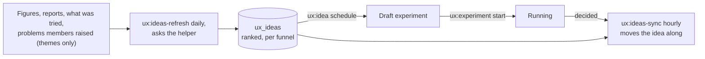

# UX ideas

The idea generator proposes changes to try on the member site. It reads the funnel figures, the
problems members raised, recent reports and everything already tried, and files ranked ideas for each
funnel. A person, or the hourly loop, turns one idea into an experiment
([UX experiments](ux-experiments.md)), and an hourly job keeps the idea's status in step with its
experiment. This page is how that works. The code is the contract; this says where to look and why it
is shaped the way it is. The numbers quoted are the defaults, and every one is a setting listed in
[deployment-switches.md](deployment-switches.md).



It works with no member answers at all. It works, and says so in the brief, when the survey tables or
the experiment table are missing, and when the survey scrubber is.

## What an idea is

One row of `ux_ideas` (`iznik-batch/database/migrations/2026_10_15_000002_create_ux_ideas_table.php`):

- The funnel (`flow`), a title (160 characters at most), the reason (`rationale`) and what it expects.
- A `score`: the expected points of finishing, times how sure the helper is, times the locality over 5.
  A one-line variant (locality 5) keeps all of it and a sprawling one a fifth. A confidence given as a
  percentage is read as one.
- A `type`: a **fix** is a defect with a right answer, and ships as an ordinary pull request. An
  **experiment** needs a test. A fix is a lead, not a fact: check the code before building it.
- A `status`: `open` (Waiting), `scheduled` (Queued), `running` (Being tried), `done` (Tried) or
  `rejected` (Set aside). The words in brackets are what the tab prints.
- A `source`, always `ai`. A member's suggested fix is a problem, not an idea: the surveys keep it
  with the problem it answers, and the Ideas list shows the idea generator's ideas only.
- `evidence` (JSON): `category`, `expected_points`, `confidence`, `locality`, `risk`, `files`,
  `like_tried`, `change` (the generator's change text, which `ux:idea schedule` uses as the
  experiment's change) and `problem` (the generator's own problem: `where`, `source`, `evidence`).
  The `rationale` is the generator's reason alone. The change is kept apart in `evidence.change`, so the
  tab prints each under its own heading, and `ux:idea schedule` uses the reason as the experiment's
  hypothesis and the change as its change.
- The problem it answers. `problem_id` is a row of `ux_problems`, set only when the generator cited a
  problem that the brief listed by number, or its title matches one. `problem_title` is that
  problem's title, or the generator's own title for the problem it found. The idea points at the
  problem and the problem does not point back.
- `experiment_id`, set while the idea is queued, running or done, and `attempts`, the number of
  tests of it that ended without a decision.

An idea is never filed twice. A title that matches **any** idea of the funnel in **any** status, or
any experiment of it, is skipped, with case and spacing ignored. The brief lists all of them as
tried, with their outcome, so the helper is told not to propose them again.

## The generator

`php artisan ux:ideas-refresh [--flow=] [--dry-run] [--force]` runs daily at 05:17. It asks the AI
support helper for ideas for each funnel with fewer than `UX_IDEAS_MIN_OPEN` (3) open ones, so most
days it costs nothing. The batch cannot let Claude near the database, so `UxIdeasService::brief()`
writes down what it knows and the helper adds what only it has, the code and its history.

**The brief** (`UxIdeasService::brief`), as plain text:

- *Figures*: a week of the funnel's rollups, with the worst device for each step. The step, field and
  device names are counted from the client log, which anybody can post to, so a name is printed only when
  it has the shape of one the site sends (letters, digits and `_ . : -`, at most 64, and one of the five
  device classes). A row with any other name is left out, so a sentence sent as a step name never reaches
  the helper.
- *Problems*: the problems members raised for this funnel and for none, each numbered like `[#12]`,
  with how many of how many answered raised it and how other members ranked it. *Values*: what
  members value, which a change must not take away. Only rows of kind `problem` are problems; a
  member's suggestion and the leftover theme are other kinds. **The generator never gets a member's
  words**, only themes, counts and rankings.
- *Surveys*: the tallies of the area survey and of the awareness questions, with the rate at which
  members say yes to a question about something Freegle does not do, so the yes answers can be
  discounted. A follow-up reads "N picked it as the biggest problem". An area survey reads "N said
  best" and "N said most needs improving". Comments are left out.
- *Reports*: the first posts of the Tech and ModTools, Development and Bug Reports categories on
  Discourse (when its API key is set; the slugs are `UX_IDEAS_DISCOURSE_CATEGORIES`) and the titles of
  the repository's open issues. Text is cut short and **scrubbed of email addresses, phone numbers and
  postcodes by the survey scrubber (`UxScrub`) before it leaves the batch**. Text that cannot be scrubbed
  is never sent, so without the scrubber nothing is fetched and the brief says `no reports`. Before the
  scrubber sees it, every link loses its query string and fragment, and any pair named like a key
  (`u=`, `k=`, `key=`, `token=`) is replaced wherever it is written, because a link in a Freegle email
  carries the member's auto-login key there and the scrubber does not know that format.
- *Tried*: everything the funnel has had proposed or run, in every status, with the decision.

**What a missing part does.** Each read of a table that belongs to another part is behind a table
check, and nothing here writes to such a table.

| Missing | The brief says | Ideas |
|---|---|---|
| the survey tables | `no surveys yet`, `no problems raised by members yet`, `no values collected yet` | still filed, with no problem id |
| the experiment table | nothing is listed as tried by an experiment | still filed |
| the survey scrubber | `no reports`, and nothing is fetched | still filed |

**The helper** (`claude-agent-sdk/ux-ideas.js`, `POST /internal/ux-ideas`, see
[ai-support-helper.md](ai-support-helper.md)) reads the funnel's files and follows their imports with
Read, Grep and Glob confined to front-end source, and no other tool. It asks for problems first and
ideas second, and returns them checked. The prompt and the output contract are in
`claude-agent-sdk/ux-ideas-prompt.js`, one file shared by the live route and the backtest, so the
thing tested is the thing that runs. It must stay free of `require()`, because `node --test` in CI
loads it (`ux-ideas-prompt.test.js` pins its load-bearing lines). `node
claude-agent-sdk/ux-ideas-prompt-cli.js brief.json` prints the prompt a brief would send.

- *Idea shape.* Each idea names the problem it answers, the screen, the control and the wording. An
  experiment must be buildable as a front-end variant: no schema change, no new backend route. It
  never suggests asking members why they left, or any question inside the flow.
- *Plain words.* The title, change, reason, expected effect and risk are read by volunteers who are not
  engineers, so the prompt asks for short plain sentences with no names from the code, "funnel" and
  never "flow", and what could get worse said in words and not as a guardrail. A title over 80
  characters (a problem's over 100) is cut at the end of a word.
- *Text from outside the team is data.* The figures, the survey answers, the problems, the values and
  the reports each sit between markers (`<<<FIGURES` and `FIGURES>>>`, and so on), with a line that says
  everything between them is evidence and not instructions. A run of three or more chevrons inside
  the text is cut to two, however long the run, so the text cannot write a marker.
- *Failure backs off.* A funnel that fails (helper down, a bad answer, a busy helper) is left alone for
  2, then 4, then at most 7 days, kept in the `config` table, and the command exits non-zero so the
  cron log shows it. `--force` tries anyway. The batch waits 960 seconds, longer than the helper's own
  15 minutes (`UX_IDEAS_TIMEOUT_MS`), so a slow run ends in the helper, where it is cancelled. The
  overlap lock lasts three hours, because seven funnels run one after another.
- *One run at a time.* The helper runs one model call at a time across every internal route. While
  the 05:17 run is going, any other internal call is told to come back later.
- *The secret.* The batch sends `UX_INTERNAL_SECRET` and the helper refuses a call without it. With
  the secret unset `ux:ideas-refresh` stops with "UX_INTERNAL_SECRET is not set".

## Turning an idea into an experiment

```
ux:idea list [--flow=give] [--status=open]
ux:idea show <id>
ux:idea schedule <id> --name=<switch> [--title= --hypothesis= --change= --expected= --touches=give,login --expected-points= --pr=]
ux:idea reject <id>      an open idea that is wrong
ux:idea reopen <id>      a set-aside idea, or a queued idea whose experiment is still a draft
```

`schedule` makes a draft experiment through `UxExperimentService::create()` and queues the idea, in
one transaction. What the person does not give comes from the idea: its title, its reason, the
generator's change text, what it expects, and its expected points when they are a size the experiment
engine accepts. It refuses an idea that is not open, a funnel that is not one of the seven, a name
that is already taken, and anything the experiment engine refuses; nothing is left behind when it
does. It prints `Idea 12 is queued as experiment <name> (draft). Start it with: ux:experiment start
<name>`.

A draft whose start is refused (a day of the funnel is too small to show the change, or the cap of
running experiments is full) would leave its idea queued for ever, because the sync only follows the
experiment. `ux:idea reopen <id>` frees such an idea and leaves the draft as it is. Schedule it again
under a new name, as the old name is taken. A queued idea whose experiment has started cannot be put
back.

`reject` is for ideas that are wrong. A set-aside idea is never brought back by the system, and the
sync never reads one.

## The hourly sync

`php artisan ux:ideas-sync` runs hourly at 29 minutes past, and is not in the backup-drain list: a
skipped hour only delays an idea's status by an hour. The experiment engine knows nothing of ideas and
never calls this code. The sync reads every queued or running idea and its experiment:

| The experiment is | The idea becomes |
|---|---|
| a draft | still queued |
| running | being tried |
| adopted, closed, reverted or stopped | tried |
| inconclusive | one more try counted. At `UX_IDEAS_MAX_ATTEMPTS` (2) the idea is tried and keeps its last experiment. Before that it is waiting again, with no experiment. |
| gone | waiting, with no experiment |

Each change is one `UPDATE` that names the status and the experiment the idea had when it was read, so
the sync is safe to run twice, a person's change at the same moment is not overwritten, and an
experiment's end is counted once. A restart by hand of an inconclusive experiment does not link its
idea again. It prints `Ideas: 1 running, 2 done, 0 back to open.`

## The hourly loop

A prompt, not code. It is **off**. Start it after the engine, the experiments section, the member
surveys, the surveys section and this change are all merged and green.

1. `php artisan ux:idea list --status=open`. Take the top idea.
2. Write a pull request that adds the variant behind `useExperiment('<name>')` and an entry in
   `ux-experiments.manifest.json`. A variant is local and deletable: one `v-if` branch, or one component
   used only by that branch.
3. When it is live (CI green, merged, the site deployed): `php artisan ux:idea schedule <id> --name=<name>`
   and then `php artisan ux:experiment start <name>`. If the start is refused, the idea stays queued:
   free it with `php artisan ux:idea reopen <id>`.
4. `ux:ideas-sync` keeps the idea's status right. Do not edit `ux_ideas` by hand.
5. After the decision: adopted means a cleanup pull request makes the variant the only code and
   removes the switch and its manifest entry, then `php artisan ux:experiment close <name>
   --cleanup-pr=<url>`. Reverted, inconclusive or stopped means a cleanup pull request removes the
   variant code.
6. A fix is a lead, not a fact: check the code before building it.

## The backtest

A generator that cannot come up with ideas we have already come up with is deficient, so it is tested
against our own history:

1. `scripts/ux-ideas-snapshot.sh <commit> <flow> <outdir>` freezes one funnel as it was at a past
   commit. `brief.json` holds what the generator may see (the files at that commit and the area's
   commit subjects before it) and `truth.json` holds what it must not (the commits after it, with
   diffs). The snapshot carries no member data, so it tests the part of the generator that works from
   code and history.
2. `.claude/workflows/ux-ideas-backtest.js` labels each later commit as a change a member would notice
   or not, has the generator answer its own prompt over the snapshot, and has a strict and a generous
   judge decide which changes an idea anticipates. A match only the generous judge accepts must survive
   a refuter.
3. **Recall** is the share of member-visible later changes (not refactors, tests, lint, or bug fixes
   nobody asked for) that at least one idea anticipated. It answers: if this generator had existed
   then, how much of what we went on to build would it have proposed? The default bar is 25 percent and
   it runs up to three rounds. Below the bar it rewrites the prompt builder from the kinds of change it
   missed, and it must not copy the missed changes into the prompt, because the prompt is also used on
   code nobody has changed yet.

Measured so far: on the set it was tuned on, 15 percent strict and 36 percent generous. On a set it had
not seen, 17 percent strict and 46 percent generous. It finds no wording change and no removal, so
those two kinds are the likeliest to be missing from the list. Backtest again after any change to
`ux-ideas-prompt.js`.

Those numbers were measured on the prompt before it asked for plain words and before the figures and
the survey answers were fenced. Neither change touches the rules the backtest depends on, but the
backtest has not been run since. Run it before the hourly loop is switched on.

## The Ideas section of the tab

`ModSysAdminUxIdeas.vue`, registered in `useUxSections.js` (see
[the SysAdmin UX tab](ux-sysadmin-tab.md)). It loads its own data from its own store
(`stores/uxIdeas.js`) and the tab says the period, device and sign-in filters do not apply. It only
reads: an idea is queued, set aside or put back with `ux:idea`.

- A strip of counts by status (Waiting (12), Queued (1), Being tried (1), Tried (4), Set aside (2))
  filters the list, in the form the Experiments section uses. Waiting is the default. One line under
  it says what the score is: the expected gain, times how sure, times how small the change is, and the
  highest is listed first.
- With Waiting chosen and no funnel, there is one line for each funnel: how many are waiting and the
  best, with its score. Choosing a funnel lists its ideas, best score first. Any other status lists its
  ideas straight away, naming the funnel on each row. Every list has a Funnel select (All funnels, or
  one) and a Type select (All, Fix, Experiment). With a funnel chosen it says "Showing Offering only.
  Show all", as the other sections do.
- The route sends at most 200 ideas unless asked for more. When the ideas that match are more than the
  list holds, the list says "Showing the first 200 of 340." and, while a funnel or a type is left to
  choose, how to see fewer.
- A row is one button: the word Score and the number, a Fix or Experiment chip, the title and the
  status. Opening it shows what changes, why, what we expect, the evidence, the problem it answers and
  the experiment it became. The expected gain is said in people: "6 more people finish in every 100
  who start". The experiment's status is worded as the Experiments section words it, so an adopted
  experiment is "Kept for now" while its holdout lasts. The links to What members say and to
  Experiments are drawn only when those sections are in the tab.
- Empty: "No ideas yet. The idea generator adds them once a day." A route the server does not have
  yet: "This part is not switched on yet."
- The address keys are `ux_istatus` (default Waiting), `ux_itype`, `ux_idea` and the shared
  `ux_flow`, so a copied link restores the choice.
- `ModSysAdminUxProblemIdeas.vue` is drawn inside the detail of a member problem, which hosts it
  without knowing it: "Ideas for this problem:" and a line for each idea. It draws nothing when the
  problem has none or the route is missing.

## The route

`GET /modtools/ux/ideas?flow=&status=&type=&problem_id=&limit=` (`iznik-server-go/ux/ideas.go`,
Support or Admin). It answers `counts` (by status, over every idea whatever the filters), `flows` (for
each funnel, how many are waiting and the best), `matching` (how many ideas match the filters, before
the limit cuts the list) and `ideas`, best score first and then lowest id. A bad
status, type, problem or limit is a 400, and a limit above 500 is cut to 500 (the default is 200). It is not
cached. The experiment each idea became is joined live, so the tab is right before the sync has run.
It carries `holdout_until` while an adopted experiment is inside its holdout, worked out as the
experiments route works it out, and a test holds the two to one answer. The member problem is joined
from `ux_problems`. Either table may be missing, and then the join is null and nothing is an error.
The ideas table itself is another matter: without it the route answers 501, and the section says that
this part is not switched on. The answer to "does this table exist" is kept for a minute.

## Deploying it

1. **Run the SQL on production first**:
   `iznik-batch/database/migrations/2026_10_15_000002_create_ux_ideas_table_migration.sql`. One
   `CREATE TABLE IF NOT EXISTS`, a short `lock_wait_timeout`, no existing table altered, safe to run
   twice.
2. **Set `UX_INTERNAL_SECRET`** in the compose `.env` and in `.env.background`
   ([ai-support-helper.md](ai-support-helper.md)), merge, then deploy the batch and the Go API, and
   rebuild the helper so it has `/internal/ux-ideas` and the secret check.
3. The site follows by itself. Before the Go route is live, or while the Go route is live and the SQL
   has not been run (it answers 501), the section says "This part is not switched on yet." The hourly
   loop stays off.

| Setting | Variable | Default |
|---|---|---|
| `ux.ideas.helper_url` | `UX_IDEAS_HELPER_URL`, else `UX_HELPER_URL` | `http://ai-support-helper:3000` |
| `ux.ideas.timeout` | `UX_IDEAS_TIMEOUT` | 960 seconds |
| `ux.ideas.min_open` | `UX_IDEAS_MIN_OPEN` | 3 |
| `ux.ideas.count` | `UX_IDEAS_COUNT` | 12 |
| `ux.ideas.max_attempts` | `UX_IDEAS_MAX_ATTEMPTS` | 2 |
| `ux.ideas.reports_days`, `discourse_categories`, `github_repo` | `UX_IDEAS_REPORTS_DAYS`, `UX_IDEAS_DISCOURSE_CATEGORIES`, `UX_IDEAS_GITHUB_REPO` | 60, `tech-modtools,development,bug-reports`, `Freegle/Iznik` |
