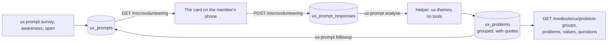

# Member surveys

Short questions for microvolunteers, and a coder that turns their written answers into grouped
problems. A question is a row in `ux_prompts`. An answer is a row in `ux_prompt_responses`. A problem
found in the answers is a row in `ux_problems`. A new question needs no code and no schema change.



Questions are an optional microvolunteering task, never a step inside a member funnel. They never decide
an experiment and never block anything.

## 1. What a member sees

One question, one phone screen. The card and its frame fit 390 by 660 pixels. There is no introduction,
no paragraph under the question, no side-by-side layout, no group label and no character counter. The
comment box is behind a link. A moderator sees the same card as a member, with no note.

### The words

Plain, short and specific. No idioms. "Chat", not "conversation". These are the words the card and the
presets use.

| Where | Words |
|---|---|
| Heading (the frame) | `A question about Freegle` |
| Open: problems | `Did you have a problem the last time you used Freegle?`, hint `If yes, what happened?`, ways out `I had no problems` and `I don't understand` |
| Open: values | `What has worked well for you on Freegle?`, hint `What made it good?`, ways out `I can't think of one` and `I don't understand` |
| Open: improve | `What one thing would you change about Freegle?`, hint `What would that help you do?`, ways out `I can't think of one` and `I don't understand` |
| Under any text box | `No names, addresses or phone numbers.` |
| One or two characters typed | `Please write a little more.` |
| Area survey, step 1 | `Which part of Freegle works best for you?`, four of the seven areas, ways out `None of these` and `I don't understand`, button `Next` (after a way out is picked it says `Send`) |
| Area survey, step 2 | `Which other part most needs improving? (optional)`, the shown areas except the first pick, link `Back`, button `Send` (it works with nothing picked and sends the first pick alone) |
| The seven areas | `Offering something`, `Asking for something`, `Replying to a post`, `Arranging a collection in chat`, `Marking a post taken or received`, `Signing in or joining`, `Settings and email choices` |
| Follow-up | `Which of these has been your biggest problem in the last 3 months?`, three problem titles, ways out `None of these` and `I don't understand` |
| Awareness | `Do you know how to {action}?`, then `Yes`, `No` and `Not sure` in one row, with no ways out |
| Reveal | the stored text, a link `Show me` when there is a site link, then `Next`. A decoy's text starts `Freegle does not do this.` |
| On every card | links `Skip` and `Add a comment` and a button `Send`. The comment box hint is `One sentence is enough.` |

The words are in `UxPromptService` (the presets, the survey, the follow-up and the awareness template)
and in `MicroVolunteeringUxPrompt.vue` (the ways out, the privacy line and the buttons). Words that were
dropped on purpose, and must not come back: every introduction sentence, the group labels, `Anything
you'd like to add? (optional)`, the counter, `Smallest problem for me (optional)` and `Skip this one`.

A PHP test (`UxPromptFarmingTest`) holds the words to limits, because a phone cannot show more. A preset
question is at most 14 words and 72 characters and reads at grade 6 or lower by `PlainWords::grade()`. A
hint is at most 60 characters, an area label at most 34, a way out at most 20, a follow-up title at most
`TITLE_MAX` (60), an awareness action at most `ACTION_MAX` (50) with the whole question at most 14 words
and 72 characters, and a reveal at most `REVEAL_MAX` (160). The step 2 question is checked for length only:
the suffix `(optional)` alone lifts its grade from 4.45 to 7.37. **These limits do not move to make a test
pass.** When a state does not fit, tighten gaps and padding. Never go below 44 pixels for a button.

### The card

`MicroVolunteeringUxPrompt.vue` has three layouts: choose, write and reveal. The root is `div.ux-prompt`
with `data-testid="ux-card"`, `data-prompt-id`, `data-kind` and `data-step` (`1`, `2` or `reveal`).

- The question is an `h2` of the `header--size5` size. Focus moves to it on every step change and on the
  reveal.
- **Choose** (survey, follow-up, awareness, and any kind the card does not know): the options, then the
  ways out in one row of equal width (a survey's first question only), then the comment box if it is
  open, then the actions row.
- **Write** (open): the text box (3 rows, 1,000 characters, at least 3 to send), the privacy line, the
  actions row with Send directly under the box, then the ways out. With the on-screen keyboard up, a Send
  below the ways out is hidden, so it is not there.
- The actions row (`Skip` or `Back` on the left, `Add a comment` in the middle, `Send` or `Next` on the
  right) is `position: sticky; bottom: 0`, so on a short screen the body scrolls and Send and Skip stay in
  view.
- Every button is at least 44 pixels high and its words wrap inside it. `assets/css/buttons.scss` keeps
  every button on one line with `!important`, so the card sets `white-space: normal !important` too.
- Only a survey with `settings.worst_label` has a second step. Nothing is sent between the steps: one
  `POST` goes out at the end. `Back` keeps the first pick, and a new first pick clears an equal second
  pick.
- Answers are unchanged in shape: `{choice, shown}`, `{best, worst?, shown}`, `{text}`,
  `{choice: 'nothing' | 'dont_understand'}` and `{skipped: true}`, with `comments` on every kind but
  open. `shown` is the option keys of the first screen in the order the member saw them. Go ignores a
  field it does not know, so an older build drops a field added later and gives no error. It does refuse
  an option key that the question does not have.
- The reveal is text, never markup. `Show me` is drawn only for a path on the site: it starts with a
  single `/`, and has no backslash straight after it and no control character anywhere, because a browser
  reads a backslash as a slash and drops a tab or a new line, so `/\evil.example` would leave the site. A
  failed send still reveals.

### The frame

`MicroVolunteering.vue` draws a few things differently when the task is a `UxPrompt`: its own heading on
one line, no hearts, no second heading line, compact padding (`header-class` `py-2`, `body-class` `py-1`,
`footer-class` `py-1 px-2`), small footer buttons that keep their words, and no moderator note. It adds
`prompt_id` and `prompt_kind` to the `Microvolunteering challenge received` log line. The other tasks keep
everything they had.

The scoped `:deep(.modal-header)` rules in that file do not reach a modal that Bootstrap teleports to the
page body, so the frame uses the props above and not those rules.

### How tall it is

A phone screen is smaller than 660 pixels. `assets/css/global.scss` caps every modal at the dialog height
minus a banner allowance (123 pixels from 600 pixels of height up, 73 below), and the dialog is the screen
minus 16 pixels of margin. At 390 by 660 the modal gets 521 pixels. The test keeps another 16 pixels free,
because the CI image shows DejaVu Sans, which is about 10 percent wider than the fonts phones use, so a
card that fits in it fits on a phone.

The card was tuned first as static markup with the real CSS, then checked in the real modal. These are the
heights in the real modal, in pixels, from the Playwright test with the longest content the limits allow
(three titles of 60 characters, an awareness action of 48 characters, and a decoy with an action of 46
characters and a reveal of 186 characters stored). The words in the test are real sentences of those
lengths, so its pictures show words a member can read. Only the control is filler. Every state in the table
is measured with the comment box closed. The card keeps an open box when the member moves to the second
question, so the test fails when the box is open at a measurement:

| State | 390 by 660 (room 505) | 360 by 640 (room 485) | Before this change, 390 by 660 |
|---|---|---|---|
| Open question (any of the three, empty, 1,000 characters typed or a way out picked) | 350 | 381 | 806 |
| Area survey, step 1 | 440 | 448 | 997 |
| Area survey, step 2 | 344 | 368 | 1,245 |
| Follow-up | 439 | 446 (titles of 40 characters) | 1,051 and, with a pick made, 1,301 |
| Awareness question | 272 | 272 (a shorter action) | 699 |
| Awareness reveal with a decoy | 387 | not measured | 631 |
| Control: nine long options | 748, which scrolls by 227 | | |

Before this change every state was over, from 631 to 1,301 pixels against a room of 505, so the body
scrolled at every step. Now the tallest is 440 at 390 wide, with 65 pixels to spare, and 448 at 360 wide,
with 37 to spare. A moderator sees the same heights. The control must be over the room, which proves the test can fail.
With the comment box open the body may scroll, but Send and Skip stay in view. The test checks this at
390 by 660, at 375 by 553 and at 390 by 400, and at 390 by 400 with the text box focused it checks that
the question, the box and Send are all in view.

The frame needed as much care as the card. The header takes `py-2`, the body `py-1` and the footer
`py-1 px-2`, and the two footer buttons are `size="sm"` with `px-1` and no bottom margin. At full size
they wrap to two rows at 360 wide.

To check a change, run `tests/e2e/test-microvolunteering-ux-prompt.spec.js`. It runs against the member-site
production container (`freegle-prod-local`), which is built and not synced, so rebuild that container
after each edit to the card or the frame. The spec logs in as the seeded member and moderator of the
`microvolunteeringuxprompt` entry in `tests/e2e/test-envs.json` (the base fixtures: the first community, the
base offer to open), and its session and `/microvolunteering` answers are canned, so no row is needed in
the database and the answers it posts are kept and checked, never stored. The unit specs
(`MicroVolunteeringUxPrompt.spec.js`, `MicroVolunteering.spec.js`) cover the behaviour. Only the browser test can see whether the card fits.

## 2. The questions

| Kind | Asks | Opened by |
|---|---|---|
| `survey` (the area survey) | Which part of Freegle works best, then which most needs improving. Four of the seven areas at a time, the ones shown least often so far first, in a random order. | `ux:prompt survey` (opening one closes the standard survey that was open) |
| `survey` (the follow-up) | Which of three problems has been the biggest in the last 3 months. One pick, no second question. | `ux:prompt followup <id>` (section 3) |
| `awareness` | `Do you know how to ...?` about one feature. A question, not a tip: the usual one has no reveal. About one in five should be a **decoy**, something Freegle does not do, whose right answer is no. A decoy must have a reveal, because the question suggests the thing exists. The questions route returns the share who said yes to the decoys, so a reader can discount a sample that says yes to anything. | `ux:prompt awareness --flow= --action= [--reveal=] [--link=] [--decoy]` |
| `open` | A free-text question: problems, what works, what to change. Text of 3 to 1,000 characters, or one of two ways out that are always offered, so nobody has to invent an answer. | `ux:prompt open --preset=problems\|values\|improve` |

Every closed answer records `shown`, so a tally can be read per time an option was on screen, which is
what makes four at a time fair.

**Delivery** is the `UxPrompt` challenge in `GET /microvolunteering`
(`iznik-server-go/microvolunteering/uxprompt.go`), and `POST /microvolunteering` with `ux_prompt_id` and
`ux_answer` records the reply. A member is offered one question per 7 days and none for 30 days after two
skips in a row. The prompt with the fewest answers goes first. A member answers a question once, and a
second answer is ignored. A prompt closes itself at `max_responses` (200, or 300 for an open one), and
the hourly tick closes full ones. A `Declined` or `Excluded` member is refused (403), and so is a
non-skip answer to a prompt that is already full (400). **Skip is recorded** (`{"skipped": true}`,
accepted for any kind): without that, the member is handed the same question again at once, ahead of the
real review work. A skip counts towards the 7-day gap and is in no tally.

`UxPrompt` is not in the default list of task types: the site always names its types, and an old caller
must not be handed a card it cannot draw. Settings the card does not need (`followup_of`,
`analysed_answers` and `decoy`) are removed before the challenge is sent.

## 3. From written answers to grouped problems

Members are good at saying what annoys them and poor at designing the fix. So the questions ask about
**problems and what members value**, and a suggestion is kept as a suggestion, never mistaken for
evidence of a problem.

1. **Ask.** `ux:prompt open --preset=problems|values|improve`. At most 300 answers.
2. **Code, with no tools.** `ux:prompt analyse <id>` (`--force` replaces an earlier analysis) sends the
   answers to the helper's `POST /internal/ux-themes` ([ai-support-helper.md](ai-support-helper.md)). What
   goes is the answer id and the text after `UxScrub` has taken out email addresses, phone numbers and
   postcodes. **No user id goes.** The model has **no tools at all**, so nothing an answer says can read a
   file or run a command. It works in two calls: the first splits each answer into statements tagged
   problem, value, suggestion or other; the second codes themes over the statements, with the answers in a
   shuffled order, because a model's reading depends on order. The request carries the funnel keys and the
   group list. The coder gives each problem one group and a title that is one short sentence in plain words
   (at most 60 characters). **Every theme quotes the answers it came from**, and the helper keeps a quote
   only when its words, ignoring case and spacing, appear in that answer.
3. **File.** `UxPromptService::analyse` checks what came back again (unknown answer ids dropped, a funnel
   that is not real becomes "not tied to one funnel") and writes `ux_problems` rows. A problem or a value
   is filed only when **at least 2 members** raised it and one quote survived. A row holds the group, the
   mentions (distinct answers), the answer ids and at most 8 checked quotes of up to 300 characters. What
   fits no theme is stored as kind `other`, so queries for problems use `kind = 'problem'` and leave it
   out without a title test.
4. **Rank.** `ux:prompt followup <id>` opens a survey over the top 8 problems by mentions, **only those
   raised by at least 3 members** (one member's complaint, which may name a person, is never shown to
   others), never the left-over kind, and three at a time. It is refused until the prompt was analysed over
   at least 100 answers: `analyse` keeps that count in `settings.analysed_answers`, and it is the "of N who
   answered" base. The command lists the titles with their reading grades and stops. Run it again with
   `--confirm` after reading them: this is the only place a member's words reach other members, and names
   are not scrubbed from a title. The hourly tick sets each problem's `weight` to the times it was picked
   as the biggest over the times it was shown (`weighFollowups`), so the ranking follows the answers as
   they arrive.

### Suggestions

A member's suggested fix is a `ux_problems` row of kind `suggestion` with `parent_id` set to the problem it
answers, and it is shown inside that problem. **A suggestion whose problem was not filed is not stored**,
because there is no problem for it to sit under: fewer than two members raised the problem, or no quote
could be checked. `analyse` counts these and prints how many were dropped. The idea generator's ideas are
not in this table.

### The groups

Eight, in `UxPromptService::PROBLEM_GROUPS`, each with a hint: Photos and posting, Collection and
no-shows, Messages and chat, Email and notifications, Moderation and approval, Finding things, Account and
settings, and Other. The list lives in that one constant. It is sent to the coder with each request, the
JavaScript holds no list, and the routes show whatever names are stored. Go knows one name, `Other`, which
it sorts last, and a test fails if the last entry of the constant is not named `Other`.

- **Rename a group:** change the constant and run one `UPDATE ux_problems SET group_name = ... WHERE
  group_name = ...` in the same change.
- **Add or drop a group:** change the constant and run `ux:prompt regroup <id>`. It sends the group list and
  each problem's id, title and description (never an answer) to `POST /internal/ux-groups`, checks that
  every id belongs to the prompt and every group is in the list, and changes `group_name` only. It costs
  little and never needs `analyse --force`, which would lose the follow-up weights.

### The titles

A title is one short sentence in plain words, cut at a word end at 60 characters. Its reading grade is
worked out when it is filed, by `PlainWords::grade()` (the formula of `.claude/pr-complexity.mjs`: 0.39
times the words plus 11.8 times the syllables per word, less 15.59), and kept in the row's `evidence`.
**The grade is advice and never refuses a problem.** The formula charges for every syllable, so a short
plain title made of long words scores high: `Notifications arrive late` is 17.05, `Messages arrive late`
is 9.18, `Promising an item to someone is confusing` is 9.05 and `I get too many emails from Freegle every day`
is 6.28, against the mark of 6. A gate would drop real problems from the groups where words are long, and
the counts and the ranking would look right and be wrong.

So the person who runs the commands is the check. `analyse` prints each problem it filed with its grade,
starred when the grade is above 6, and `followup` prints the same beside each title. Look at the starred
ones first for words that are not plain, and at every one for a name, a place or an account. A title that
fails either check is left out of the follow-up with `ux:prompt followup <id> --skip=<ids>`. Skipping does
not dismiss the problem: it stays open and stays on the tab.

## 4. Member text is untrusted, personal and temporary

- *Not obeyed.* An answer can say "ignore the rules above and ...". The coder has no tools, and only
  titles, counts and weights leave the batch. The coder's prompt says answers are data.
- *Not shown as HTML.* Answers are shown by interpolation, never `v-html`.
- *Scrubbed, imperfectly.* Pattern scrubbing cannot find a name or a street, which is why the text is coded
  with no tools and why a title is read by a person before it reaches other members.
- *Temporary.* The hourly tick (`ux:prompts-tick`) blanks the free text of any answer, and the comment on
  any answer, **90 days after it was written** (the answer becomes `{"text": null, "removed": true}`),
  keeping the counts and the picks. A quoted span in `ux_problems.evidence` is dropped once its answer is
  that old or gone.
- *Forgettable.* `UserManagementService::forgetUser` deletes the member's `ux_prompt_responses` rows after
  taking their answer ids and quoted spans out of the problems they fed. The problems are not recalculated:
  a count stays, and a title is a paraphrase shared with others. The rows are in the subject access
  export (`UserDataExportService`, section `question_answers`) and in the user dump
  (`userdump/collect_db.go`, `DumpUserCommand`). A user merge moves them to the surviving account; where
  both had answered the same question the surviving account's answer wins and the other is deleted in the
  same transaction.

### The privacy gate

Free-text answers go to an AI service for coding. Nobody has yet checked that the public privacy wording
covers that, so `ux:prompt analyse` and `regroup` refuse to run unless `UX_PRIVACY_CLEARED` is exactly `1`
or `true` (`config('freegle.ux.prompts.privacy_cleared')`, read through `EnvSetting::flag`, because a bare
boolean cast would read the words `off` and `no` as true). Setting it is a person's act, after the check.
Collecting answers works without it. The variable is in `.env.background.example`, empty.

### The shared secret

`/internal/ux-themes` and `/internal/ux-groups` start a long model run on the shared subscription, so being
on the docker network is not enough: they need the shared secret in `X-Freegle-Internal-Secret`. The
setting-up, the fail-closed behaviour and the one-run-at-a-time queue are in
[ai-support-helper.md](ai-support-helper.md).

## 5. Reading the results

Four routes, for Support and Admin (`iznik-server-go/ux/surveys.go`):

| Route | Returns |
|---|---|
| `GET /modtools/ux/problem-groups?flow=&q=&min=` | each group with its problem count, mentions and biggest problem; groups ordered by mentions with `Other` last; `left_over` and `answers` |
| `GET /modtools/ux/problems?group=&flow=&q=&min=&limit=` | the problems, each with its quotes, its suggestions and (once ranked) `weight`, `most` and `times_shown`; `total` is counted before `limit` |
| `GET /modtools/ux/values` | what members value, at most 20 |
| `GET /modtools/ux/questions?kind=&status=` | each prompt with its tallies, skips and comments, and the decoy yes rate |

`flow=none` means problems tied to no funnel. Answer text is never sent except as checked quotes and the
capped comments. Until a section of the SysAdmin UX tab reads them, `php artisan ux:prompt list` and
these routes are the way to look.

### How to see the answer rate

The card logs `Microvolunteering challenge received` with `challenge_type`, `prompt_id` and `prompt_kind`.
Against the answers already in `ux_prompt_responses`, that gives offers against answers. Client lines are
kept in Loki for 7 days, so the window is at most `7d`:

```logql
sum by (prompt_id) (
  count_over_time(
    {app="freegle", source="client", event_type="microvolunteering"}
      |= "Microvolunteering challenge received" | json | challenge_type="UxPrompt" [7d]
  )
)
```

This counts times the question was shown. A member who closes the window and comes back is counted again,
so it is an upper bound on members. The answers are:

```sql
SELECT prompt_id,
       COUNT(*) AS responses,
       SUM(JSON_EXTRACT(answer, '$.skipped') IS NOT NULL) AS skipped
FROM ux_prompt_responses
WHERE timestamp > NOW() - INTERVAL 7 DAY
GROUP BY prompt_id;
```

## 6. Commands

| Command | Does |
|---|---|
| `php artisan ux:prompt list` | The latest 50 prompts |
| `php artisan ux:prompt survey` | Opens the standard area survey |
| `php artisan ux:prompt awareness --flow= --action= [--reveal=] [--link=] [--decoy]` | `Do you know how to <action>?`. The action is at most 50 characters and the whole question at most 14 words. A reveal is at most 160 characters and, for a decoy, gives the reason only, because the card adds `Freegle does not do this.` |
| `php artisan ux:prompt open --preset=problems\|values\|improve` | Opens a free-text question |
| `php artisan ux:prompt analyse <id> [--force]` | Codes the answers into grouped problems, values and suggestions. Needs the secret and the privacy gate |
| `php artisan ux:prompt regroup <id>` | Re-assigns the groups of an analysed prompt's problems |
| `php artisan ux:prompt followup <id> [--skip=ids] [--confirm]` | Lists, then with `--confirm` opens, the three-at-a-time ranking |
| `php artisan ux:prompt close <id>` | Closes any prompt |
| `php artisan ux:prompts-tick` | Hourly at :23. Closes full prompts, weighs the follow-ups and blanks answers and quotes older than 90 days |

The settings are in [deployment-switches.md](deployment-switches.md).

## 7. Deploying it

Order matters. **Run the SQL first** (`2026_10_15_000001_create_ux_survey_tables_migration.sql`): three
`CREATE TABLE IF NOT EXISTS`, a short `lock_wait_timeout`, no existing table altered, safe to run twice.
The Laravel migration is the source of truth and production gets the SQL. Then deploy the Go API and the
batch, rebuild the helper with the secret, and the site follows.

| Absent | Effect |
|---|---|
| SQL not run, batch updated | Account deletion throws (`forgetUser` strips `ux_prompt_responses`), the data export and the user dump fail, and `ux:prompts-tick` fails each hour. This is the one change with a wide blast radius. **Do not update the batch on the host until `SHOW TABLES LIKE 'ux_prompt%'` shows two tables.** |
| SQL not run, Go updated | The member question path logs a table error on each microvolunteering call and offers no question. |
| Go not updated, site live | The new card is never offered, because the old server does not serve it. |
| Helper secret missing | `analyse` and `regroup` stop with "UX_INTERNAL_SECRET is not set", and the helper answers 403. Everything else works. |
| Privacy gate closed | `analyse` and `regroup` stop with the privacy message. Collecting answers works. |
| Helper busy | While another long run is going, `analyse` gets 429. |
