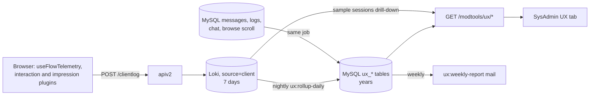

# UX telemetry

How we find where members get stuck, go back, change their minds, give up, or never find a
feature. The rationale and the alternatives considered are in
`plans/2026-10-11-ux-pain-point-instrumentation.md`; this page is the contract the code is held to.

## 1. Fields on every client log line

`useClientLog.js` `queueLog` adds these to every entry, so no line needs a join to `session_start`:

| Field | Values |
|---|---|
| `device_class` | `app-ios`, `app-android`, `mobile` (width < 768), `tablet` (768 to 1199), `desktop` |
| `logged_in` | `true` / `false` |
| `is_app` | `true` / `false` |
| `page_route` | The Vue route **name** (`give-mobile-photos`, `message-id`), never the URL. Bounded, so it can be grouped by. |

`page_view` also carries `page_id` and the modal context, like interaction events do.

Every **flow** event also carries two fields frozen when its flow started, `start_logged_in` (whether
the member was signed in then) and `started_ms` (when, in epoch milliseconds). `logged_in` itself is
read at send time, so it changes mid-flow when a member signs in as part of Give, Ask or Reply, and
is wrong for grouping the start and the completion of one flow. The experiment read groups by
`start_logged_in` and cuts by `started_ms` ([The hourly tick](ux-experiments.md#the-hourly-tick)).

## 2. Flow events

Emitted only through `composables/useFlowTelemetry.js`, which owns the names as exported
constants (`FlowName`, `FlowEvent`). Each is a `/clientlog` entry with **`event_type="flow"`**
(a Loki label, so the rollup selects them cheaply) and `action_name` set to the event.

**Envelope**, added by the composable:

| Field | Meaning |
|---|---|
| `flow` | One of `FlowName`: `give`, `ask`, `reply`, `login`, `chat_promise`, `chat_outcome`, `settings` |
| `flow_instance_id` | uuid, new on each `flow_start` |
| `step` | Route name for routed flows, pane or state name otherwise |
| `step_seq` | 1, 2, 3 within the instance: the number of `step_enter`s so far, so `flow_start` carries 0 |
| `first_visit` | On `step_enter`: true the first time this instance enters this step |
| `dwell_ms` | On `step_complete`, `step_back`, `flow_abandon`: ms since the matching `step_enter`. On `flow_complete`: ms since `flow_start` |
| `variant` | The member's experiment arms as `name:arm` joined by `,`, sorted; `''` when none. Frozen at `flow_start`: every event of an instance carries the same value, even if logging in at the end changes the id the arm is computed from |
| `entry` | On `flow_start` only |
| `start_logged_in` | `true` / `false`: whether the member was signed in when the flow started. Frozen at `flow_start`, so every event of an instance carries the same value, unlike `logged_in`, which is read at send time. The experiment read groups by it |
| `started_ms` | When the flow started, in epoch milliseconds. Frozen at `flow_start`. The experiment read counts only flows that started at least `settle_minutes` before the end of its window, and cuts on this |

**Events** (`FlowEvent`):

| Event | Extra fields |
|---|---|
| `flow_start` | `entry` |
| `step_enter` | `first_visit` |
| `step_complete` | `dwell_ms` |
| `step_back` | `dwell_ms`, `to_step` |
| `field_revisit` | `field`, `change_kind` (`replaced`, `cleared`, `toggled`, `removed`). For give and ask, only a change to the same draft counts: the submit emptying the draft, or another draft replacing it, sends nothing |
| `validation_failed` | `field`, `rule`, `attempt` |
| `choice_switched` | `field`, `from`, `to` (only for enumerated choices, never free text) |
| `flow_submit` | `attempt` |
| `flow_submit_result` | `ok`, `status`, `error_code` |
| `flow_complete` | `dwell_ms`. A step still open when the flow completes (the one it submitted from) gets its `step_complete` first |
| `flow_abandon` | `reason` (`navigated`, `closed`, `hidden`, `idle`), `last_step`, `dwell_ms` |
| `flow_resume` | `age_ms`; `reason=idle` when it brings back an instance the idle timer ended |
| `help_sought` | (the live `flow` and `step` are in the envelope) |

**Never** a field value typed by a member: names, kinds, rules and counts only. The vitest suite
for the composable asserts this. The field helpers take no value arguments, and a field, rule,
step, entry or choice that is not a plain token (letters, digits and `_:.-`, up to 40) is sent as
`other` instead of being dropped.

An instance ends at `flow_complete` or `flow_abandon`; at most one of them is sent per instance,
except that an `idle` abandon can be followed by a `flow_resume` with `reason=idle` if the member
carries on, and the instance then continues to its own end. The rollup takes those abandons back
off, and counts only the other resumes (restored drafts) as `resumed`.
A hidden tab alone is not an abandon (the camera, photo picker or an app switch hides it and the
member returns); it only flushes the log. `flow_abandon` with `reason=hidden` is sent on a `pagehide`
that is not persisted into the back/forward cache, `idle` after 30 minutes with
no flow event, `navigated` when the route leaves the flow's routes, `closed` when a modal flow is
dismissed.

### Routed flows: steps from the router

For `give` and `ask` the pages call nothing. `composables/useFlowRoutes.js` holds a route-name to
rank map and `plugins/flowTelemetry.client.js` feeds it every navigation:

| Flow | Routes by rank |
|---|---|
| give | 1 `give`, `give-mobile`, `give-mobile-photos`, `give-clearance`; 2 `give-whereami`, `give-mobile-details`; 3 `give-options`, `give-mobile-options`; 4 `give-whoami`, `give-mobile-whereami` |
| ask | 1 `ask`, `ask-mobile`, `ask-mobile-photos`; 2 `ask-whereami`, `ask-mobile-details`; 3 `ask-whoami`, `ask-mobile-whereami` |

A move to a higher rank sends `step_complete` then `step_enter`; to a lower rank `step_back` then
`step_enter` (so `first_visit` is false); to an equal rank (a redirect between the desktop and
mobile page of the same step) only `step_enter`. Entering the first route starts the instance, with
`entry` taken from the last clicked component (`navbar`, `post_button`, `give_ask_buttons`,
`myposts`, `notification`), else `home`, `post_page`, `from_<route>` or `deep_link`; a saved draft
with content older than five seconds starts it as `draft_restored` and sends `flow_resume`.

Leaving the flow's routes ends the instance: `flow_complete` if a `flow_submit_result` with
`ok=true` was sent, otherwise `flow_abandon` with `reason=navigated`. Going from one flow to the
other also sends a `choice_switched` on `type` (`Offer`, `Wanted`). `flow_submit` and
`flow_submit_result` come from `stores/compose.js`, with a short `error_code`, never message text.

### Flows driven by their own component

| Flow | Where | Steps |
|---|---|---|
| `reply` | `useReplyStateMachine.js` `transitionTo` | the machine states; `entry` is the reply source, or `restored` |
| `login` | `LoginModal.vue` via `useLoginTelemetry.js` | `signup`, `signin`, `forgot`; `entry` is `forced` or `navbar` |
| `chat_promise` | `PromiseModal.vue` | `choose`; `entry` is `chat` or `maybe` |
| `chat_outcome` | `OutcomeModal.vue` | `choose`; `entry` is the outcome type |
| `settings` | `pages/settings` via `useSettingsTelemetry.js` | `settings`; the instance starts at the first save in a visit, so a visit that only looks sends nothing. It completes when the page is left after a save that worked, and abandons if every save failed. A setting saved a second time in the visit is a `field_revisit` |

API calls made while an instance is live carry the header `X-Freegle-Flow-Instance`, so the
`source="api"` line for the message create can be joined to the instance.

## 3. Interaction and impression fields

Flow, interaction and impressions lines carry `url` as origin and path only: the query string and hash are dropped, because they can hold an auto-login key (`?u=&k=`) or search terms. `interactive` is true when the click landed in or on anything matching the control selector (button, link, form field, label, `[role=button]`, `[tabindex]`, `.btn`, `[data-bs-toggle]`), or else within an element styled `cursor: pointer`. A Vue `@click` on a div leaves nothing for the selector to find, and the pointer cursor is what tells the member it can be clicked; the control reported is the outermost element of that run of pointer-cursor ancestors.

`plugins/interactionCapture.client.js` sends `label` as its own field (as well as in the message),
and on clicks:

| Field | True when |
|---|---|
| `rage` | This click is the third on the same element within 1 second; set once per burst, not on the clicks that follow it |
| `repeat_no_api` | The same labelled element was clicked 2 to 30 seconds ago and no API request started in the 1.5 seconds after that earlier click (background polling later does not count) |

Anything inside an element marked `data-ux-ignore` (the ModTools UX tab) is skipped: no clicks, scrolls or impressions.

Scroll interactions and `impressions` events are **sampled per session**: a coin flipped once per
browser session (sessionStorage) at `SAMPLE_RATE = 0.1`. Sampled-out sessions send neither; sent
lines carry `sample_rate`. Flow events, clicks, errors and `session_start` are never sampled.

`/clientlog` is not logged a second time as a `source="api"` line, and is rate limited per IP
(`CLIENTLOG_RATE_PER_MIN`, default 600 entries a minute). Flow events are counted separately
against ten times that, so other traffic from a shared address cannot crowd them out; entries
over either limit are dropped in place, keeping the batch's order. A tripped limit is logged once
a minute.

## 4. Experiments

Every flow event carries the member's arms in `variant` as `name:arm` pairs, so the funnel splits by
arm with no per-experiment recording code. How a member gets an arm, and how an experiment is run, read
and decided, is on its own page: [UX experiments](ux-experiments.md).

Posts with a photo get more replies, so a change to the give flow can raise completion and lower the
share of offers with a photo. `useGivePhotoTelemetry.js` measures that: each posted OFFER sends one
`give_posted` client log (`event_type="give_posted"`) with `photos` (the member's own photos, not an AI
illustration), `with_photo` and `variant`, the same arm string the flow events carry. The engine's own
guardrails do not read it. A reviewer of a give experiment reads the share with `with_photo` true for
each arm from Loki, beside the funnel's completion.

## 5. Rollup tables

Written by `php artisan ux:rollup-daily [--date=YYYY-MM-DD]` (scheduled 02:20 UTC for yesterday,
and backfilling any of the previous five days that has no `ux_telemetry_health_daily` rows; five
because every one of them is still wholly inside Loki's seven-day retention). Rerunning a day
replaces it. A Loki error other than the series limit aborts the day and leaves its old rows; only
the series limit is split or skipped. Raw lines (impressions) are read 1000 to a request, halving
the window while a page comes back full: Loki passes each result internally in one message capped
at 4MB, and a larger page hangs until the client times out, which reads as "Loki unavailable".
Schema in the migration above.

| Table | From | Notes |
|---|---|---|
| `ux_flow_daily` | flow events | `entered` counts `step_enter` with `first_visit`; `reentered` the rest. `completed`, `backed`, `abandoned` and `help_sought` count once per visit, so rates over them divide by `entered + reentered` |
| `ux_flow_outcome_daily` | flow events | per flow |
| `ux_field_daily` | `field_revisit`, `validation_failed`, `choice_switched` | per field |
| `ux_flow_signal_daily` | `step_enter`, `step_back`, `help_sought`, the three field events, `flow_complete` | Separate visits (flow instances) with each sign of second thoughts, and how many of them also sent `flow_complete`: signal `reached` (entered the step, the base), `backed`, `help`, and `field` (with the field). Loki joins on `flow_instance_id` in one query (`and on (flow_instance_id)`), so no raw line is paged. A visit that goes back on one day and finishes after midnight UTC counts as not finished, a small undercount that is the same for every row. The same visit can split in two where `logged_in` changes at the step. Rows exist only from the day the table was added. The job skips the table, with a warning, when it does not exist yet |
| `ux_component_daily` | `interaction`, `impressions` | impressions scaled by `1/sample_rate`; dead click = click with `interactive=false` |
| `ux_feature_adoption_daily` | `page_view` for the routes in `config('freegle.ux.features')`, `users.lastaccess` | |
| `ux_search_daily` | `source="vector_search"` lines, `browse_scroll_depth` | `re_searched_60s` is a floor: only logged-in searches can be linked |
| `ux_regret_daily` | MySQL | `withdrawn_24h`, `duplicate_10m`, `promise_reneged`, `reply_after_taken`; `base` is the denominator |
| `ux_telemetry_health_daily` | all of the above | `flow_start:<flow>` against the flow's entry `page_view`s, for the flows that start when their page opens. Reply starts on typing and settings at the first save, so a visit that only looks sends nothing, and both are left out. The routes in `ux.flow_entry_routes` are matched exactly (a Loki label regex matches anywhere in the value, so unanchored "give" counted every give page); `event:<type>` against the median of the metric's own last 14 days, using only days on or after its change point in `ux.health_change_points` (the first full day it was collected as it is now: scroll and impressions went to 10% of sessions, and flow lines began, in mid-October 2026) and only days with something recorded. Under 7 such days the row has no expected value and no ratio, which reads as "not enough history" and raises no alarm. Add a line to `health_change_points` when a sample rate or the lines a client sends changes |
| `ux_sample_sessions` | `flow_abandon` | up to 20 per (flow, step); deleted after 8 days |

## 6. Read API

All Support/Admin only, `start` and `end` as `YYYY-MM-DD` (default the last 7 days), and each
also returns the same figures for the preceding period of equal length as `previous`. The funnels
answer gives that period's own dates as `previous.start` and `previous.end`, so a client prints them
from the server and never works them out.

Every one of the eight rollup reads takes `device` (`web`, `app`, `mobile`, `tablet`, `desktop`,
`app-ios` or `app-android`) and `signed_in` (`1` or `0`), checked once against that list. A bad
value is a 400. `web` is mobile, tablet and desktop, and `app` is the two apps. A row with no
device recorded is counted under no device value, so it is in the figures only when no device is
asked for. Only some tables can be cut, and every answer says what it did: `filters` holds what was
applied (an empty string means not applied or not asked), and `ignored` lists the filters asked for
that this read does not apply (always an array).

| Read | Table | `device` | `signed_in` |
|---|---|---|---|
| `funnels` | `ux_flow_daily` | cut | cut |
| `outcomes` | `ux_flow_outcome_daily` | cut | ignored |
| `fields` | `ux_field_daily` | cut | ignored |
| `friction` | `ux_component_daily` | cut | ignored |
| `adoption`, `regret`, `search`, `health` | their own tables | ignored | ignored |

`logged_in` in the rollup is the state when each event was sent, not when the visit began, so the
outcomes (started, finished) cannot be cut by it: a signed-in rate of finished over started could pass
100 percent. The cache key carries both filters (`serve()`). The code is `ux/filters.go`.

| Route | Returns |
|---|---|
| `GET /modtools/ux/funnels?flow=` | per flow and step: entered, reentered, visits (their sum, the denominator for rates), completed, backed, abandoned, revisits, validation_failures, help_sought, dwell p50/p90; `by` breakdown on `device_class`, `logged_in`, `variant`; and, from `ux_flow_signal_daily` and for the current period only, `reached`, `backed_then` and `help_then`, each `{people, finished}` (separate visits, and how many finished the funnel), left out when there are none |
| `GET /modtools/ux/outcomes` | per flow: started, submitted, submit_ok, submit_failed, completed, abandoned, resumed |
| `GET /modtools/ux/fields?flow=` | per field: revisits, validation_failures, choice_switches; and, for the current period, `reached` (the step's `{people, finished}`) and `then` (visits with trouble on this field, and how many finished), left out when there are none. Signed in is ignored, as for the rest of this read |
| `GET /modtools/ux/friction` | top 20 (page, component) by rage, dead, repeated intent, sorted by change against previous |
| `GET /modtools/ux/adoption` | per feature: using_users / active_users |
| `GET /modtools/ux/regret` | per signal, per day |
| `GET /modtools/ux/search` | per day |
| `GET /modtools/ux/health` | per metric, per day, with `ok` false when ratio is outside 0.7 to 1.3 |
| `GET /modtools/ux/samples?date=&flow=&step=` | the sampled session ids and each one's client timeline from Loki (flow and interaction events, in order, with no member text) |

## 7. Where to look

The **UX** sub-tab of ModTools SysAdmin. It is a row of sections: Overview (the Data health row and
one row for each funnel), Funnels (one funnel at a time) and Pages and features. What each shows, the
address keys, the filters and how to read Biggest loss are on its own page. `ux:weekly-report` mails
the five largest week-on-week changes to `config('freegle.ux.report_to')` every Monday, with a link
that opens the tab. A table whose week has fewer than 7 rollup days is not compared; the mail says how many days each week has. Event-metric alarms are only listed once they have the 7-day like-for-like baseline above.

- [The SysAdmin UX tab](ux-sysadmin-tab.md): the sections, the address, the filters, Biggest loss.
- [UX experiments](ux-experiments.md): how a change is shown to some members, read every hour and
  decided within a day.
- [Member surveys](ux-member-surveys.md): the questions microvolunteers are asked, the card, and the coder that groups what they write into problems.

`tests/e2e/test-ux-telemetry.spec.js` holds the flows to the event contract in section 2. The browser
test of the tab itself is described on the page above.
