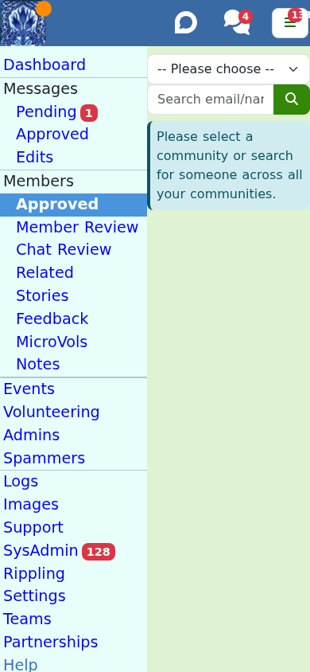

# Managing members

Most of moderation is about people, not posts. ModTools gives you tools to welcome, help,
review and, when you must, remove members.

## The members list

**Members > Approved** (`/members/approved`) lists a community's members.

From here you can:

- **Filter** by type (with notes, moderators, bouncing email, banned, mod-mails) and
  **search** by name, email or id.
- **Order** the list **Newest first** (the default) or **Oldest first**, by when each person
  joined. The order works with any filter and with a search. A member who left and joined
  again keeps their place from when they first joined.
- **Add** a member by email (this sends the standard welcome). A TrashNothing member cannot be
  added this way: you are told so, and nothing happens. They join communities through TrashNothing.
- **Ban** a member by id, with a reason.
- **Merge** two accounts that are the same person (irreversible; you choose which email
  survives). You can merge two members of your communities, and one of them can be your own
  account. You cannot merge an account that has a higher system role than you: ask Support to
  do that.
- Change a member's **role** (Member, Moderator, Owner).

### How far a search reaches

A search only ever looks at the communities **you** moderate. That is true whichever way
you search - by name, by email, or by the member's number.

- With a community chosen in the box at the top left, you search that community.
- With **-- Please choose --** selected, you search every community you moderate at once.
  This is the one to use when somebody reports a member and you do not know which
  community they are on.

So a search that finds nobody does not mean the account does not exist. It usually means
that freegler has only ever joined communities you do not moderate, and rippling makes
that more common: a post can reach your community from a freegler who is not on it.

Someone with **Support** access can look up any freegler on the system, on any community,
so ask them when you need to see an account that is outside your own communities. See
[Support Tools](https://wiki.ilovefreegle.org/Support_Tools) on the wiki.

If a freegler who has donated asks us to stop asking them for money, Support can turn off
**Donation requests** on their account in Support Tools. That stops every donation ask, on the
site and by email, for a year; Support Tools shows the date it ends. The freegler can also do it
themselves in Settings.

You can type the member's number with or without a `#` in front of it. Both work.

## "Email delayed" is not the same as "bouncing"

You may see a blue notice on a member saying **Email delayed since <date> - <provider> is
not currently accepting our mail**.

This is not a problem with that member's email address, and it is nothing they or you can
fix. It means the company that runs their email - Yahoo, Microsoft, whoever - has
temporarily stopped accepting mail from Freegle's sending servers. It affects everyone at
that provider at once, so if you see it on one member you will usually see it on many.

While that is going on we deliberately stop generating their emails rather than pile up
mail that cannot be delivered, and the notice tells you roughly how many we have held
back. When the provider starts accepting us again, they get a catch-up digest and a
summary of any unread chats. Stale post notifications are not resent, because by then the
item has usually gone.

So: nothing to do. Do not chase the member, and do not remove them.

Contrast this with the red **bouncing** notice, which really does mean their address is
rejecting mail - a closed account, a typo, a full mailbox - and where reactivating after
they have fixed it is the right move.

## Member review

**Members > Review** (`/members/review`) is a queue of members automatically flagged by
Freegle's unusual-behaviour checks, across all your communities. For each, you see notes,
spammer status, whether they are active in places far apart, whether they have changed
location repeatedly, bouncing-email status and ban history, plus a postcode tester.

The count beside **Member Review** in the menu is red for members nobody has dealt with yet,
and blue for members who are held by a moderator or flagged in a community where you are not
an active moderator. Once you have reviewed or held everything, the red count goes and only
blue is left.

Treat these as prompts to look, not verdicts. There is no rule against joining several
communities or posting enthusiastically. Ban only with clear evidence of harm, and prefer
leaving well-meaning members alone.

## Related members

**Members > Related** (`/members/related`) surfaces pairs of accounts that look like the
same person, or the same household. Each card says why the pair was picked up:

- both accounts were signed in from the same browser
- both gave the same mobile number in chat
- both gave the same street address in chat

The note names the accounts and says how many messages the details appeared in, and when, so
you can usually judge the pair without opening either chat.

If the two accounts have also replied to the same post, the note says so. That one is worth
a closer look. Someone with two accounts normally replies to different posts, so replying to
the same one means either they lost track of which account they were in, or they are putting
themselves forward twice for the same item.

Most pairs are innocent. People forget a password and register again, or a couple share a
phone. Nobody is blocked or flagged by appearing here. You can **ignore** the pair, or send
the member a friendly "let us know" email so **they** decide whether and how to merge their
own accounts. Merging helps, because replies sent to an account somebody has stopped using
are never read.

A shared postcode on its own is deliberately not enough to pair two accounts. A UK postcode
covers around fifteen homes, so it would pair neighbours.

## Spammers

**Spammers** (`/spammers`) is Freegle's shared spammer list. Everyone can search and view
confirmed spammers; with the Spam admin permission you also handle pending additions,
safelisting and removals. You can add a member to the list, safelist someone wrongly
flagged, or request a removal.

Reporting a genuine spammer helps every community, not just yours.

### Dealing with many at once

A spammer often creates dozens of accounts with the same name and different email
addresses. Both the spammer list and the members list have a bar above the rows for
dealing with up to fifty of them in one go:

- Tick the members you want, or **Select all shown**. Each tick box sits in the top
  corner of its card. The count shows how many you have, and the button that acts on them
  appears once at least one is ticked.
- On **Pending Add**, with Spam admin, **Confirm add to spammer list** confirms every
  ticked report. A report somebody else is holding cannot be ticked there; release it
  first. If one cannot be confirmed, the notice afterwards says which and why, and the
  rest still go through.
- On the members list, **Report N as spammers** asks for one reason and reports every
  ticked person to the Spam team, Spam admins included: they then confirm the reports in
  one go on Pending Add. Anyone already reported, already on the list or safelisted is left
  as they are, and the notice afterwards says how many. Ticking a person who is on several
  of your communities ticks them once, and the cards show the report straight away.
- On the spammer list, **Copy list** puts the ticked members on the clipboard as plain
  text, one per line with the fields separated by tabs: id, name, email, reason, date added
  and who reported them, always in that order. With nothing ticked it copies everything
  shown. It pastes into a spreadsheet as columns and into a document as readable lines,
  with none of the page's other text. A name that starts with a sign a spreadsheet would
  treat as a formula is prefixed so it stays text. There is no Copy on the members list:
  moderators do not take member lists away.

## Chat review

**Chats > Review** (`/chats/review`) shows member-to-member chat messages automatically
flagged for **worry words** (money, phone numbers, email addresses, bad language) or by a
community's "quicker chat review" setting. You can approve a message, or add a moderator
note that both people in the chat can see. "Delete All" clears the queue.

You can act on messages in chats with your community's moderators, and in chats where the
person receiving the message is a member of a community you moderate. If the person receiving
the message is not in any community, the message is yours to review when the person sending it
is in one of your communities. This includes a backup moderator of the community. A message that appears only because of wider review can be approved
but not held, deleted or changed, and you cannot act on a chat you are in yourself. Messages in a chat you are in do not appear in
your own queue or in your review count, though other moderators of the community still see them. A moderator
with no connection to the community cannot act on its messages.

Some chats are held because a post has not yet rippled out to the member who replied.
Those release automatically; you do not need to do anything. See
[./rippling-out.md](./rippling-out.md).

When someone replies to an OFFER of a child car seat, Freegle asks them what to check and
whether they still want it before their reply is passed on. Only they see the question until
they answer. After a Yes the person offering sees the question and the answer with the reply.
A reply they said no to, or never answered within three days, is not delivered, and the message
shows why when you look at it. If their reply is held for your review, the question is held
with it, and the person offering sees it when you approve the reply.

A message that matches a Freegle-wide **block** keyword does not come to this queue at
all. It is dropped: the other person never receives it, and it is marked rejected with
the reason recorded, exactly as if you had rejected it yourself. That applies whatever
the sender's chat moderation setting, apart from Unmoderated. Block keywords are
Freegle-wide scam signatures kept by support; the words that bring a message here for
you to judge are flag keywords.

### Putting one member's chat under review

A member's own **Support** record has a **Chat Moderation** setting, which decides what
happens to every message they send:

- **Moderated** - the default. Messages are checked for worry words and held if they match.
- **Unmoderated** - those checks are skipped.
- **Fully moderated** - every message they send is held for review before it reaches the
  other person.

"Fully moderated" is effectively a shadow ban: the member sees their message sent as normal
and gets no indication that it is waiting for a moderator. Use it for someone whose messages
all need reading before they go out - for example a member who keeps returning under new
accounts. Set it on each account you have linked to them; it follows the account, not the
person. The setting is recorded in the member's logs, with who changed it.

Once a member is under review, later messages in the same conversation stay held while an
earlier one is unreviewed, so a chat cannot get ahead of the queue.

Approving a held message with **approve all future** turns the setting off for that member,
so use plain approve if you want them to stay under review.

(This is different from moderating the **ChitChat** discussion feed, which is done on the
main Freegle site by the ChitChat Moderation team, not in ModTools.)

## During a lockdown

While Freegle is in a [lockdown](../ops/runbooks/lockdown.md), most of the member tools
on this page are switched off on purpose. You keep the plain **Approve** button; Ban,
Remove, Merge, and the **Mail** and **Leave** standard-message buttons are refused, and
you cannot start a new chat with a member. A lockdown is a response to a spam or
phishing wave, and the tools that write to a member or open a chat with one are
exactly the ones worth taking away while an incident is live.

Chat between members is held while the lockdown is on, and nobody reads it. When Support
lifts it, the held messages go through the usual checks: messages from accounts marked as
spammers are dropped, and anything the checks would normally send to **Chats > Review**
still goes there.

## Notes about members

**Members > Notes** (`/members/notes`) is a feed of moderator notes. Flagged notes are
always visible; others are scoped to the selected community. You can add a note from many
places - a member row, the sender panel on a post, or the ban dialog, which records who
banned whom and why. Notes are how the team keeps a shared memory of a member.

## Messaging a member

- Use the **Mail** or **Leave** standard-message buttons on a member row.
- Or open **Chats** (`/chats`), which lists your conversations with members and with other
  moderators, with a chat pane and search.

### Trash Nothing members who didn't choose your community

Some members exist here only because posts of theirs came in from Trash Nothing and we
matched them to a community from where they are - they never chose your community. Those
members carry a warning on their member row saying so, and the **Chat**, **Mail** and
standard-message buttons are not offered, because there is no relationship to use and no
way for them to reply to you. You can still remove or ban them.

Their membership log shows **TrashNothing unaddressed** ("TN post with no Freegle groups chosen by
user, group chosen by system"). A TrashNothing member who joined a community
through TrashNothing shows **via partner** instead and is an ordinary member. Members of either
kind are left out of the Stories newsletter, Freegle's engagement emails and Community News.

The warning is about your community only: choosing a different community doesn't change
anything on yours.

### Contacting Trash Nothing members

- **A chat they opened stays open to you.** If a Trash Nothing member writes to your volunteers,
  by email or with the Contact button, that chat is open to every moderator on your community,
  and you can reply in it even after they leave. A new chat is different: once a Trash Nothing
  member leaves, you can't start one with them. A **Chat** button for a Trash Nothing member you
  can't contact says so instead of opening a chat.
- **The same goes for notes in chat review.** You can add a note to a chat between two members
  only if any Trash Nothing member in it has chosen a community you moderate.
- **Removing them still sends your message.** If you remove a Trash Nothing member of your
  community with a standard message, it goes, because they were a member when you sent it. A
  Trash Nothing request to join that is still waiting for approval isn't a membership yet, so
  rejecting it sends nothing.
- **Support and Admin aren't bound by this.** They act for Freegle as a whole, so they can
  contact any Trash Nothing member.
- **Your messages are signed.** Trash Nothing shows them your message as if it came from a
  Freegle member, so a chat message, a standard message or a reply about a post from your team
  ends with "From the volunteers who run" and your community's name.
- **Someone who replies is already a member.** Trash Nothing joins its members to a community
  before they can reply to its posts, so a Trash Nothing member who replies to a post on your
  community is in your member list, and you can ban them or hold their chat as for anyone.
  Replying doesn't change a placement, though: only choosing your community on Trash Nothing
  does.

## Refer a chat to Support

If a chat needs more help than you can give, refer it to Support.

1. Open the member's chat and press **Refer to Support**.
2. If you like, say what you need help with in the box. It is optional, but it helps.
3. Confirm. You will see a link to your case.

Support will look at the chat and reply in the case. You also get an email to say there is a reply. Open
the case from the link and reply there. Replying to the email does not reach Support.

The case shows its status, what you asked and the replies. Support's own notes, including the AI's, are
for Support only, and you will not see them. Nothing is sent to the member. If they need to be told
something, Support will tell you and you can tell them.

If you refer the same chat again while the case is open, your new note is added to the same case.

For Support volunteers: referred chats are on the **Cases** tab of Support Tools. The red number on the
Support menu item and on that tab is the cases waiting for a reply from Support. A case stops counting
when Support replies, and counts again if the moderator writes back. When the AI helper has written a
reply, it is already in the reply box, marked as a suggestion: check it, change what you need, then send.
It goes to the moderator, not the member.

## Banning and removing

On a member you can:

- **Remove** them from the community (they simply leave), or
- **Ban** them, which requires a reason and is confirmed with an extra step. A note is
  recorded automatically.

You cannot remove yourself while you are an owner or moderator, because that would drop your
role. ModTools shows the reason when you try. To leave, change your own role to Member first,
or ask another owner to.

Removing or banning is a last resort. A friendly word usually solves the problem.

A ban stops someone posting on your community and replying to posts there. It also withdraws
their open OFFERs and WANTEDs that were posted on your community, and takes them out of any
neighbouring community they had rippled to but which hadn't approved them yet; one still
waiting for your approval is deleted. A post that rippled in from a neighbour is left to that
neighbour. It does **not**
stop them writing to your volunteers, by email or with the Contact button on your community
page, and that is deliberate: it is how someone appeals a ban. Their message arrives in
their chat with your volunteers, which every moderator on the community can see. A Trash
Nothing member you have banned is no longer a member, but a chat they opened stays open to
you, so you can read it and reply in it.

The **spammer list** is the stronger measure. Someone on it is banned everywhere, and
nothing they send reaches us at all: their email is dropped, the volunteers address
included, and a message to volunteers from the site or app is never delivered. It does not
lock their account, so they can still sign in. Someone only *proposed* for the list, and
still waiting on a second moderator, can write to volunteers as normal, so they can put
their case before the decision is made.

Some members are on your list only because a post of theirs **rippled in**: rippling
joins the poster so the post can live on your community. You can contact them from the
member list like anyone else, with **Chat**, **Mail** and the member standard messages.
Replies about the rippled post itself stay with the community they posted it on. The
membership becomes an ordinary one once they have something to do with your community:
they join it, move into your area, post on it, reply to one of its posts, or write back to
one of your members about their rippled post. See [rippling out](rippling-out.md).

## Feedback and micro-volunteering

- **Members > Feedback** (`/members/feedback`) collects members' free-text feedback and
  happy/unhappy ratings, with charts, so you can see how the community feels.
- **Members > Micro-volunteering** (`/members/microvolunteering`) shows the members who
  help moderate through lightweight review tasks, with an accuracy score. These members
  are a real help; a thank-you goes a long way.

## Next steps

- The queues these members' posts flow through: [Moderating posts](moderating-posts.md).
- Community-level configuration: [Running your community](running-your-community.md).
